# Ticketing Platform

[English](README.md) · **Español**

[](https://github.com/whymvm/ticketing-platform/actions/workflows/ci.yml)


[](LICENSE)

Backend reactivo y orientado a eventos para vender entradas (conciertos, teatro, deportes) que **nunca vende más entradas de las que tiene un evento**, aunque miles de clientes compren al mismo tiempo.

La API recibe la compra, la guarda y responde `202 Accepted` de inmediato. Un consumidor de SQS reserva las entradas después, con una escritura condicional atómica en DynamoDB. Las reservas vencen a los 10 minutos y los pagos a los 5, y un scheduler devuelve esas entradas al inventario. La disponibilidad se puede consultar puntualmente o seguir en tiempo real con [Server-Sent Events](https://html.spec.whatwg.org/multipage/server-sent-events.html).

Todo corre en local con un solo comando: `docker compose up`.

## Tabla de contenido

1. [El problema y cómo se resuelve](#1-el-problema-y-cómo-se-resuelve)
2. [Funcionalidades](#2-funcionalidades)
3. [Stack tecnológico](#3-stack-tecnológico)
4. [Puesta en marcha](#4-puesta-en-marcha)
5. [Configuración](#5-configuración)
6. [Uso: endpoints principales](#6-uso-endpoints-principales)
7. [Arquitectura](#7-arquitectura)
8. [Flujos principales](#8-flujos-principales)
9. [Decisiones de arquitectura](#9-decisiones-de-arquitectura)
10. [Concurrencia y consistencia](#10-concurrencia-y-consistencia)
11. [Seguridad](#11-seguridad)
12. [Pruebas y calidad](#12-pruebas-y-calidad)
13. [Ciclo DevOps](#13-ciclo-devops)
14. [Infraestructura como código](#14-infraestructura-como-código)
15. [Limitaciones conocidas](#15-limitaciones-conocidas)
16. [Producción en AWS](#16-producción-en-aws)
17. [Hoja de ruta](#17-hoja-de-ruta)
18. [Estructura del proyecto](#18-estructura-del-proyecto)
19. [Licencia y autor](#19-licencia-y-autor)
20. [Referencias](#20-referencias)

## 1. El problema y cómo se resuelve

Cuando salen a la venta las entradas de un evento popular, miles de personas intentan comprar al mismo tiempo. Un sistema tradicional entonces vende el mismo asiento a varias personas, genera compras duplicadas y sufre *timeouts*.

| Problema | Mecanismo que lo resuelve |
|---|---|
| Sobreventa | Escrituras condicionales atómicas sobre el inventario del evento (`available >= n`) dentro de una transacción de DynamoDB |
| Compras duplicadas | [`Idempotency-Key`](https://datatracker.ietf.org/doc/draft-ietf-httpapi-idempotency-key-header/) obligatoria en `POST /orders`, guardada en la misma transacción que la orden; consumidores idempotentes, porque [SQS entrega al menos una vez](https://docs.aws.amazon.com/AWSSimpleQueueService/latest/SQSDeveloperGuide/standard-queues.html) |
| *Timeouts* bajo carga | API no bloqueante (WebFlux) que solo valida, guarda, encola y responde `202`. La cola nivela la carga sobre la base de datos |

## 2. Funcionalidades

| Funcionalidad | Implementación |
|---|---|
| Gestión de eventos | `POST /events` y `GET /events/{id}`, con el inventario de cada evento |
| Reserva temporal (máximo 10 minutos) | El consumidor reserva las entradas con `expiresAt = ahora + 10 min` |
| Procesamiento asíncrono de compras | `POST /orders` responde `202` con el id de la orden; un consumidor SQS verifica la disponibilidad real y reserva o rechaza |
| Estado de la orden | `GET /orders/{id}` devuelve el estado de la orden y el de sus entradas (`ticketStatus`, uno de los cinco estados de la entrada) |
| Control de concurrencia | Escrituras condicionales y transacciones en DynamoDB, verificadas con una prueba de concurrencia automatizada |
| Liberación automática de reservas vencidas | Scheduler reactivo cada 30 s sobre un índice disperso y fragmentado |
| Disponibilidad en tiempo real | `GET /events/{id}/availability` y un *stream* SSE con una sola fuente compartida por evento |
| Confirmación y pago (`PENDING_CONFIRMATION`) | `POST /orders/{id}/confirm`, y el proveedor de pagos notifica el resultado con `POST /orders/{id}/payment` |
| Cortesías (`COMPLIMENTARY`) | `POST /events/{id}/complimentary`, protegido con una clave de administración, en una sola transacción condicional |
| Transiciones auditables | `GET /orders/{id}/history`: cada transición escribe su registro en la misma transacción que el cambio |

### Estados de las entradas y de las órdenes

Las entradas tienen exactamente cinco estados. Cada evento cuenta cuántas entradas hay en cada estado, y los cinco contadores siempre suman la capacidad.

| Estado de la entrada | Ocupa inventario | Es venta | Es contable | Final |
|---|---|---|---|---|
| `AVAILABLE` | No | No | No | No |
| `RESERVED` | Sí, temporalmente | No | No | No |
| `PENDING_CONFIRMATION` | Sí, temporalmente | No | No | No |
| `SOLD` | Sí | Sí | **Sí** | **Sí, irreversible** |
| `COMPLIMENTARY` | Sí | No | **No** | **Sí** |

La orden tiene su propio ciclo de vida, porque la asincronía exige tres estados más: `QUEUED` (en la cola, todavía sin entradas), `REJECTED` y `EXPIRED`.

| Estado de la orden | Estado de las entradas | Cómo llega la orden a ese estado |
|---|---|---|
| `QUEUED` | — | `POST /orders` |
| `RESERVED` | `RESERVED` | El consumidor encontró entradas suficientes |
| `PENDING_CONFIRMATION` | `PENDING_CONFIRMATION` | El cliente confirmó antes de que venciera la reserva |
| `SOLD` | `SOLD` | El proveedor aprobó el pago |
| `COMPLIMENTARY` | `COMPLIMENTARY` | Un administrador emitió cortesías |
| `REJECTED` | `AVAILABLE` (o nunca se retuvieron) | No quedaban entradas (`SOLD_OUT`), el evento ya empezó (`EVENT_CLOSED`) o se rechazó el pago (`PAYMENT_DECLINED`) |
| `EXPIRED` | `AVAILABLE` | Venció la reserva (10 min) o el pago (5 min) |

`SOLD` y `COMPLIMENTARY` no tienen salida: en el código cada estado de la orden es un tipo sellado que solo tiene sus transiciones válidas, así que revertir una venta **no compila**.

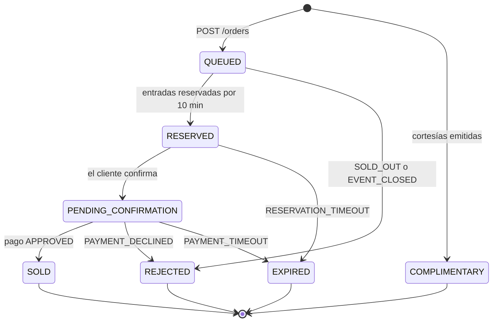

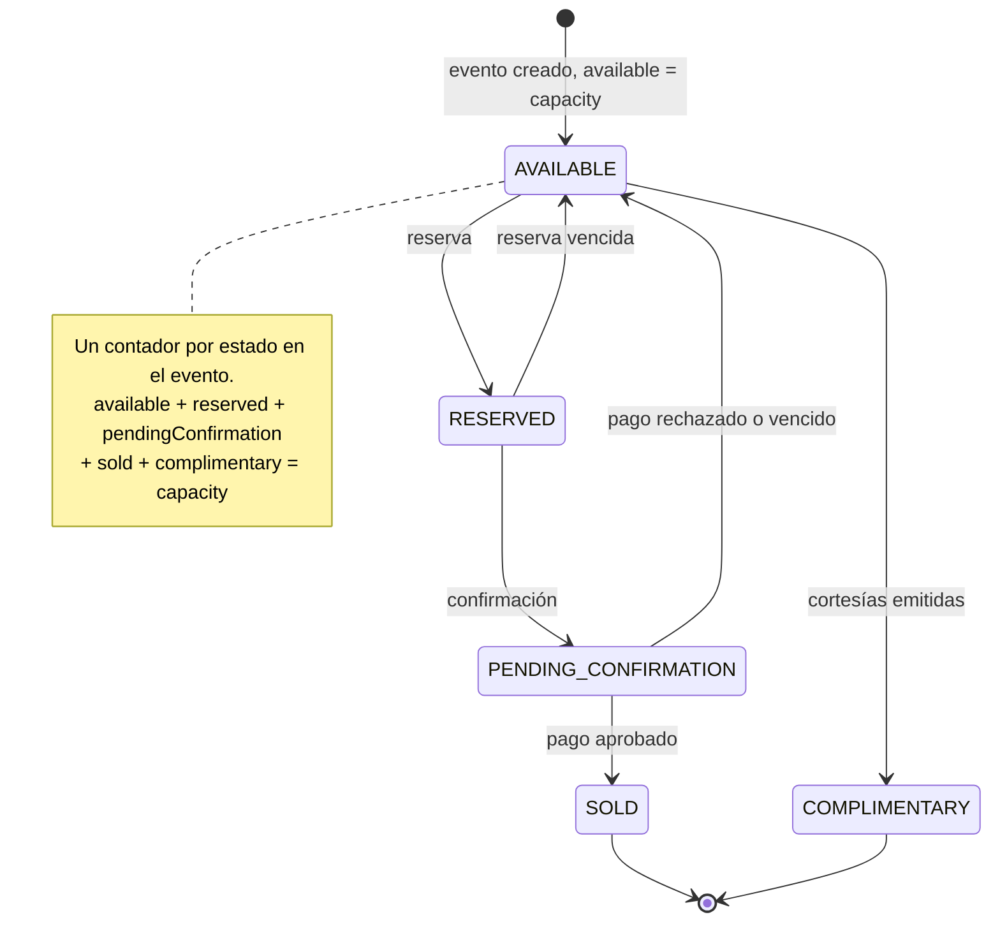

## 3. Stack tecnológico

| Área | Tecnología |
|---|---|
| Lenguaje | Java 25 ([*records*](https://openjdk.org/jeps/395), [interfaces selladas](https://openjdk.org/jeps/409), [*pattern matching* en `switch`](https://openjdk.org/jeps/441), [variables sin nombre `_`](https://openjdk.org/jeps/456)) |
| Framework | Spring Boot 4.1.1, [Spring WebFlux](https://docs.spring.io/spring-framework/reference/web/webflux.html) (rutas funcionales), [Project Reactor](https://github.com/reactor/reactor-core) |
| Persistencia | Amazon DynamoDB (AWS SDK v2, cliente *enhanced* asíncrono) |
| Mensajería | Amazon SQS, cola estándar con cola de mensajes fallidos (DLQ) |
| Nube local | LocalStack 4.14.0 (DynamoDB y SQS) |
| Infraestructura como código | Terraform 1.16.3 con el *provider* de AWS apuntando a LocalStack |
| Contenedores | Docker ([*multi-stage build*](https://docs.docker.com/build/building/multi-stage/), usuario sin privilegios) y Docker Compose |
| Arquitectura | Clean Architecture, generada con el plugin de scaffold de Bancolombia 4.7.2 |
| Pruebas | JUnit 5, Mockito, reactor-test (`StepVerifier`), `WebTestClient`, [BlockHound](https://github.com/reactor/BlockHound), [ArchUnit](https://www.archunit.org/), [Testcontainers](https://java.testcontainers.org/modules/localstack/), [PIT](https://pitest.org/), [JaCoCo](https://www.jacoco.org/jacoco/) |
| Pruebas de API | Colección de Postman ejecutada con Newman |
| CI | GitHub Actions |
| Observabilidad | Spring Boot Actuator, Micrometer y Prometheus |
| Documentación de la API | [springdoc](https://springdoc.org/) (Swagger UI) |

Los [*virtual threads*](https://openjdk.org/jeps/444) **no** se usan a propósito: WebFlux y el SDK asíncrono de AWS ya son no bloqueantes, y mezclar ambos modelos agrega complejidad sin beneficio (ADR 0011).

## 4. Puesta en marcha

### Requisitos previos

| Herramienta | Para qué |
|---|---|
| Docker con Docker Compose v2 | Ejecutar todo el sistema. **Es el único requisito**: la aplicación se compila dentro de Docker y no hace falta una cuenta de AWS |
| Java 25 | Solo para compilar y correr las pruebas fuera de Docker |
| Node.js 22 (`npx`) | Solo para correr la colección de Postman con Newman |

### Ejecutar con Docker

```bash
git clone https://github.com/whymvm/ticketing-platform.git
cd ticketing-platform
docker compose up --build
```

Compose levanta tres servicios en orden:

1. **`localstack`**: emula DynamoDB y SQS en el puerto `4566`.
2. **`terraform`**: cuando LocalStack está sano, crea las tablas, el índice y las colas, y termina.
3. **`app`**: cuando Terraform terminó con éxito, la aplicación arranca en el puerto `8080`.

El primer arranque tarda unos minutos (construir la imagen y crear las colas). La aplicación está lista cuando su *health check* responde `UP`:

```bash
curl http://localhost:8080/actuator/health/readiness
# {"status":"UP"}
```

Otros comandos útiles:

```bash
docker compose logs -f app     # logs de la aplicación
docker compose down            # detener, conservando los volúmenes
docker compose down --volumes  # detener y reiniciar todo (incluido el estado de Terraform)
```

### Atajos de Gradle

Los mismos pasos existen como tareas de Gradle (`./gradlew tasks --group ticketing`):

| Comando | Qué hace |
|---|---|
| `./gradlew build` | Compila, corre todas las pruebas unitarias y **falla si la cobertura de líneas baja del 90 %** |
| `./gradlew coverage` | Genera el reporte de cobertura de todo el proyecto |
| `./gradlew integrationTest` | Prueba de concurrencia contra LocalStack con el Terraform real (Testcontainers, unos 2 minutos) |
| `./gradlew mutationTest` | Pruebas de mutación (PIT); es lenta |
| `./gradlew localUp` | Construye la imagen y levanta el entorno; termina cuando la aplicación está sana |
| `./gradlew postmanTest` | Corre la colección de Postman contra `http://localhost:8080` |
| `./gradlew smokeTest` | `localUp` + `postmanTest`: prueba de punta a punta contra el entorno levantado (bajo demanda, no en el CI) |
| `./gradlew localLogs` | Últimas 200 líneas del log de la aplicación |
| `./gradlew localDown` / `localReset` | Detiene el entorno, conservando o borrando sus volúmenes |
| `./gradlew terraformValidate` | Verifica el formato y valida el código de Terraform |

Si `./gradlew build`, `./gradlew integrationTest`, `./gradlew terraformValidate` y `./gradlew terraformScan` pasan en local, un *pull request* debería pasar el CI.

### Herramientas

| Herramienta | URL |
|---|---|
| Swagger UI | <http://localhost:8080/v3/swagger-ui.html> |
| Documento OpenAPI | <http://localhost:8080/v3/api-docs> |
| *Health probes* | <http://localhost:8080/actuator/health/liveness> y `/readiness` |
| Métricas de Prometheus | <http://localhost:8080/actuator/prometheus> |
| Colección de Postman | [`postman/ticketing-platform.postman_collection.json`](postman/ticketing-platform.postman_collection.json) |

## 5. Configuración

Todos los valores llegan por variables de entorno. Los de infraestructura **no tienen valor por defecto a propósito**: si falta uno, la aplicación falla al arrancar en lugar de trabajar contra el recurso equivocado. `docker-compose.yml` los define todos para el entorno local.

| Variable | Valor local | Para qué |
|---|---|---|
| `AWS_REGION` | `us-east-1` | Región de AWS |
| `AWS_ENDPOINT` | `http://localstack:4566` | Solo para LocalStack; vacío significa AWS real |
| `AWS_ACCESS_KEY_ID` / `AWS_SECRET_ACCESS_KEY` | `test` / `test` | Credenciales ficticias que acepta LocalStack. **No son secretos** |
| `ADMIN_API_KEY` | `local-admin-key` | Clave de las operaciones administrativas (cortesías). Vacía significa que siempre se niegan |
| `EVENTS_TABLE` | `local-ticketing-events` | Eventos y sus contadores de inventario |
| `ORDERS_TABLE` | `local-ticketing-orders` | Órdenes, con el índice `expiring-orders` |
| `ORDER_HISTORY_TABLE` | `local-ticketing-order-history` | Historial de transiciones, solo de altas |
| `IDEMPOTENCY_TABLE` | `local-ticketing-idempotency` | Claves de idempotencia, que el TTL nativo borra a las 24 h |
| `QUEUE_RESERVATIONS_URL` | `http://localstack:4566/000000000000/local-ticketing-reservations` | Cola de órdenes creadas |
| `EXPIRED_RESERVATIONS_DELAY` | `PT30S` (por defecto) | Intervalo del scheduler de vencimientos |

Reglas de negocio que son constantes del dominio: reservas de 10 minutos (`ReservedOrder.RESERVATION_TIME`), pagos de 5 minutos (`PendingConfirmationOrder.PAYMENT_TIME`), máximo 6 entradas por orden (`OrderDetails.MAX_TICKETS_PER_ORDER`) y claves de idempotencia de 8 a 64 caracteres `[A-Za-z0-9_-]`.

## 6. Uso: endpoints principales

Todas las rutas están bajo `/api/v1`. Los errores usan `application/problem+json` ([RFC 9457](https://www.rfc-editor.org/rfc/rfc9457)) con un `code` estable. Los códigos de estado siguen [RFC 9110](https://www.rfc-editor.org/rfc/rfc9110).

| Método | Ruta | Descripción | Éxito |
|---|---|---|---|
| `POST` | `/events` | Crear un evento | `201` + `Location` |
| `GET` | `/events/{id}` | Evento con su inventario | `200` |
| `GET` | `/events/{id}/availability` | Entradas en cada estado en este momento | `200` |
| `GET` | `/events/{id}/availability/stream` | Disponibilidad en tiempo real (SSE) | `200 text/event-stream` |
| `POST` | `/events/{id}/complimentary` | Emitir cortesías (`X-Admin-Key`) | `201` + `Location` |
| `POST` | `/orders` | Crear una orden (asíncrona) | **`202`** + `Location` + `Retry-After` |
| `GET` | `/orders/{id}` | Estado de la orden | `200` |
| `POST` | `/orders/{id}/confirm` | Confirmar una orden reservada y esperar su pago | **`202`** |
| `POST` | `/orders/{id}/payment` | Notificación de pago del proveedor (*webhook*) | `200` |
| `GET` | `/orders/{id}/history` | Todas las transiciones de la orden | `200` |

**Encabezados**

| Encabezado | Dónde | Significado |
|---|---|---|
| `X-Customer-Id` | Órdenes | Quién es el cliente. No hay autenticación: la identidad es declarada (`local-customer` si falta). Una orden de otro cliente responde `404` |
| `Idempotency-Key` | `POST /orders`, cortesías | Hace que repetir la petición sea seguro |
| `Idempotent-Replayed` | Respuesta | `true` cuando la respuesta es una orden creada por una petición anterior con la misma clave |
| `X-Admin-Key` | Cortesías | Clave de administración compartida |

Los ejemplos son respuestas reales del entorno local (se omiten los encabezados de seguridad).

### 6.1 Crear un evento

```bash
curl -i -X POST http://localhost:8080/api/v1/events \
  -H 'Content-Type: application/json' \
  -d '{"name":"Rock al Parque","venue":"Parque Simón Bolívar","startsAt":"2026-12-05T01:00:00Z","finishesAt":"2026-12-05T05:00:00Z","capacity":100}'
```

```http
HTTP/1.1 201 Created
Location: /api/v1/events/dd4f6309-2d6c-428f-af9a-30a6c7095379

{"id":"dd4f6309-2d6c-428f-af9a-30a6c7095379","name":"Rock al Parque","venue":"Parque Simón Bolívar",
 "startsAt":"2026-12-05T01:00:00Z","finishesAt":"2026-12-05T05:00:00Z","capacity":100,
 "inventory":{"available":100,"reserved":0,"pendingConfirmation":0,"sold":0,"complimentary":0},
 "createdAt":"2026-10-11T22:20:41.541119709Z"}
```

### 6.2 Crear una orden

```bash
curl -i -X POST http://localhost:8080/api/v1/orders \
  -H 'Content-Type: application/json' \
  -H 'X-Customer-Id: customer-1' \
  -H 'Idempotency-Key: order-0001-abc' \
  -d '{"eventId":"dd4f6309-2d6c-428f-af9a-30a6c7095379","quantity":2}'
```

```http
HTTP/1.1 202 Accepted
Location: /api/v1/orders/78fdc3a0-4617-4321-aadb-55fbeb9e61b5
Retry-After: 1
Idempotent-Replayed: false

{"id":"78fdc3a0-4617-4321-aadb-55fbeb9e61b5","eventId":"dd4f6309-2d6c-428f-af9a-30a6c7095379",
 "customerId":"customer-1","quantity":2,"status":"QUEUED",
 "createdAt":"2026-10-11T22:20:41.680932251Z","updatedAt":"2026-10-11T22:20:41.680932251Z"}
```

Repetir la misma petición con la misma clave devuelve la misma orden en su estado actual, con `Idempotent-Replayed: true`. Usar la misma clave con otro cuerpo se rechaza:

```json
{"detail":"the Idempotency-Key was already used with a different request","instance":"/api/v1/orders",
 "status":422,"title":"Unprocessable Content","code":"IDEMPOTENCY_KEY_REUSED"}
```

### 6.3 Consultar la orden

El cliente consulta el `Location` del `202`, esperando `Retry-After` segundos entre intentos.

```bash
curl http://localhost:8080/api/v1/orders/78fdc3a0-4617-4321-aadb-55fbeb9e61b5 -H 'X-Customer-Id: customer-1'
```

```json
{"id":"78fdc3a0-4617-4321-aadb-55fbeb9e61b5","eventId":"dd4f6309-2d6c-428f-af9a-30a6c7095379",
 "customerId":"customer-1","quantity":2,"status":"RESERVED","ticketStatus":"RESERVED",
 "expiresAt":"2026-10-11T22:30:41.769469167Z",
 "createdAt":"2026-10-11T22:20:41.680932251Z","updatedAt":"2026-10-11T22:20:41.769469167Z"}
```

### 6.4 Confirmar y pagar

```bash
curl -i -X POST http://localhost:8080/api/v1/orders/78fdc3a0-4617-4321-aadb-55fbeb9e61b5/confirm \
  -H 'X-Customer-Id: customer-1'
```

```http
HTTP/1.1 202 Accepted

{"id":"78fdc3a0-...","status":"PENDING_CONFIRMATION","ticketStatus":"PENDING_CONFIRMATION",
 "expiresAt":"2026-10-11T22:25:43.864522418Z", ...}
```

Después, el proveedor de pagos notifica el resultado (`APPROVED` o `DECLINED`):

```bash
curl -X POST http://localhost:8080/api/v1/orders/78fdc3a0-4617-4321-aadb-55fbeb9e61b5/payment \
  -H 'Content-Type: application/json' \
  -d '{"result":"APPROVED"}'
```

```json
{"id":"78fdc3a0-...","status":"SOLD","ticketStatus":"SOLD","updatedAt":"2026-10-11T22:20:43.914335502Z", ...}
```

### 6.5 Historial de la orden

```bash
curl http://localhost:8080/api/v1/orders/78fdc3a0-4617-4321-aadb-55fbeb9e61b5/history -H 'X-Customer-Id: customer-1'
```

```json
{"orderId":"78fdc3a0-4617-4321-aadb-55fbeb9e61b5","transitions":[
  {"toStatus":"QUEUED","reason":"ORDER_PLACED","occurredAt":"2026-10-11T22:20:41.680932251Z"},
  {"fromStatus":"QUEUED","toStatus":"RESERVED","reason":"TICKETS_RESERVED","occurredAt":"2026-10-11T22:20:41.769469167Z"},
  {"fromStatus":"RESERVED","toStatus":"PENDING_CONFIRMATION","reason":"ORDER_CONFIRMED","occurredAt":"2026-10-11T22:20:43.864522418Z"},
  {"fromStatus":"PENDING_CONFIRMATION","toStatus":"SOLD","reason":"PAYMENT_APPROVED","occurredAt":"2026-10-11T22:20:43.914335502Z"}]}
```

### 6.6 Disponibilidad

```bash
curl http://localhost:8080/api/v1/events/dd4f6309-2d6c-428f-af9a-30a6c7095379/availability
```

```json
{"eventId":"dd4f6309-2d6c-428f-af9a-30a6c7095379","capacity":100,"available":98,"reserved":0,
 "pendingConfirmation":0,"sold":2,"complimentary":0,"asOf":"2026-10-11T22:20:44.030069960Z"}
```

En tiempo real (el *stream* envía el estado actual, después cada cambio, y un comentario `:heartbeat` cada 15 s):

```bash
curl -N http://localhost:8080/api/v1/events/dd4f6309-2d6c-428f-af9a-30a6c7095379/availability/stream
```

```text
id:1791757247462
event:availability
data:{"eventId":"dd4f6309-...","capacity":100,"available":96,"reserved":0,"pendingConfirmation":0,"sold":2,"complimentary":2,"asOf":"2026-10-11T22:20:47.462107128Z"}
```

### 6.7 Cortesías

```bash
curl -i -X POST http://localhost:8080/api/v1/events/dd4f6309-2d6c-428f-af9a-30a6c7095379/complimentary \
  -H 'Content-Type: application/json' \
  -H 'X-Admin-Key: local-admin-key' \
  -H 'Idempotency-Key: comp-0001-abc' \
  -d '{"recipientId":"guest-7","quantity":2}'
```

```http
HTTP/1.1 201 Created
Location: /api/v1/orders/9e19096e-bd16-410e-bd24-c5ee50b680c5
Idempotent-Replayed: false

{"id":"9e19096e-bd16-410e-bd24-c5ee50b680c5","eventId":"dd4f6309-...","customerId":"guest-7","quantity":2,
 "status":"COMPLIMENTARY","ticketStatus":"COMPLIMENTARY", ...}
```

El invitado puede consultar la orden con `X-Customer-Id: guest-7`.

### 6.8 Códigos de error

| HTTP | `code` |
|---|---|
| `400` | `INVALID_EVENT_NAME`, `INVALID_EVENT_VENUE`, `INVALID_EVENT_SCHEDULE`, `EVENT_STARTS_IN_THE_PAST`, `INVALID_EVENT_CAPACITY`, `INVALID_ORDER_QUANTITY`, `INVALID_ORDER_EVENT`, `INVALID_CUSTOMER`, `IDEMPOTENCY_KEY_REQUIRED`, `INVALID_IDEMPOTENCY_KEY`, `INVALID_PAYMENT_NOTIFICATION`, `MISSING_REQUEST_BODY`, `MALFORMED_REQUEST_BODY` |
| `403` | `ADMIN_ACCESS_DENIED` |
| `404` | `EVENT_NOT_FOUND`, `ORDER_NOT_FOUND` (también para la orden de otro cliente, para no revelar que existe) |
| `409` | `TICKETS_SOLD_OUT`, `RESERVATION_EXPIRED`, `ORDER_NOT_RESERVED`, `PAYMENT_EXPIRED`, `ORDER_NOT_AWAITING_PAYMENT`, `CONCURRENCY_CONFLICT` |
| `422` | `EVENT_CLOSED`, `IDEMPOTENCY_KEY_REUSED` |
| `500` | `INTERNAL_ERROR` (sin detalles internos en el cuerpo) |

La [colección de Postman](postman/ticketing-platform.postman_collection.json) cubre todos estos flujos y los casos de error (agotado, evento que ya empezó, pago rechazado, cliente equivocado, claves faltantes), con aserciones.

## 7. Arquitectura

### 7.1 Contexto del sistema

- **Los clientes** consultan eventos, crean y confirman órdenes y consultan su estado.
- **Los visitantes** siguen en tiempo real la disponibilidad de un evento.
- **Los administradores** crean eventos y emiten cortesías.
- **El proveedor de pagos** notifica el resultado de cada pago.

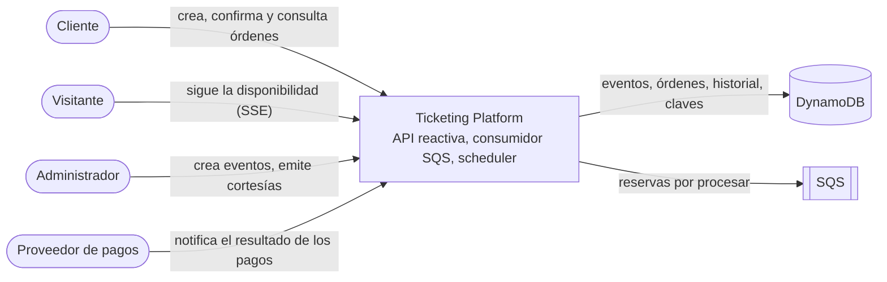

### 7.2 Contenedores (entorno local)

Un solo contenedor de aplicación tiene tres roles: la API reactiva, el consumidor SQS y el scheduler de vencimientos. Habla con DynamoDB y SQS en LocalStack. Un contenedor de Terraform crea esos recursos antes de que arranque la aplicación.

| Componente | Responsabilidad |
|---|---|
| API reactiva (`reactive-web`) | Valida, guarda, publica y responde. Nunca toca el inventario al crear una orden |
| Consumidor SQS (`sqs-listener`) | Lee los mensajes `ORDER_PLACED` y reserva o rechaza cada orden |
| Scheduler (`scheduler`) | Cada 30 s vence las reservas y los pagos cuyo plazo terminó |
| DynamoDB | Tablas `events`, `orders` (con el índice `expiring-orders`), `order-history` e `idempotency` |
| SQS | Cola `reservations` con su DLQ (máximo 5 recepciones) |

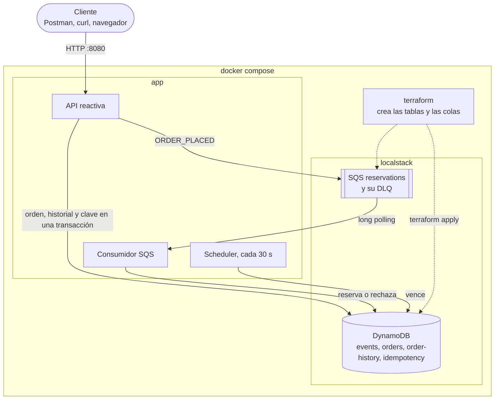

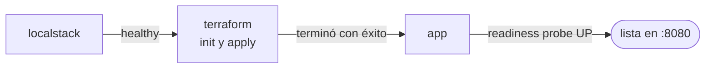

### 7.3 Clean Architecture

El proyecto sigue Clean Architecture tal como la define Robert C. Martin en [*The Clean Architecture*](https://blog.cleancoder.com/uncle-bob/2012/08/13/the-clean-architecture.html), y su estructura se generó con el plugin oficial de Gradle de Bancolombia, [**scaffold-clean-architecture**](https://github.com/bancolombia/scaffold-clean-architecture) (versión 4.7.2, [documentación](https://bancolombia.github.io/scaffold-clean-architecture/docs/intro)). El plugin organiza el código en capas, que Bancolombia explica en [*Clean Architecture — Aislando los detalles*](https://medium.com/bancolombia-tech/clean-architecture-aislando-los-detalles-4f9530f35d7a):


*Imagen: Bancolombia, [Clean Architecture — Aislando los detalles](https://medium.com/bancolombia-tech/clean-architecture-aislando-los-detalles-4f9530f35d7a).*

- **Dominio:** el módulo `model` (entidades, objetos de valor y los *gateways*, que son los puertos) y el módulo `usecase` (la lógica de negocio). Es la capa más interna y no depende de ninguna otra.
- **Infraestructura:** los *driven adapters* (implementaciones de los *gateways*: DynamoDB, SQS) y los *entry points* (donde empiezan los flujos: HTTP, el *listener* de SQS, el scheduler), más los *helpers*.
- **Aplicación:** el módulo más externo; ensambla los módulos, crea los *beans* de los casos de uso y arranca Spring Boot.

Las dependencias solo apuntan hacia adentro: el dominio no conoce Spring, ni AWS, ni DynamoDB. Dos verificaciones lo hacen cumplir en cada *build*: la tarea del plugin [`validateStructure`](https://bancolombia.github.io/scaffold-clean-architecture/docs/tasks/validate-structure) y las reglas de [ArchUnit](https://www.archunit.org/) de `ArchitectureTest`. Cada módulo, modelo y caso de uso se creó con las tareas del plugin ([`generateModel`](https://bancolombia.github.io/scaffold-clean-architecture/docs/tasks/generate-model), [`generateUseCase`](https://bancolombia.github.io/scaffold-clean-architecture/docs/tasks/generate-use-case), [`generateDrivenAdapter`](https://bancolombia.github.io/scaffold-clean-architecture/docs/tasks/generate-driven-adapter), [`generateEntryPoint`](https://bancolombia.github.io/scaffold-clean-architecture/docs/tasks/generate-entry-point)), no a mano.

| Capa | Módulo | Contenido |
|---|---|---|
| Dominio | `domain/model` | Entidades como *records* (`Event`, `Inventory`, `Availability`), estados de la orden como tipos sellados, una excepción específica por caso y los puertos (`gateways`) |
| Dominio | `domain/usecase` | Un caso de uso por acción: `PlaceOrder`, `ReserveTickets`, `ConfirmOrder`, `RecordPayment`, `ReleaseExpiredReservations`, `IssueComplimentary`, `WatchAvailability` y las consultas |
| Infraestructura | `entry-points/reactive-web` | Rutas funcionales, *handlers*, mapeo de errores (RFC 9457), encabezados de seguridad, CORS |
| Infraestructura | `entry-points/sqs-listener` | *Listener* reactivo con *long polling* y apagado ordenado |
| Infraestructura | `entry-points/scheduler` | Tarea [`@Scheduled`](https://docs.spring.io/spring-framework/reference/integration/scheduling.html) reactiva |
| Infraestructura | `driven-adapters/dynamo-db` | Adaptadores de los puertos, transacciones y expresiones condicionales, fuente de *polling* del SSE |
| Infraestructura | `driven-adapters/sqs-sender` | Publicador de `ORDER_PLACED` |
| Infraestructura | `helpers/metrics` | Métricas del SDK de AWS en Micrometer |
| Aplicación | `applications/app-service` | Arranque de Spring Boot, ensamblaje de los casos de uso, `Clock` inyectado |

Los puertos son pequeños y con nombre de negocio (`OrderCreator`, `OrderRetriever`, `InventoryUpdater`, `ComplimentaryIssuer`…), así que cada caso de uso depende solo de lo que usa (segregación de interfaces).

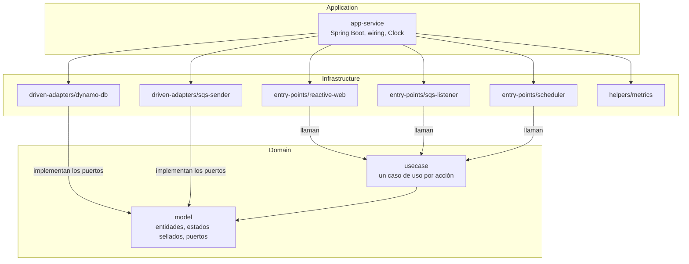

## 8. Flujos principales

### 8.1 Crear una orden (`POST /orders`)

1. El *handler* lee `X-Customer-Id` e `Idempotency-Key`; el dominio valida la clave y la orden (cantidad entre 1 y 6).
2. Si la clave ya existe para ese cliente y no ha vencido:
   - misma petición (huella SHA-256 de los datos) → devuelve la orden original en su estado actual, con `Idempotent-Replayed: true`, sin escribir ni publicar nada;
   - otra petición → `422 IDEMPOTENCY_KEY_REUSED`.
3. Si no, verifica que el evento exista (`404`) y que no haya empezado (`422 EVENT_CLOSED`).
4. Escribe en **una sola transacción** la orden en `QUEUED`, su primer registro de historial y la clave de idempotencia.
5. Publica `ORDER_PLACED` (solo el id de la orden: [*claim check*](https://www.enterpriseintegrationpatterns.com/patterns/messaging/StoreInLibrary.html)) y responde `202` con `Location` y `Retry-After: 1`.
6. Si dos peticiones con la misma clave compiten, la condición sobre la clave deja ganar a una sola; la otra relee la clave y responde con la orden ganadora.

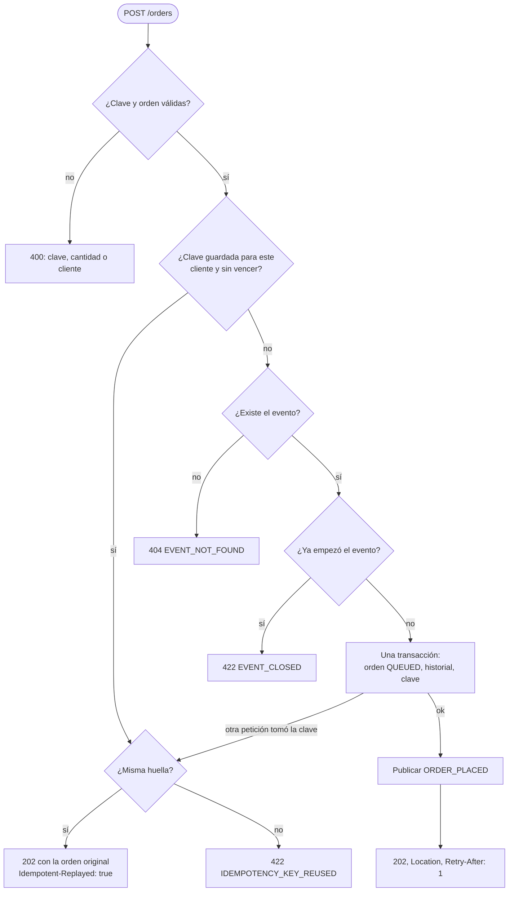

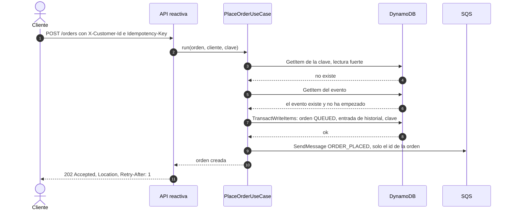

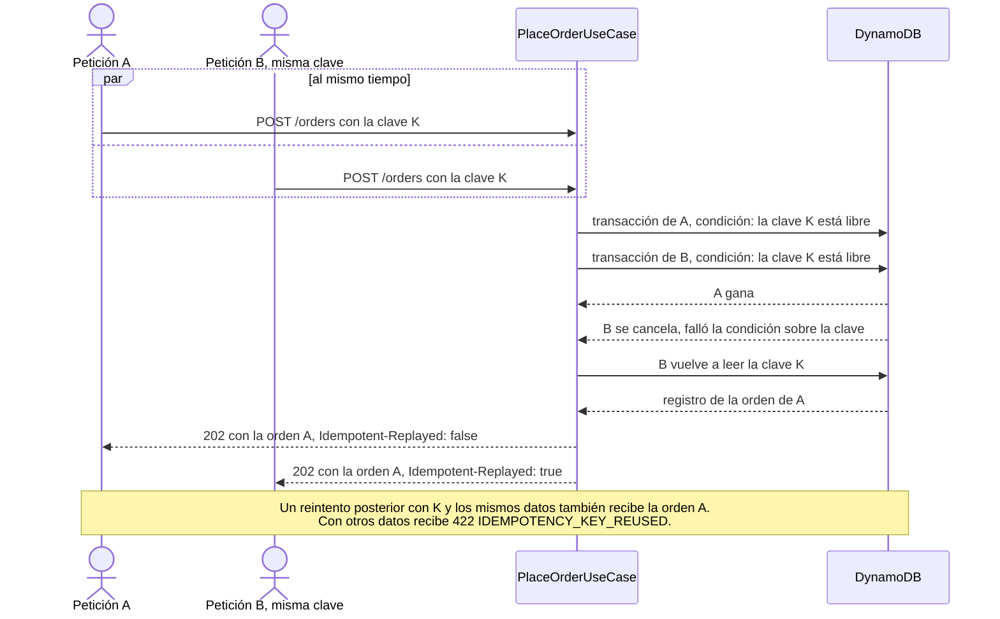

### 8.2 Reservar las entradas (consumidor SQS)

1. El *listener* recibe hasta 10 mensajes con [*long polling*](https://docs.aws.amazon.com/AWSSimpleQueueService/latest/SQSDeveloperGuide/sqs-short-and-long-polling.html) (10 s) y procesa cada uno en su propio *publisher*.
2. Lee la orden con [lectura fuerte](https://docs.aws.amazon.com/amazondynamodb/latest/developerguide/HowItWorks.ReadConsistency.html). Si ya no está en `QUEUED` (un mensaje duplicado), no hace nada.
3. Vuelve a verificar que el evento no haya empezado, porque la cola puede ir atrasada. Si ya empezó, rechaza la orden con `EVENT_CLOSED`.
4. Una transacción mueve las entradas (`available - n`, `reserved + n`, con la condición `available >= n`), pasa la orden a `RESERVED` (condición `status = QUEUED`) y escribe el registro de historial.
5. Si falla la condición del inventario, la orden se rechaza con `SOLD_OUT`. Un `TransactionConflict` se reintenta 3 veces con [*backoff* exponencial](https://aws.amazon.com/blogs/architecture/exponential-backoff-and-jitter/) desde 50 ms.
6. El mensaje se borra **solo después** de guardar su efecto. Un error técnico lo deja en la cola: reaparece tras el [*visibility timeout*](https://docs.aws.amazon.com/AWSSimpleQueueService/latest/SQSDeveloperGuide/sqs-visibility-timeout.html) (15 s) y, después de 5 recepciones, va a la [DLQ](https://docs.aws.amazon.com/AWSSimpleQueueService/latest/SQSDeveloperGuide/sqs-dead-letter-queues.html).

| Resultado | Mensaje |
|---|---|
| Reservada, o rechazada (`SOLD_OUT`, `EVENT_CLOSED`) | Se borra: es una respuesta de negocio válida |
| La orden ya no está en `QUEUED` | Se borra, sin efectos |
| Mensaje ilegible o de otro tipo | No se borra → DLQ |
| Error técnico o conflictos que persisten | No se borra → se reentrega y luego va a la DLQ |

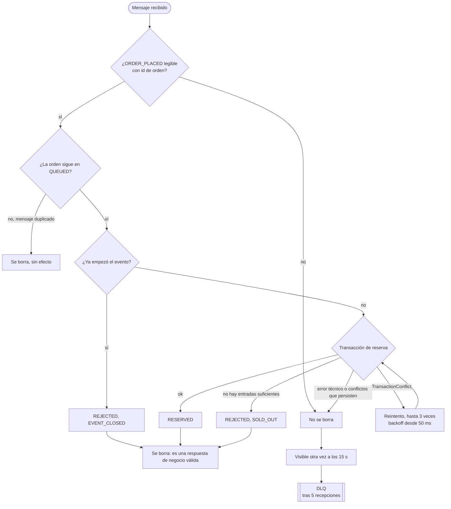

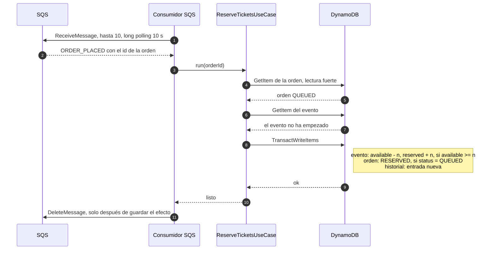

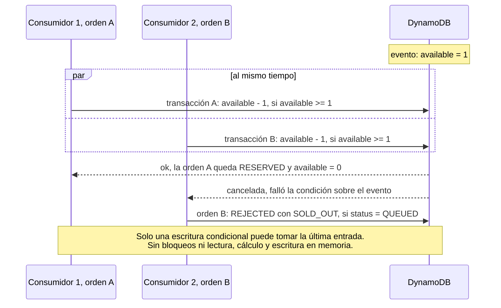

### 8.3 Confirmación y pago

1. `POST /orders/{id}/confirm` sobre una orden `RESERVED` del cliente: el dominio rechaza una reserva cuyo plazo terminó (`409 RESERVATION_EXPIRED`), aunque el scheduler todavía no la haya liberado.
2. Una transacción mueve las entradas de `reserved` a `pendingConfirmation` y pasa la orden a `PENDING_CONFIRMATION`, con un plazo de pago de 5 minutos. Respuesta: `202`.
3. Confirmar de nuevo una orden que ya está en `PENDING_CONFIRMATION` o `SOLD` la devuelve tal como está.
4. El proveedor notifica `POST /orders/{id}/payment`:
   - `APPROVED` → `SOLD` (`pendingConfirmation - n`, `sold + n`);
   - `DECLINED` → `REJECTED` con `PAYMENT_DECLINED`, y las entradas vuelven a `available`;
   - una notificación tardía (después del plazo) se rechaza con `409 PAYMENT_EXPIRED`: una aprobación tardía nunca vende entradas que ya se liberaron;
   - la misma notificación otra vez devuelve la orden tal como está, porque los proveedores repiten sus notificaciones.

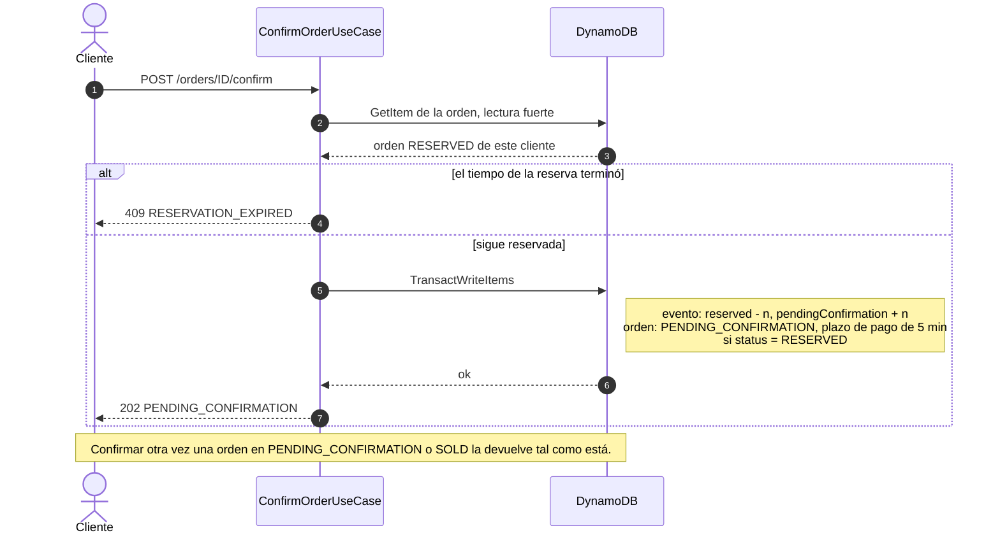

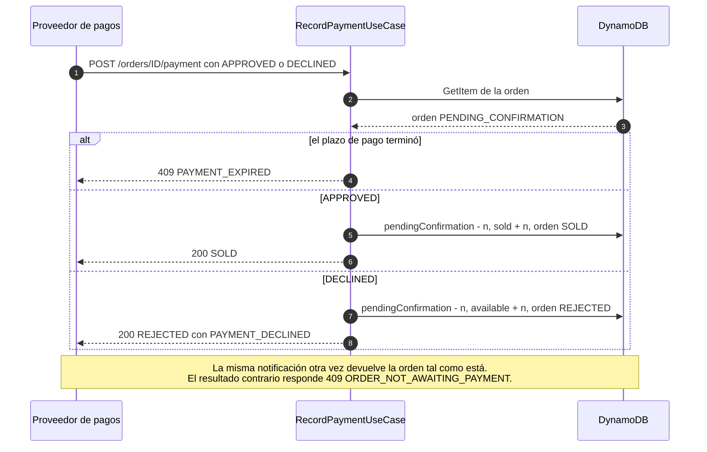

### 8.4 Vencimiento de reservas y pagos

1. Cada 30 s, el scheduler consulta el [índice disperso](https://docs.aws.amazon.com/amazondynamodb/latest/developerguide/bp-indexes-general-sparse-indexes.html) `expiring-orders`: en él solo están las órdenes vivas en `RESERVED` y `PENDING_CONFIRMATION`, repartidas en 4 [fragmentos](https://docs.aws.amazon.com/amazondynamodb/latest/developerguide/bp-partition-key-sharding.html).
2. Para cada orden (hasta 16 a la vez) vuelve a comprobar el instante exacto, porque el índice es eventualmente consistente.
3. Una transacción devuelve las entradas a `available`, pasa la orden a `EXPIRED` (`RESERVATION_TIMEOUT` o `PAYMENT_TIMEOUT`), la saca del índice y escribe el registro de historial.
4. Si otro proceso cambió la orden primero (el cliente confirmó a tiempo, llegó el pago), la condición sobre el estado falla y la orden se omite.

Todas las instancias corren el scheduler; no hace falta elegir un líder, porque por cada orden gana una sola escritura condicional. El reloj se vuelve a leer en cada ejecución (`Flux.defer`): una versión anterior lo leía una sola vez al arrancar, así que las reservas creadas después nunca vencían. Ahora una prueba se suscribe dos veces al mismo flujo y comprueba que cada ejecución usa un instante nuevo.

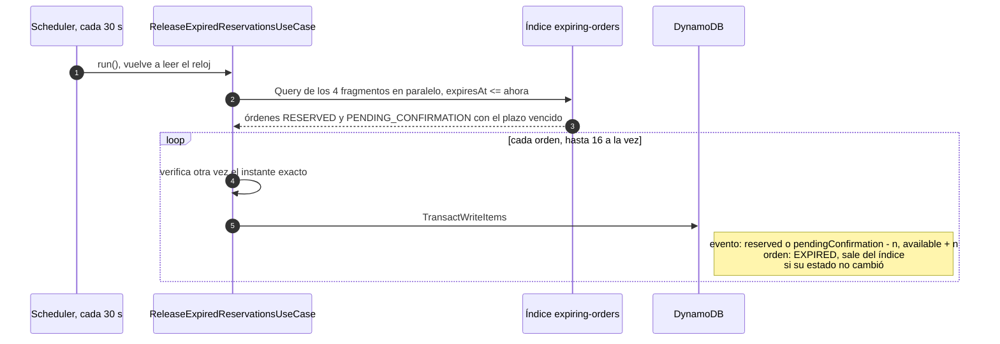

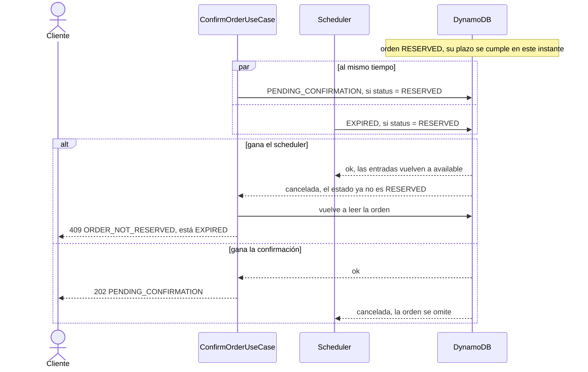

### 8.5 Disponibilidad en tiempo real (SSE)

1. El *stream* verifica primero que el evento exista: una vez empieza una respuesta SSE, su `200` ya no puede convertirse en `404`.
2. Cada suscriptor arranca con su propia lectura del estado actual.
3. Todos los suscriptores de un mismo evento comparten **una sola** fuente de *polling* (`share()`), que lee DynamoDB una vez por segundo y solo mientras alguien está mirando.
4. `distinctUntilChanged` solo envía cambios reales; un *heartbeat* cada 15 s evita que los *proxies* cierren la conexión.

Medido en local: 5 clientes durante 10 s hicieron 20 lecturas a DynamoDB, en lugar de unas 60 con un *polling* por suscriptor.

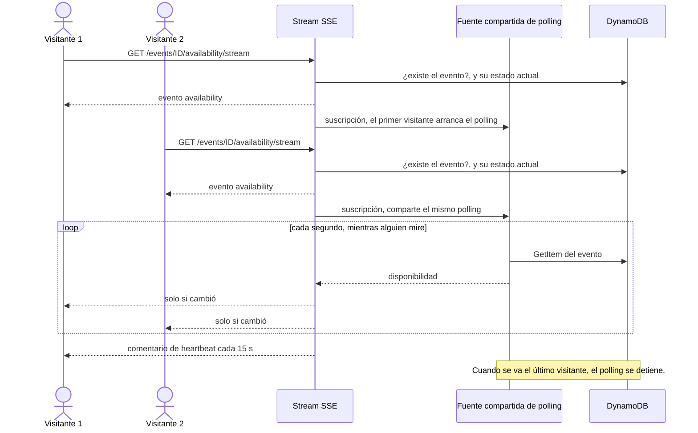

### 8.6 Cortesías

Las cortesías **no** pasan por la cola (ADR 0023). Una transacción de 4 ítems toma las entradas (`available - n`, `complimentary + n`, condición `available >= n`), crea la orden `COMPLIMENTARY`, escribe su registro de historial y guarda la clave de idempotencia. Sin cupo responde `409 TICKETS_SOLD_OUT` y no escribe nada. El administrador conoce el resultado en el acto y no quedan órdenes `REJECTED`.

Medido en local: 20 peticiones en paralelo de 1 cortesía sobre un evento de 5 entradas dieron exactamente 5 `201` y 15 `409`.

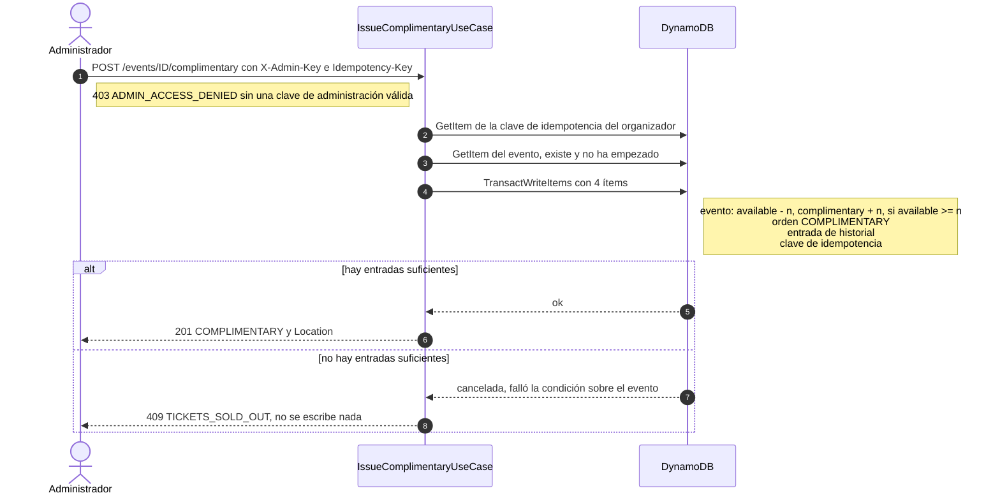

### 8.7 Apagado ordenado del consumidor

El *listener* es un [`SmartLifecycle`](https://docs.spring.io/spring-framework/docs/current/javadoc-api/org/springframework/context/SmartLifecycle.html) que, cuando la aplicación se detiene, deja de pedir mensajes, **espera su *poll* abierto** (máximo 10 s), procesa y borra lo que traiga y solo entonces termina. Spring lo detiene antes que el servidor web y antes de cerrar los clientes SQS; Docker espera 35 s ([`stop_grace_period`](https://docs.docker.com/reference/compose-file/services/)) para no matar el proceso antes.

Antes de este cambio, un mensaje recibido por el *poll* de una instancia que se apagaba esperaba todo el *visibility timeout* (15 s) después de cada reinicio. El primer arreglo, cancelar el *poll*, no funcionó: cancelar desde el cliente no impide que el servidor entregue el mensaje. Verificado después en 5 de 5 reinicios (ADR 0021).

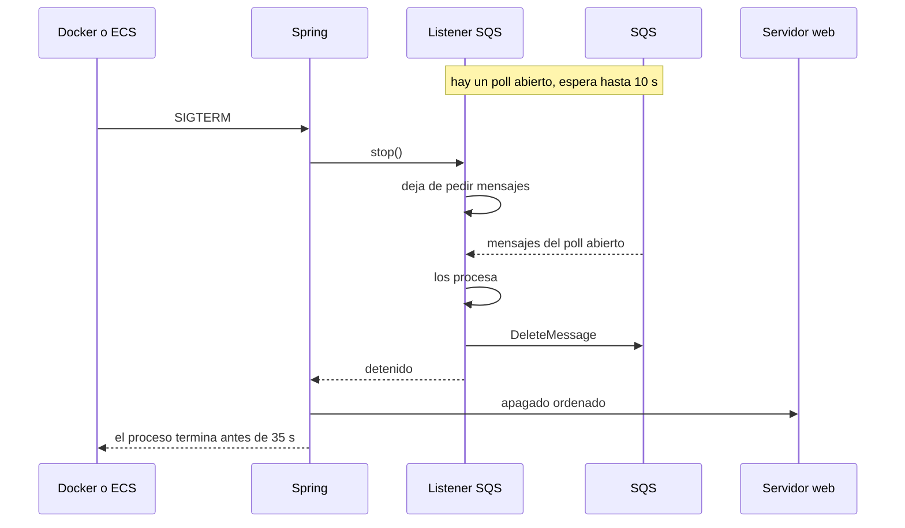

## 9. Decisiones de arquitectura

Cada decisión importante queda registrada abajo como un ADR breve ([*Architecture Decision Record*](https://cognitect.com/blog/2011/11/15/documenting-architecture-decisions)): el contexto, las opciones, la decisión con su razón, y sus pros y contras. Los números son estables, porque el código y los comentarios de Terraform los citan (por ejemplo, `ADR 0008`). Un ADR nunca se reescribe: cuando una decisión cambia, uno nuevo la reemplaza.

| ADR | Decisión |
|---|---|
| 0001 | Máquinas de estado separadas para órdenes y entradas |
| 0002 | La reserva la hace el consumidor SQS; la API solo encola |
| 0003 | Inventario como contadores en el evento |
| 0004 | SQS estándar, una cola por responsabilidad, cada una con DLQ |
| 0005 | Escrituras condicionales dentro de una sola transacción |
| 0006 | Scheduler de vencimientos sobre un índice disperso y fragmentado |
| 0007 | Confirmación con un pago simulado asíncrono (reemplazado por 0022) |
| 0008 | Plazo propio para los pagos |
| 0009 | Disponibilidad en tiempo real con SSE y una fuente compartida |
| 0010 | Un solo desplegable con roles activables |
| 0011 | Sin *virtual threads* |
| 0012 | Solo entorno local, Terraform sobre LocalStack |
| 0013 | Una tabla de DynamoDB por agregado |
| 0014 | `Idempotency-Key` guardada en la misma transacción que la orden |
| 0015 | Escritura doble resuelta con reintentos y reencolado (reemplazado por 0019) |
| 0016 | Mensajes *claim check*: solo el `orderId` |
| 0017 | Identidad declarada, sin autenticación |
| 0018 | Dominio inmutable con transiciones atómicas |
| 0019 | Diferir el *transactional outbox* y aceptar el riesgo de la escritura doble |
| 0020 | Estados de la orden como tipos sellados |
| 0021 | El consumidor SQS espera su *poll* abierto al apagarse |
| 0022 | El pago se confirma con una notificación del proveedor |
| 0023 | Cortesías en una sola transacción condicional, sin cola |

### 9.1 Modelo de dominio

#### ADR 0001 · Máquinas de estado separadas para órdenes y entradas

- **Contexto:** una entrada tiene cinco estados (`AVAILABLE`, `RESERVED`, `PENDING_CONFIRMATION`, `SOLD`, `COMPLIMENTARY`), pero una orden asíncrona atraviesa situaciones que ninguno describe: espera en la cola sin entradas, se rechaza porque no quedan, o vence. Una "orden `AVAILABLE`" no tiene sentido.
- **Opciones:** (1) usar los estados de la entrada también para la orden; (2) agregar estados nuevos a la entrada; (3) dos máquinas de estado.
- **Decisión:** opción 3. Las entradas conservan exactamente los cinco estados. La orden reutiliza esos nombres cuando el significado coincide y solo agrega `QUEUED`, `REJECTED` y `EXPIRED`. La API devuelve ambos: `status` (la orden) y `ticketStatus` (siempre uno de los cinco).
- **Por qué:** modela la asincronía tal como es, sin romper el conjunto cerrado de estados de la entrada.
- **Pros:** las reglas de las entradas quedan intactas; la correspondencia orden ↔ entrada vive en un solo lugar (`OrderStatus.ticketStatus()`), cubierta por pruebas.
- **Contras:** más estados que explicar y una correspondencia que mantener.

#### ADR 0018 · Dominio inmutable con transiciones atómicas

- **Contexto:** cada transición debe guardar de forma atómica el nuevo estado de la orden, el movimiento de inventario y el registro de historial. El código corre en un entorno reactivo y concurrente, y el dominio no debe saber cómo se guarda nada.
- **Opciones:** (1) entidades mutables con *setters*; (2) *records* inmutables cuyas transiciones devuelven un `OrderChange` (antes, después, movimiento de inventario y auditoría) que aplica un único método genérico del repositorio.
- **Decisión:** la opción 2 en su espíritu. Cada transición devuelve un objeto inmutable nuevo (`QueuedOrder.reserve()` devuelve un `ReservedOrder`). En lugar de un `apply(OrderChange)` genérico, cada transición tiene su propio método en el adaptador, que arma su transacción, y el registro de historial se deriva del nuevo estado (`OrderHistoryEntry.of(order)`).
- **Por qué:** no hay estado mutable compartido entre hilos, y las transiciones son funciones puras: dado un estado y un instante, el resultado siempre es el mismo.
- **Pros:** las transiciones son triviales de probar; nunca existe una transición sin su registro, ni un registro sin su transición; los nombres de los puertos dicen qué cambia (`InventoryUpdater.reserveTickets`).
- **Contras:** un método y una transacción por transición en el adaptador, en lugar de uno genérico; se crean más objetos (irrelevante frente al I/O).

#### ADR 0020 · Estados de la orden como tipos sellados

- **Contexto:** la orden tiene transiciones restringidas (una orden `QUEUED` se puede reservar o rechazar; una `REJECTED` es final), y cada estado tiene datos propios (`expiresAt` solo existe en una orden reservada, `rejectionReason` solo en una rechazada).
- **Opciones:** (A) el patrón [*State*](https://refactoring.guru/design-patterns/state) clásico (GoF), con un contexto mutable que delega en un objeto estado; (B) `sealed interface Order` con un *record* por estado, cada uno con solo sus datos y sus transiciones válidas; (C) un solo *record* con un *enum* `status` que valida las transiciones en ejecución.
- **Decisión:** opción B. `QueuedOrder`, `ReservedOrder`, `PendingConfirmationOrder`, `SoldOrder`, `RejectedOrder`, `ExpiredOrder` y `ComplimentaryOrder`; los datos comunes viven en `OrderDetails`.
- **Por qué:** una transición inválida deja de ser un error en ejecución y pasa a ser código que no compila. Con *records* inmutables, la indirección del *State* clásico no aporta nada; B es la forma idiomática del patrón en Java 25.
- **Pros:** `SoldOrder` no tiene transiciones, así que revertir una venta no compila; ningún campo queda en `null` según el estado; un `switch` sobre `Order` debe cubrir todos los estados, así que un estado nuevo señala cada lugar que hay que actualizar (pasó al agregar `ExpiredOrder` y `SoldOrder`).
- **Contras:** una orden leída de DynamoDB es un `Order` genérico, así que el estado concreto se decide igual en ejecución, en el borde; no protege contra la concurrencia (lo hace la escritura condicional, ADR 0005); los adaptadores traducen entre el tipo y un `status` plano; cada estado nuevo es un *record* más.

#### ADR 0003 · Inventario como contadores en el evento

- **Contexto:** nunca vender de más, y que cada entrada tenga su propio estado. Un evento puede tener decenas de miles de entradas, y la admisión es general (sin elegir asiento).
- **Opciones:** (1) solo contadores; (2) precrear un ítem por entrada y tomar entradas libres al comprar; (3) híbrido: los contadores son la compuerta atómica y los ítems de entrada se crean al reservar.
- **Decisión:** los contadores `available`, `reserved`, `pendingConfirmation`, `sold` y `complimentary` del evento son la compuerta atómica: decide una sola escritura condicional `available >= n`. Los ítems por entrada de la opción 3 quedaron fuera de esta versión.
- **Por qué:** una sola condición, fácil de razonar y de probar, impide la sobreventa sin escribir miles de ítems por evento ni competir por entradas libres.
- **Pros:** el invariante `available + reserved + pendingConfirmation + sold + complimentary = capacity` se cumple por construcción; una sola escritura por reserva.
- **Contras:** todas las reservas de un evento escriben el mismo ítem (*hot partition*: una partición admite como máximo [1.000 unidades de escritura por segundo](https://docs.aws.amazon.com/amazondynamodb/latest/developerguide/bp-partition-key-design.html) y una [escritura transaccional cuesta dos](https://docs.aws.amazon.com/amazondynamodb/latest/developerguide/transaction-apis.html), así que unas 500 transiciones por segundo por evento); no se puede saber *qué* entrada tiene cada cliente, así que no admite asientos numerados.

### 9.2 Concurrencia y persistencia

#### ADR 0005 · Escrituras condicionales dentro de una sola transacción

- **Contexto:** cada transición debe ser atómica y auditable, y las compras concurrentes nunca deben vender de más. Una transición toca varios ítems: los contadores del evento, la orden y su registro de historial.
- **Opciones:** (1) leer, cambiar en memoria y guardar (*lost updates*: justo el error del sistema tradicional); (2) escrituras separadas con compensación (ventanas de inconsistencia); (3) un solo [`TransactWriteItems`](https://docs.aws.amazon.com/amazondynamodb/latest/developerguide/transaction-apis.html).
- **Decisión:** opción 3. Una transacción con la [actualización condicional](https://docs.aws.amazon.com/amazondynamodb/latest/developerguide/Expressions.ConditionExpressions.html) de los contadores (`available >= n`), la actualización de la orden condicionada a su estado esperado (`status = QUEUED`, `status = RESERVED`…) y el registro de historial. Los motivos de cancelación de DynamoDB se traducen a excepciones del dominio: una condición de inventario fallida es una respuesta de negocio (`SOLD_OUT`) y nunca se reintenta; un `TransactionConflict` se convierte en `ConcurrencyConflictException` y se reintenta con *backoff* exponencial.
- **Por qué el estado y no una versión:** cada escritura cambia el estado, así que el estado esperado ya cumple el papel de la versión: dos procesos nunca pueden aplicar dos transiciones desde el mismo estado. Es un atributo menos que mantener.
- **Pros:** atomicidad real, todo o nada; ningún contador puede quedar negativo; el historial lo garantiza la misma operación.
- **Contras:** las escrituras transaccionales cuestan el doble; máximo 100 ítems por transacción; las transacciones concurrentes sobre el mismo evento producen `TransactionConflict`; si algún día existiera una actualización que conserve el estado, haría falta la `version`.

#### ADR 0013 · Una tabla de DynamoDB por agregado

- **Contexto:** DynamoDB se puede modelar como una sola tabla con claves sobrecargadas o como varias tablas. Las transacciones entre tablas funcionan igual dentro de una región.
- **Opciones:** (1) *single-table design*; (2) una tabla por agregado o tipo de registro.
- **Decisión:** opción 2.
- **Por qué:** cada tabla tiene una sola responsabilidad y su propia política: `order-history` es solo de altas, `idempotency` es efímera con TTL nativo y `orders` tiene su propio índice de vencimientos.
- **Pros:** un esquema que se explica solo; IAM granular por tabla en AWS; retención y *backups* adecuados a cada tipo de dato; más fácil de probar y de defender.
- **Contras:** más tablas que definir y administrar; una consulta entre agregados necesita varias lecturas (hoy no hay ninguna).

#### ADR 0014 · `Idempotency-Key` guardada en la misma transacción que la orden

- **Contexto:** las compras duplicadas vienen del doble clic, del reintento del cliente tras un *timeout* de red o de ataques de *replay*. La misma clave debe producir una sola orden, aunque llegue varias veces a la vez.
- **Opciones:** (1) guardar la clave y después la orden (un fallo deja una clave que apunta a nada); (2) guardar la orden y después la clave (un fallo permite que un reintento cree un duplicado); (3) leer la clave primero y, si no existe, escribir la orden y la clave en una sola transacción con `attribute_not_exists`.
- **Decisión:** opción 3. La clave pertenece a un cliente (`customerId#clave`) y dura 24 horas. Misma clave y misma petición (huella SHA-256) → la orden original, `Idempotent-Replayed: true`. Misma clave y otra petición → `422`. Dos peticiones concurrentes → la transacción deja ganar a una sola, y la otra responde con la orden ganadora.
- **Por qué:** es la única opción sin una ventana en la que la clave y la orden no coincidan.
- **Pros:** imposible crear dos órdenes con la misma clave; sin claves huérfanas; una repetición no publica otro mensaje. Medido: 20 peticiones en paralelo con una clave crearon una sola orden.
- **Contras:** una lectura más en cada `POST /orders`, y una transacción de 3 ítems en lugar de 2.

### 9.3 Mensajería

#### ADR 0002 · La reserva la hace el consumidor SQS; la API solo encola

- **Contexto:** el problema de negocio son los picos de miles de compradores al mismo tiempo. La compra se debe aceptar de inmediato, y la disponibilidad real la verifica un consumidor asíncrono.
- **Opciones:** (1) la API reserva de forma síncrona y después encola; (2) la API solo valida, guarda la orden `QUEUED`, encola y responde `202`; (3) como la opción 2, más una verificación de cupo de solo lectura que rechaza enseguida si el evento está agotado.
- **Decisión:** opción 2.
- **Por qué:** la cola se vuelve un amortiguador. La API absorbe el pico con trabajo mínimo, y la concurrencia acotada de los consumidores decide cuántas escrituras compiten por el inventario.
- **Pros:** latencia baja y estable en `POST /orders`; la base de datos recibe un flujo nivelado; los fallos transitorios se reintentan sin que el cliente lo note.
- **Contras:** el cliente no sabe de inmediato si obtuvo entradas y debe consultar la orden (guiado por `Location` y `Retry-After`); cuando un evento se agota, se siguen encolando órdenes que terminarán rechazadas. La opción 3 queda como optimización futura.

#### ADR 0004 · SQS estándar, una cola por responsabilidad, cada una con DLQ

- **Contexto:** los mensajes se deben procesar al menos una vez. Había dos trabajos asíncronos con perfiles muy distintos: las reservas (un pico masivo, milisegundos) y los pagos (un flujo menor que depende de un proveedor externo lento).
- **Opciones:** (1) [SQS FIFO](https://docs.aws.amazon.com/AWSSimpleQueueService/latest/SQSDeveloperGuide/FIFO-queues.html) con `MessageGroupId = eventId`; (2) una sola cola estándar con dos tipos de mensaje; (3) una cola estándar por responsabilidad, cada una con su DLQ.
- **Decisión:** opción 3, con un *visibility timeout* de 15 s para reservas y de 30 s para pagos, y `maxReceiveCount = 5`.
- **Por qué:** la consistencia no depende del orden de los mensajes sino de las escrituras condicionales (ADR 0005), así que el límite de *throughput* por grupo de FIFO no aporta nada y convertiría un evento popular en un cuello de botella. Las colas separadas aíslan los fallos: un proveedor de pagos caído no frena las reservas.
- **Pros:** *throughput* prácticamente ilimitado; aislamiento de fallos; una DLQ y alarmas por cola que dicen enseguida dónde está el problema.
- **Contras:** los consumidores deben tolerar duplicados y desorden (ADR 0016); más recursos que administrar.

#### ADR 0016 · Mensajes *claim check*: solo el `orderId`

- **Contexto:** [SQS estándar](https://docs.aws.amazon.com/AWSSimpleQueueService/latest/SQSDeveloperGuide/standard-queues.html) entrega cada mensaje al menos una vez y sin orden garantizado, y un mensaje vuelve a estar visible si un consumidor muere mientras lo procesa.
- **Opciones:** (1) mensajes con todo el estado (cantidad, evento, cliente…); (2) mensajes con solo el id de la orden, para que el consumidor siempre cargue la orden actual.
- **Decisión:** opción 2. El consumidor lee la orden con lectura fuerte y solo actúa si está en el estado esperado (`QUEUED`); si no, el mensaje es un duplicado o llegó tarde, y se borra sin efectos. Un mensaje se borra solo después de guardar su efecto.
- **Por qué:** el estado vive en DynamoDB, no en el mensaje.
- **Pros:** inmune a duplicados, desorden y datos viejos o manipulados; el consumidor nunca confía en cantidades ni montos que vengan en un mensaje.
- **Contras:** una lectura a DynamoDB por mensaje.

#### ADR 0015 · Escritura doble resuelta con reintentos y reencolado (reemplazado por 0019)

- **Lo que proponía:** cada orden `QUEUED` tendría un plazo en el índice de vencimientos, y un scheduler volvería a publicar las órdenes `QUEUED` demasiado antiguas. El diseño se conserva como primer paso del plan del ADR 0019.

#### ADR 0019 · Diferir el *transactional outbox* y aceptar el riesgo de la escritura doble

- **Contexto:** crear una orden la guarda en DynamoDB y después publica en SQS, sin una transacción común. Si el guardado funciona y la publicación falla (SQS caído, o el proceso muere entre ambas), la orden queda en `QUEUED` y nadie la procesa.
- **Opciones:** (1) una tabla de [*outbox* transaccional](https://microservices.io/patterns/data/transactional-outbox.html) escrita en la misma transacción que la orden; (2) [DynamoDB Streams](https://docs.aws.amazon.com/amazondynamodb/latest/developerguide/Streams.html) como *outbox*: solo se escribe la orden, y un lector de cambios publica en SQS; (3) reintentos más un scheduler de reencolado (ADR 0015); (4) diferir y documentar.
- **Decisión:** opción 4. Mitigaciones vigentes: la publicación no es *fire and forget*, así que si falla el error llega al cliente; el SDK de AWS reintenta los fallos transitorios; el consumidor es idempotente, así que una futura republicación no causa daño.
- **Por qué:** con el tiempo limitado, la prioridad fue el núcleo del sistema: la reserva con control de concurrencia.
- **Pros:** el tiempo se dedicó a lo más importante (sin sobreventa, idempotencia, vencimientos).
- **Contras:** un fallo entre las dos escrituras deja una orden atascada en `QUEUED`. Reintentar con la **misma** `Idempotency-Key` devuelve esa orden atascada sin volver a publicar; solo una clave nueva crea una orden nueva.
- **Plan:** primero la opción 3, que reutiliza el scheduler y el índice existentes; en producción, la opción 2, que elimina el problema en lugar de repararlo.

#### ADR 0021 · El consumidor SQS espera su *poll* abierto al apagarse

- **Contexto:** el *listener* de la plantilla del scaffold no tenía ciclo de vida, y el [apagado ordenado](https://docs.spring.io/spring-boot/reference/web/graceful-shutdown.html) de Spring Boot solo cubre el servidor web. Un experimento mostró que, después de un reinicio, una orden nueva tardaba 16 s en reservarse: el *long poll* abierto del proceso que se apagaba recibía el mensaje y nunca lo borraba, así que el mensaje esperaba todo el *visibility timeout* (15 s).
- **Opciones:** (1) no hacer nada, porque el consumidor es idempotente y el mensaje solo se retrasa; (2) cancelar el *poll* abierto al apagarse; (3) dejar de pedir mensajes, **esperar** el *poll* abierto, procesar y borrar lo que traiga y después terminar; (4) liberar los mensajes recibidos con [`ChangeMessageVisibility`](https://docs.aws.amazon.com/AWSSimpleQueueService/latest/SQSDeveloperGuide/sqs-visibility-timeout.html) en 0.
- **Decisión:** opción 3, como un `SmartLifecycle` que Spring detiene antes que el servidor web y antes de cerrar los clientes SQS. `waitTimeSeconds` bajó de 20 a 10 s, porque también acota el apagado; Spring tiene 15 s por fase de apagado y Docker 35 s (`stop_grace_period`), para que Docker no mate el proceso antes.
- **Por qué:** la opción 2 se construyó primero y **se descartó por la evidencia**: en 2 de 3 reinicios el mensaje siguió tardando 16 s, porque cancelar la petición en el cliente no impide que el servidor entregue el mensaje. AWS no documenta ese caso, así que el diseño no puede depender de él. La opción 4 solo sirve para mensajes que el cliente sí recibió.
- **Pros:** un reinicio o un despliegue no deja mensajes esperando (verificado en 5 de 5 reinicios: menos de 1 s, en lugar de 16 s); una orden creada durante el apagado la procesa la instancia que se está apagando.
- **Contras:** detener una instancia tarda hasta 10 s; un *poll* de 10 s hace el doble de recepciones vacías que uno de 20 s (un costo despreciable).

### 9.4 Flujos de negocio

#### ADR 0006 · Scheduler de vencimientos sobre un índice disperso y fragmentado

- **Contexto:** las reservas vencen a los 10 minutos y los pagos a los 5. Al vencer, las entradas deben volver al inventario, con su registro de historial, sin interferir con un cliente que confirma justo en ese momento, y con varias instancias corriendo.
- **Opciones:** (1) el [TTL nativo](https://docs.aws.amazon.com/amazondynamodb/latest/developerguide/TTL.html) de DynamoDB (borra los ítems vencidos en un plazo de unos días y no ejecuta lógica de negocio); (2) mensajes SQS con [retardo](https://docs.aws.amazon.com/AWSSimpleQueueService/latest/SQSDeveloperGuide/sqs-delay-queues.html) (máximo 15 minutos, más mensajes y más estados); (3) un scheduler periódico sobre un índice disperso, dividido en fragmentos.
- **Decisión:** opción 3. Cada 30 s el scheduler consulta los fragmentos, vuelve a comprobar el instante exacto de cada orden y la vence con el mismo tipo de transacción condicional que cualquier otra transición. Si ganó otro flujo (el cliente confirmó a tiempo), la condición falla y la orden se omite.
- **Por qué:** es determinista, pasa por el dominio, queda en el historial y es seguro con varias instancias sin elegir un líder.
- **Pros:** precisión de segundos; el índice disperso solo contiene órdenes vivas, porque el atributo de fragmento se quita cuando una orden sale de `RESERVED` o `PENDING_CONFIRMATION`; los fragmentos evitan que un vencimiento masivo sature una partición.
- **Contras:** la consulta periódica cuesta aunque nada venza; una liberación puede tardar hasta el plazo más 30 s (de todos modos, el dominio rechaza confirmar una reserva vencida); las fechas en texto se ordenan con un margen menor a 1 s, así que el caso de uso comprueba el instante exacto.

#### ADR 0008 · Plazo propio para los pagos

- **Contexto:** el primer diseño solo vencía las reservas. Pero si el pago nunca llega, una orden en `PENDING_CONFIRMATION` retendría sus entradas para siempre, y nunca se venderían.
- **Opciones:** (1) solo vence `RESERVED`; (2) `PENDING_CONFIRMATION` también vence, con su propio plazo.
- **Decisión:** opción 2: 5 minutos para pagar. El mismo scheduler y el mismo índice la vencen, con el motivo `PAYMENT_TIMEOUT`, y las entradas vuelven a `available`.
- **Por qué:** ninguna entrada puede quedar retenida para siempre, y el comportamiento es simétrico con el de la reserva.
- **Pros:** el inventario siempre vuelve.
- **Contras:** con un proveedor real, un pago aprobado después del plazo significa que el cliente pagó por entradas que ya se liberaron. Una aprobación tardía se rechaza (`409 PAYMENT_EXPIRED`) y nunca vende entradas liberadas, pero una integración real necesita un proceso de conciliación o reembolso.

#### ADR 0007 · Confirmación con un pago simulado asíncrono (reemplazado por 0022)

- **Lo que proponía:** confirmar publicaría en la cola de pagos, y un consumidor llamaría a una pasarela simulada detrás de un puerto `PaymentGateway`. Se empezó a construir y se descartó por su costo; ver el ADR 0022.

#### ADR 0022 · El pago se confirma con una notificación del proveedor

- **Contexto:** `PENDING_CONFIRMATION` es uno de los cinco estados de la entrada, pero la primera implementación pasaba directo de `RESERVED` a `SOLD`, así que ese estado nunca se usaba. Lo importante es que el estado exista con un significado real, no que el pago sea asíncrono.
- **Opciones:** (1) pago asíncrono por cola y pasarela simulada (ADR 0007); (2) una notificación del proveedor de pagos (*webhook*); (3) mantener `RESERVED` → `SOLD`.
- **Decisión:** opción 2. Confirmar pasa la orden a `PENDING_CONFIRMATION` (`202`) con 5 minutos para pagar. El proveedor notifica `POST /orders/{id}/payment`: `APPROVED` → `SOLD`; `DECLINED` → `REJECTED (PAYMENT_DECLINED)` y las entradas vuelven. Una notificación repetida devuelve la orden tal como está; una tardía se rechaza.
- **Por qué:** la opción 1 se empezó y se descartó: exigía un consumidor nuevo, un *listener* para dos colas, un módulo de pasarela simulada y otro publicador. Además, un *webhook* es como funcionan los proveedores de pago reales. La asincronía de la plataforma ya la demuestra la cola de reservas.
- **Pros:** cada estado de la entrada tiene un significado real; muy poco código nuevo; reutiliza las transiciones de inventario, el historial y el scheduler.
- **Contras:** **el *webhook* no está autenticado**: cualquiera que conozca el id de una orden que espera su pago puede marcarla como pagada. En producción debe verificar la firma del proveedor (HMAC del cuerpo y un *timestamp*, como lo hace [Stripe](https://docs.stripe.com/webhooks)). La cola de pagos queda en Terraform sin uso.

#### ADR 0023 · Cortesías en una sola transacción condicional, sin cola

- **Contexto:** `COMPLIMENTARY` era el único estado de la entrada sin uso. El diseño enviaba las cortesías por el mismo flujo asíncrono que una compra. Pero son una operación administrativa de bajo volumen: no hay picos que absorber, y la protección contra la sobreventa viene de la escritura condicional, no de la cola.
- **Opciones:** (1) asíncrona, como una compra (`202`, `QUEUED`, el consumidor decide); (2) una sola transacción condicional, síncrona.
- **Decisión:** opción 2. Una transacción de 4 ítems: mover `available` → `complimentary` con la condición `available >= n`, crear la orden (nace final, en `COMPLIMENTARY`), su registro de historial y la clave de idempotencia. Con cupo: `201`. Sin cupo: `409 TICKETS_SOLD_OUT`, y no se escribe nada. Acceso con `X-Admin-Key`, comparada en tiempo constante con [`MessageDigest.isEqual`](https://docs.oracle.com/en/java/javase/25/docs/api/java.base/java/security/MessageDigest.html).
- **Por qué:** la misma garantía contra la sobreventa con menos piezas, y una respuesta inmediata para el administrador.
- **Pros:** no quedan órdenes `REJECTED`; un `TransactionConflict` con una reserva simultánea es seguro de reintentar, porque no se escribió nada. Medido: 20 peticiones en paralelo sobre 5 entradas dieron exactamente 5 `201` y 15 `409`.
- **Contras:** a diferencia de una compra, no pasa por la cola; la clave de administración es un secreto compartido, no una identidad, así que el historial no dice qué administrador emitió las cortesías.

#### ADR 0009 · Disponibilidad en tiempo real con SSE y una fuente compartida

- **Contexto:** los visitantes quieren ver la disponibilidad en tiempo real, y durante un lanzamiento miles pueden estar mirando el mismo evento.
- **Opciones:** (1) solo un `GET`, consultado periódicamente por cada cliente; (2) SSE donde cada conexión lee la base de datos; (3) un `GET` más SSE alimentado por una sola fuente compartida por evento.
- **Decisión:** opción 3. Un solo *polling* por evento observado, compartido por todos los suscriptores (`share()`), que solo corre mientras alguien mira; `distinctUntilChanged` solo envía cambios reales; un *heartbeat* cada 15 s evita que los *proxies* cierren la conexión.
- **Por qué:** el costo de lectura no debe crecer con el número de visitantes. Medido: 5 clientes durante 10 s hicieron 20 lecturas en lugar de unas 60.
- **Pros:** reactivo de punta a punta (`Flux` hasta el navegador); el caso de uso solo conoce el puerto `InventoryChangeFeed`, así que DynamoDB Streams puede reemplazar el *polling* sin tocarlo.
- **Contras:** las conexiones largas consumen recursos en cada instancia; 1 lectura por segundo por evento observado y por instancia, aunque no haya cambios; hasta 1 s de retraso.

### 9.5 Plataforma y seguridad

#### ADR 0010 · Un solo desplegable con roles activables

- **Contexto:** el sistema tiene varios componentes ejecutables, el scaffold ofrece un solo módulo de aplicación y todo corre en local.
- **Opciones:** (1) un microservicio por componente; (2) un desplegable con todo siempre activo; (3) un desplegable cuyos roles se activan por configuración (`@ConditionalOnProperty`).
- **Decisión:** se diseñó la opción 3; se construyó la opción 2.
- **Por qué:** simple de ejecutar y de operar, sin código duplicado. Con roles, la misma imagen podría correr después como servicios separados sin cambiar el código.
- **Pros:** una imagen y una configuración, fácil de operar en local.
- **Contras:** la API y los *workers* comparten CPU y memoria y no escalan por separado; para producción, primero hacen falta los roles.

#### ADR 0011 · Sin *virtual threads*

- **Contexto:** los [*virtual threads*](https://openjdk.org/jeps/444) son una de las novedades más visibles del Java moderno. La aplicación es reactiva (WebFlux sobre Netty) y usa los clientes asíncronos del SDK de AWS.
- **Opciones:** (1) usar *virtual threads*; (2) mantenerse 100 % reactivo y no bloqueante.
- **Decisión:** opción 2.
- **Por qué:** los *virtual threads* resuelven el escalado de código **bloqueante**, y aquí no lo hay. Mezclar dos modelos de concurrencia agrega complejidad sin un beneficio medible. En su lugar se usan otras características modernas de Java: *records*, interfaces selladas y *pattern matching* en `switch`.
- **Pros:** un solo modelo de concurrencia; BlockHound hace cumplir la regla "nunca bloquear".
- **Contras:** no se muestran los *virtual threads*. Aplicarían a una dependencia que solo ofrezca un cliente bloqueante (por ejemplo, el SDK de un proveedor de pagos), envuelta en `Schedulers.fromExecutor(Executors.newVirtualThreadPerTaskExecutor())`.

#### ADR 0012 · Solo entorno local, Terraform sobre LocalStack

- **Contexto:** todo el sistema debe correr en cualquier máquina con Docker, con DynamoDB y SQS emulados. Desplegar en AWS tiene un costo real de unos USD 85 al mes.
- **Opciones:** (1) desplegar además un entorno productivo en AWS; (2) solo local, con *scripts* de AWS CLI; (3) solo local, con el [*provider* de AWS de Terraform](https://registry.terraform.io/providers/hashicorp/aws/latest/docs) apuntando a [LocalStack](https://docs.localstack.cloud/) como contenedor de inicialización, más una propuesta AWS documentada.
- **Decisión:** opción 3. Terraform es la única fuente de verdad de tablas y colas. LocalStack también emula DynamoDB, porque el *provider* de Terraform usa APIs (*tags*, *backups* continuos, TTL) que DynamoDB Local no implementa por completo.
- **Por qué:** costo cero, solo hace falta Docker, e infraestructura como código real y modular: los módulos no saben que corren en local y se reutilizarían en producción.
- **Pros:** entorno reproducible; IaC validada en el CI.
- **Contras:** la arquitectura en AWS se defiende con su diseño, sus decisiones y sus costos, no en vivo.
- **Actualización:** el entorno productivo ya existe como Terraform (`envs/prod`), validado y escaneado en el CI y listo para aplicar; el entorno local sigue siendo el que se ejecuta (§16).

#### ADR 0017 · Identidad declarada, sin autenticación

- **Contexto:** la autenticación quedó fuera del alcance, pero el sistema igual necesita saber quién hace cada petición: para delimitar las claves de idempotencia, para limitar las peticiones por cliente y para impedir que un cliente consulte o confirme las órdenes de otro.
- **Opciones:** (1) `customerId` en el cuerpo de la petición; (2) un encabezado `X-Customer-Id` detrás de una interfaz de la capa web; (3) autenticación completa (Cognito + JWT).
- **Decisión:** opción 2, simplificada. La regla de pertenencia vive en el dominio (`Order.belongsTo`), y la orden de otro cliente responde `404` para no revelar que existe.
- **Por qué:** mantiene la identidad fuera de los datos de negocio y deja un camino claro hacia la autenticación real.
- **Pros:** la regla de pertenencia tiene pruebas unitarias; la identidad está separada del cuerpo.
- **Contras:** la identidad es declarada: cualquiera puede suplantar a otro cliente cambiando el encabezado; sin la interfaz, agregar JWT obliga a tocar los *handlers*. Propuesta productiva: Cognito + JWT validado por Spring Security, con `customerId` tomado del *claim* `sub` y un grupo `admin`.

## 10. Concurrencia y consistencia

- **Sin *locks* en memoria.** No hay `synchronized` ni *locks* dentro de la JVM, que además no funcionarían con varias instancias. La concurrencia se resuelve en DynamoDB, así que la aplicación escala horizontalmente sin coordinación.
- **Invariante del inventario.** `available + reserved + pendingConfirmation + sold + complimentary = capacity`, y ningún contador es negativo. El *record* `Inventory` rechaza cualquier estado que lo rompa.
- **Escrituras condicionales.** Cada transición es una transacción con dos condiciones: una sobre el inventario (`available >= n`, `reserved >= n`…) y otra sobre el estado esperado de la orden (`status = QUEUED`, `status = RESERVED`…). El estado esperado cumple el papel de la versión del bloqueo optimista: dos procesos nunca aplican dos transiciones desde el mismo estado.
- **Reintentos solo donde ayudan.** Solo se reintenta un `TransactionConflict` (3 veces, *backoff* exponencial desde 50 ms). Una condición fallida es una respuesta de negocio (`SOLD_OUT`, ya procesada) y nunca se reintenta.
- **Lecturas fuertes.** Toda lectura de una orden por id es fuertemente consistente, así que un cliente que consulta justo después del `202` nunca recibe un `404` (*read-your-writes*).
- **Entrega al menos una vez.** Un mensaje se borra solo después de guardar su efecto; los consumidores son idempotentes porque actúan sobre el estado actual de la orden, no sobre el mensaje.
- **No bloqueante.** Solo se usan clientes asíncronos de AWS, y BlockHound hace fallar cualquier prueba que bloquee un hilo reactivo.

**Evidencia:** la prueba automatizada `ConcurrencyIntegrationTest` envía 50 compras simultáneas de 1 entrada para un evento de 10, contra LocalStack con el Terraform real. Resultado: exactamente **10 `RESERVED`** y **40 `REJECTED (SOLD_OUT)`**, y el inventario cuadra. Si se quita la condición `available >= n`, la prueba falla. También medido: 20 peticiones en paralelo con la misma `Idempotency-Key` crearon una sola orden.

## 11. Seguridad

### Qué está implementado

| Aspecto | Medida |
|---|---|
| Secretos y credenciales | Ningún secreto en el código. Todo llega por variables de entorno. Las únicas credenciales son las ficticias de LocalStack (`test`/`test`) y una clave de administración solo para local, ambas señaladas como tales |
| Reintentos maliciosos o accidentales | `Idempotency-Key` asociada al cliente, con huella de la petición y TTL de 24 h; consumidores, confirmación y notificación de pago idempotentes |
| Acaparamiento de inventario | Máximo 6 entradas por orden; las reservas vencen a los 10 minutos y los pagos a los 5 |
| Acceso a órdenes de otros clientes ([IDOR](https://cheatsheetseries.owasp.org/cheatsheets/Insecure_Direct_Object_Reference_Prevention_Cheat_Sheet.html)) | La orden de otro cliente responde `404`, no `403`, para no revelar que existe |
| Operaciones administrativas | `X-Admin-Key` comparada en tiempo constante; sin clave configurada, toda petición administrativa se niega |
| Validación de entradas | Validación en el dominio (*records* que se validan a sí mismos); errores en formato RFC 9457 sin trazas ni detalles internos |
| Encabezados HTTP ([OWASP](https://cheatsheetseries.owasp.org/cheatsheets/HTTP_Headers_Cheat_Sheet.html)) | `Content-Security-Policy`, `Strict-Transport-Security`, `X-Content-Type-Options`, `Referrer-Policy`, `Cache-Control: no-store`; se elimina el encabezado `Server`. CORS restringido a orígenes conocidos y a `GET`/`POST` |
| Mensajes | *Claim check*: el consumidor nunca confía en cantidades ni montos que vengan en un mensaje |
| Contenedor | Imagen *multi-stage*, solo JRE, usuario sin privilegios |
| Datos en reposo | DynamoDB [cifra por defecto](https://docs.aws.amazon.com/amazondynamodb/latest/developerguide/EncryptionAtRest.html); las colas usan [SSE-SQS](https://docs.aws.amazon.com/AWSSimpleQueueService/latest/SQSDeveloperGuide/sqs-server-side-encryption.html) |
| Cadena de suministro (CI) | *Token* de solo lectura por defecto; cada GitHub Action [fijada a un SHA completo](https://docs.github.com/en/actions/security-for-github-actions/security-guides/security-hardening-for-github-actions) |

### Qué no está implementado

En local **no hay autenticación ni Spring Security**, no hay límite de peticiones y el *webhook* de pagos está abierto. En AWS, el entorno productivo agrega un JWT validado por API Gateway (el cliente sale del token, no de un encabezado), *throttling* e IAM de mínimo privilegio ([§16.3](#163-seguridad-y-la-factura)); la aplicación sigue sin hacer autorización propia. La lista completa, organizada según el OWASP Top 10, está en [§15.2](#152-seguridad-owasp-top-10).

## 12. Pruebas y calidad

| Tipo | Herramientas | Qué verifica |
|---|---|---|
| Casos de uso | JUnit 5, Mockito, `StepVerifier` | Cada caso de uso con los puertos simulados, incluidos errores, reintentos y carreras |
| Componentes reactivos | `WebTestClient`, `StepVerifier` | *Handlers*, rutas, mapeo de errores, *stream* SSE, *listener* y scheduler |
| Dominio | JUnit 5 | Invariantes, transiciones y validaciones de cada *record* |
| Llamadas bloqueantes | BlockHound | Ninguna llamada bloqueante en un hilo reactivo |
| Arquitectura | ArchUnit, `validateStructure` | Reglas de capas de Clean Architecture |
| Concurrencia | Testcontainers + LocalStack + Terraform real | Sin sobreventa con 50 compras concurrentes |
| Punta a punta | Postman + Newman | Todos los flujos y casos de error contra el entorno levantado, bajo demanda (`./gradlew smokeTest`) |
| Mutación | PIT | Que las pruebas verifiquen el código, no solo lo recorran |

Resultados al 2026-10-11:

- **Cobertura de líneas: 99,1 %** de todo el proyecto (358 pruebas). El *build* falla por debajo del 90 % (`minLineCoverage` en `gradle.properties`) y el CI lo vuelve a verificar.
- **Puntaje de mutación: 94,4 %** (340 de 360 mutantes eliminados).

Reportes: `build/reports/coverage/html/index.html` (cobertura) y `<módulo>/build/reports/pitest/index.html` (mutación).

## 13. Ciclo DevOps

Cómo cubre el proyecto las ocho fases **Plan → Code → Build → Test → Release → Deploy → Operate → Monitor**, y qué falta.

| Fase | Qué existe | Estado | Qué falta |
|---|---|---|---|
| **Plan** | Requisitos, modelo de dominio, diseño de datos, contrato de la API y arquitectura diseñados antes de programar; decisiones registradas como ADR (§9); *issues* de GitHub por funcionalidad | ✅ | — |
| **Code** | [Gitflow](https://nvie.com/posts/a-successful-git-branching-model/): `feature/*` → `develop` mediante *pull requests*, `release/*` y `hotfix/*` → `main`; *commits* pequeños y semánticos; plugin de scaffold para módulos y casos de uso | ✅ | — |
| **Build** | *Wrapper* de Gradle con *build cache* y *configuration cache*; Dockerfile *multi-stage* que compila dentro de Docker; imagen ARM64 para Fargate | ✅ | — |
| **Test** | Pruebas unitarias, reactivas, de arquitectura, de concurrencia, de punta a punta y de mutación; umbral de cobertura del 90 % en el *build* y en el CI | ✅ | PIT corre bajo demanda, no en el CI con un umbral |
| **Release** | Gitflow: `release/x.y.z` se integra en `main` y se etiqueta `vX.Y.Z`. El *tag* ejecuta el *workflow* de *release*: verifica que el commit esté en `main`, lo construye y lo prueba otra vez, publica la imagen Docker en GitHub Packages para amd64 y arm64 (con *provenance* y SBOM) y crea el GitHub Release con notas generadas | ✅ | Un archivo de *changelog*; publicar en ECR le corresponde a un *pipeline* de CD (§16.5) |
| **Deploy** | `docker compose up` despliega todo el entorno local; `envs/prod` despliega en AWS con un `terraform apply` por versión, actualización gradual y reversión automática (§16.5) | 🟡 | Se aplica a mano, no con un *pipeline*; todavía sin `terraform plan` en los *pull requests* |
| **Operate** | [*Health probes*](https://docs.spring.io/spring-boot/reference/actuator/endpoints.html) (*liveness*, *readiness*), *health checks* del contenedor, apagado ordenado alineado entre Spring, Docker y ECS, DLQ, consumidores idempotentes; *runbook* de AWS con *kill switch* (§16.5) | 🟡 | La *readiness* no verifica DynamoDB ni SQS |
| **Monitor** | Métricas de Micrometer en formato Prometheus; en AWS, logs en CloudWatch, logs de acceso en JSON y cinco alarmas por correo (abuso, 5xx, DLQ, edad de la cola, CPU), más un presupuesto mensual (§16.5) | 🟡 | Logs de la aplicación en texto, sin `correlationId`; sin métricas de negocio, *dashboards* ni trazas |

### Integración continua

Cada *pull request* a `develop` o `main`, y cada *push* a `develop`, `main`, `release/**` y `hotfix/**`, ejecuta cuatro *jobs* independientes en paralelo:

| Job | Qué hace |
|---|---|
| Build and test | `./gradlew build coverageReport` con JDK 25: compilación, validación de la estructura, pruebas unitarias y umbral de cobertura del 90 %; la cobertura se muestra en el resumen de la ejecución y los reportes se suben como artefactos |
| Validate Terraform | `terraform fmt -check`, `terraform validate` de los tres stacks (`envs/local`, `envs/prod`, `bootstrap`) y un escaneo de seguridad con [Checkov](https://www.checkov.io/) que falla ante cualquier hallazgo nuevo (§16.6) |
| Integration tests | `./gradlew integrationTest`: la prueba de concurrencia contra LocalStack, con los recursos creados por el Terraform real (Testcontainers) |
| Docker image | Construye la imagen productiva en un *runner* ARM64 (la arquitectura de Fargate) y verifica que arranca con el sistema de archivos raíz de solo lectura |

Un *push* nuevo al mismo *pull request* cancela la ejecución desactualizada, y la regla de la rama exige el CI en verde para integrar en `develop`.

### Release

[Gitflow](https://www.atlassian.com/git/tutorials/comparing-workflows/gitflow-workflow): una rama `release/x.y.z` sale de `develop`, se integra en `main` y en `develop`, y `main` se etiqueta `vX.Y.Z`. Subir el *tag* ejecuta `.github/workflows/release.yml`:

| Job | Qué hace |
|---|---|
| Verify the tagged commit | Falla si el *tag* no está en `main`; corre `./gradlew build` sobre ese commit exacto |
| Publish the Docker image | Construye `linux/amd64` y `linux/arm64` (el jar se compila una sola vez, de forma nativa; solo la etapa final se construye por plataforma) y publica `ghcr.io/whymvm/ticketing-platform` con los *tags* `X.Y.Z`, `X.Y` y `latest`, las etiquetas OCI, una atestación de *provenance* y un SBOM |
| Create the GitHub release | `gh release create` con las notas generadas a partir de los *pull requests* integrados y el comando para descargar la imagen |

El *token* del *workflow* solo recibe `packages: write` y `contents: write` en los *jobs* que los necesitan. Una versión publicada se ejecuta con su infraestructura sin construir nada:

```bash
APP_IMAGE=ghcr.io/whymvm/ticketing-platform:1.0.0 docker compose up --no-build --wait
```

El CI y el *release* son *workflows* separados porque tienen un disparador y unos permisos distintos: el CI corre en cada cambio con un *token* de solo lectura; el *release* corre solo con un *tag* de versión y escribe. Un despliegue sería un tercero (CD), con aprobación manual y credenciales de AWS mediante OIDC.

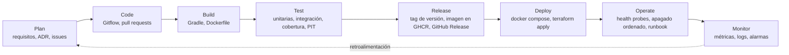

```mermaid
flowchart LR
    subgraph ci["ci.yml, cada pull request y push"]
        change(["Cambio"]) --> build["Build and test<br/>compilación, pruebas unitarias, umbral de cobertura"]
        change --> integ["Integration tests<br/>LocalStack y el Terraform real"]
        change --> tf["Validate Terraform<br/>fmt, validate, Checkov"]
        change --> img["Docker image<br/>build ARM64, verificación de arranque"]
        build & integ & tf & img --> green{"¿Todo en verde?"}
        green -->|"sí"| merge["Integrar en develop"]
    end
    subgraph rel["release.yml, tag de versión en main"]
        tag(["vX.Y.Z"]) --> verify["Verify<br/>tag en main, build"]
        verify --> publish["Publicar la imagen<br/>ghcr.io, amd64 y arm64"]
        publish --> ghrel["GitHub Release"]
    end
```

## 14. Infraestructura como código

Todos los entornos los crea Terraform, no *scripts*. En local el *provider* de AWS apunta a LocalStack; en AWS, `envs/prod` reutiliza los mismos módulos `data` y `messaging` y agrega los de red, cómputo, entrada, identidad y observabilidad (§16).

```text
infra/terraform/
├── bootstrap/           # una vez por cuenta: bucket del estado, registro ECR, rol de release con GitHub OIDC, presupuesto mensual
├── envs/local/          # entorno local: provider apuntando a LocalStack, tags por defecto
├── envs/prod/           # AWS: estado remoto en S3, todos los módulos de abajo
└── modules/
    ├── data/            # tablas DynamoDB: events, orders (+ GSI expiring-orders), order-history, idempotency (+ TTL)
    ├── messaging/       # colas SQS, cada una con su DLQ y su política de redrive
    ├── network/         # VPC, subredes públicas, gateway endpoint de DynamoDB, security groups
    ├── compute/         # ECS Fargate, roles IAM, autoscaling, Cloud Map
    ├── auth/            # Cognito
    ├── edge/            # API Gateway HTTP API
    └── observability/   # alarmas y su topic SNS
```

| Decisión | Detalle |
|---|---|
| Facturación bajo demanda | `PAY_PER_REQUEST`: se paga por uso, sin planear capacidad |
| Índice disperso y fragmentado | `expiring-orders` solo contiene las reservas y los pagos vivos, repartidos en 4 fragmentos para que un vencimiento masivo no sature una partición |
| Idempotencia con TTL nativo | DynamoDB borra las claves a las 24 h; la aplicación ignora las claves vencidas que aún no se han borrado |
| Colas de mensajes fallidos | `maxReceiveCount = 5`; retención de 4 días en la cola y de 14 en la DLQ; *redrive* permitido solo desde su propia cola |
| Cifrado | SSE-SQS en todas las colas; DynamoDB siempre cifra en reposo |
| Parámetros por entorno | `point_in_time_recovery`, `deletion_protection` y el *throughput* máximo bajo demanda son variables de los módulos: apagadas en local, encendidas en `envs/prod` |
| *Tags* por defecto | `project`, `env` y `managed-by` en todos los recursos |
| Estado | En local, un volumen de Docker que se reconcilia en cada ejecución; en AWS, un *bucket* S3 versionado y cifrado con bloqueo nativo (`use_lockfile`) |
| Verificaciones | `./gradlew terraformValidate` (formato y validación de todos los stacks) y `./gradlew terraformScan` (Checkov), igual que el CI |

## 15. Limitaciones conocidas

La solución no se presenta como perfecta. Estas son sus limitaciones conocidas, por qué existen y cómo se resolverían.

### 15.1 Consistencia y mensajería

| Limitación | Impacto | Solución |
|---|---|---|
| **Sin *transactional outbox*** (ADR 0019). Crear una orden escribe en DynamoDB y después publica en SQS, sin una transacción entre ambos | Si el proceso muere, o SQS falla después de los reintentos del SDK, entre las dos escrituras, la orden queda en `QUEUED` para siempre y sus entradas nunca se reservan. El cliente recibe el error, pero reintentar con la misma `Idempotency-Key` devuelve la orden atascada sin volver a publicar | *Transactional outbox*: solo se escribe la orden, y DynamoDB Streams (con EventBridge Pipes o Lambda) publica en SQS. Mientras tanto, un scheduler que vuelva a publicar las órdenes `QUEUED` antiguas (diseñado en el ADR 0015, no construido) |
| **Sin atributo `version`.** El bloqueo optimista se apoya en el estado esperado, no en un número de versión | Hoy es seguro, porque cada escritura cambia el estado. Si se agregara una actualización que conserve el estado (por ejemplo, editar una orden reservada), dos escritores podrían pisarse | Agregar `version` a la orden y a la condición de cada transacción |
| **Sin entidad por entrada.** El inventario son cinco contadores por evento | No se puede saber *qué* entrada tiene cada cliente; solo admite admisión general, no asientos numerados | Crear un ítem por entrada dentro de la transacción (hasta 100 ítems) |
| ***Hot partition*.** Todas las reservas de un evento escriben el mismo ítem | Techo teórico de unas 500 transiciones por segundo por evento; por encima, más `TransactionConflict` y reintentos | Contadores fragmentados por evento; la cola ya nivela los picos |
| **Verificación no atómica del inicio del evento.** El consumidor verifica que el evento no haya empezado y después escribe | Si el evento empieza en esos milisegundos, la reserva se hace (igual vence en 10 minutos). Confirmar después de que el evento empezó no se bloquea | Agregar el instante de inicio a la condición de la transacción, y la misma regla a la confirmación |
| **Índice de vencimientos con fechas en texto.** `expiresAt` es un texto ISO-8601 | El índice ordena con un margen menor a 1 s; el caso de uso vuelve a comprobar el instante exacto | Guardar un *epoch* numérico para el índice |
| **Cola de pagos sin uso.** Terraform crea la cola `payments` y su DLQ, que nadie usa desde el ADR 0022 | Infraestructura muerta | Quitarla de Terraform |

### 15.2 Seguridad (OWASP Top 10)

Organizada según el [OWASP Top 10 (2021)](https://owasp.org/Top10/).

| OWASP 2021 | Limitación | Solución en producción |
|---|---|---|
| [A01](https://owasp.org/Top10/A01_2021-Broken_Access_Control/) Pérdida de control de acceso | **Sin autenticación ni Spring Security.** `X-Customer-Id` es declarado y se puede suplantar: quien conozca el id de una orden y el de su cliente puede consultarla o confirmarla | Amazon Cognito + JWT validado por Spring Security (`oauth2-resource-server`); `customerId` tomado del *claim* `sub` |
| A01 Pérdida de control de acceso | **El *webhook* de pagos (`POST /orders/{id}/payment`) no está autenticado.** Cualquiera que conozca el id de una orden en `PENDING_CONFIRMATION` puede marcarla como pagada | Verificar la firma del proveedor (HMAC del cuerpo con un secreto en AWS Secrets Manager) y un *timestamp* para evitar repeticiones |
| A01 Pérdida de control de acceso | `POST /events` está abierto; las cortesías usan una clave compartida, no un rol, y no registran quién las emitió; una clave incorrecta responde `403` en lugar de `401` | Grupo `admin` de Cognito para todos los endpoints administrativos; autor y motivo guardados en el historial |
| [A04](https://owasp.org/Top10/A04_2021-Insecure_Design/) Diseño inseguro (abuso de recursos) | **Sin límite de peticiones.** El `WebFilter` diseñado ([*token bucket*](https://en.wikipedia.org/wiki/Token_bucket) por cliente, `429 RATE_LIMITED`, encabezados [`RateLimit-*`](https://datatracker.ietf.org/doc/draft-ietf-httpapi-ratelimit-headers/)) no se construyó; además, se podría evadir cambiando `X-Customer-Id` | Regla *rate-based* de AWS WAF por IP en el borde, más un límite por cliente con un contador compartido |
| A04 Diseño inseguro (abuso de recursos) | Sin límite de conexiones SSE por instancia, ni límite explícito del tamaño del cuerpo | Límite de conexiones con `503`; límite del *codec* de pocos KB con `413` |
| [A05](https://owasp.org/Top10/A05_2021-Security_Misconfiguration/) Configuración de seguridad incorrecta | Actuator (`/actuator/prometheus`) y Swagger UI están expuestos en el puerto de la API; `Strict-Transport-Security` se envía por HTTP plano porque en local no hay TLS; los campos JSON desconocidos se ignoran en lugar de rechazarse | Puerto de gestión separado y no público; TLS en CloudFront o en el balanceador; Swagger desactivado en producción; deserialización estricta |
| [A06](https://owasp.org/Top10/A06_2021-Vulnerable_and_Outdated_Components/) Componentes vulnerables | Algunas versiones de dependencias se fuerzan a mano; no hay escaneo automático de dependencias ni de imágenes | Dependabot, OWASP Dependency-Check o Trivy en el CI, y escaneo de imágenes en ECR |
| [A09](https://owasp.org/Top10/A09_2021-Security_Logging_and_Monitoring_Failures/) Fallas de registro y monitoreo | Logs de texto sin id de correlación; sin alarmas | Ver §15.3 |

### 15.3 Operación y observabilidad

| Limitación | Solución |
|---|---|
| **Sin logs estructurados.** Los logs son texto plano, sin `correlationId`, `orderId` ni `eventId`, y el id no se propaga de HTTP al mensaje SQS | Logs JSON ([*structured logging* de Spring Boot](https://docs.spring.io/spring-boot/reference/features/logging.html)) con un id de correlación que viaja en los atributos del mensaje SQS; una línea canónica por petición |
| Sin métricas de negocio (`orders.placed`, `orders.rejected{reason}`, `inventory.conflicts`…) ni alarmas | Contadores de Micrometer; alarmas de CloudWatch sobre la profundidad de la DLQ, la antigüedad del mensaje más viejo y la tasa de conflictos |
| La *readiness* no verifica DynamoDB ni SQS | *Health indicators* propios |
| Un solo desplegable con los tres roles siempre activos: la API y los *workers* no escalan por separado | Activar cada rol por configuración (`@ConditionalOnProperty`) y correr la misma imagen como servicios separados |
| Detener una instancia tarda hasta 10 s (el *listener* espera su *poll* abierto) | Costo aceptado del ADR 0021 |
| *Polling* del SSE: 1 lectura por segundo por evento observado y por instancia, aunque no haya cambios; hasta 1 s de retraso | DynamoDB Streams detrás del mismo puerto, sin tocar el caso de uso |
| `terraform apply` falla al agregar el índice a una tabla que ya existe (causa raíz todavía en hipótesis) | *Workaround*: `docker compose down --volumes`. El CI siempre parte de cero |

### 15.4 Alcance

- Solo se ejecuta el entorno local. El entorno de AWS es Terraform listo para aplicar (`envs/prod`), validado y escaneado en el CI pero no desplegado, así que todavía no se ha probado contra AWS real (§16).
- No hay listado de eventos (`GET /events`) ni cancelación de órdenes.
- Crear un evento no es idempotente: reintentar `POST /events` crea otro evento.
- El contrato de la API lo genera springdoc y se publica en Swagger UI; no hay un archivo OpenAPI escrito a mano.

## 16. Producción en AWS

El entorno productivo está escrito en Terraform (`infra/terraform/envs/prod`), se valida y se escanea en cada *pull request* y está listo para `terraform apply`. No queda encendido, para no generar un costo permanente; esta sección explica cómo se despliega, cuánto cuesta y por qué se tomó cada decisión.

Está diseñado para un **presupuesto pequeño con un techo de costo por construcción**: un evaluador, unos cientos de peticiones al día, y límites duros sobre lo que un abuso puede hacer consumir al *backend* ([§16.3](#163-seguridad-y-la-factura) explica el riesgo que queda). La [§16.7](#167-a-escala-qué-cambiaría) describe cómo evoluciona cuando llega tráfico real.

### 16.1 Arquitectura

```text
Cliente ──HTTPS──> API Gateway HTTP API ──VPC link──> AWS Cloud Map (SRV) ──> Servicio ECS Fargate (ARM64)
                   · JWT de Cognito                                            · 1 tarea (autoscaling hasta 2)
                   · throttling (10 rps, ráfaga 20)                            · subredes públicas, sin NAT Gateway
                   · X-Customer-Id = "sub" del token                           · security group: solo el VPC link
                                                                                      │
                        ┌──────────────────────────────┬──────────────────────────────┼──────────────────────┐
                        ▼                              ▼                              ▼                      ▼
               DynamoDB (bajo demanda,         SQS reservations + DLQ         CloudWatch Logs + alarmas  SSM Parameter Store
               throughput máximo, PITR,        (SSE-SQS)                      → correo por SNS           (clave de administración)
               gateway endpoint)
```

```mermaid
flowchart LR
    client(["Cliente"])
    cognito["Amazon Cognito<br/>user pool, sin registro público"]
    subgraph aws["Cuenta de AWS, us-east-1"]
        apigw["API Gateway HTTP API<br/>authorizer JWT, throttling<br/>X-Customer-Id = sub del token"]
        subgraph vpc["VPC, 2 zonas de disponibilidad"]
            link["VPC link"]
            map["AWS Cloud Map<br/>registros SRV"]
            ecs["ECS Fargate ARM64<br/>1 a 2 tareas, subredes públicas<br/>security group: solo el VPC link"]
        end
        ddb[("DynamoDB<br/>por un gateway endpoint")]
        sqs[["SQS reservations<br/>y su DLQ"]]
        ssm["SSM Parameter Store<br/>clave de administración"]
        cw["CloudWatch<br/>logs y alarmas"]
        sns["SNS<br/>alertas por correo"]
    end
    client -->|"inicia sesión"| cognito
    client -->|"HTTPS con el access token"| apigw
    apigw -.->|"valida el token"| cognito
    apigw --> link
    map -.->|"IP y puerto de las tareas sanas"| link
    link --> ecs
    ecs --> ddb
    ecs --> sqs
    ecs --> cw
    ssm -.->|"secreto inyectado al arrancar"| ecs
    cw --> sns
```

```text
infra/terraform/
├── bootstrap/        # una vez por cuenta: bucket del estado, registro ECR, rol de release con GitHub OIDC, presupuesto mensual
├── envs/local/       # LocalStack
├── envs/prod/        # AWS: compone todos los módulos de abajo
└── modules/
    ├── data/         # tablas DynamoDB (compartido con local)
    ├── messaging/    # colas SQS y DLQ (compartido con local)
    ├── network/      # VPC, 2 subredes públicas, gateway endpoint de DynamoDB, security groups encadenados
    ├── compute/      # clúster ECS, task definition, servicio, autoscaling, roles IAM, Cloud Map
    ├── auth/         # user pool de Cognito sin registro público
    ├── edge/         # HTTP API, VPC link, authorizer JWT, throttling, logs de acceso
    └── observability/# topic SNS y alarmas de CloudWatch
```

### 16.2 Decisiones y *trade-offs*

| Decisión | Por qué | *Trade-off* |
|---|---|---|
| **API Gateway HTTP API como única entrada**, sin balanceador | Sin costo fijo (se paga por petición); HTTPS en el *endpoint* por defecto con certificado de AWS, validación de JWT y *throttling* incluidos | [AWS WAF no protege HTTP APIs](https://docs.aws.amazon.com/waf/latest/developerguide/waf-chapter.html) (solo REST APIs, CloudFront y ALB). El [*timeout* máximo de integración es de 30 s](https://docs.aws.amazon.com/apigateway/latest/developerguide/http-api-quotas.html), así que el *stream* SSE se corta cada 30 s y `EventSource` se reconecta solo |
| **VPC link + AWS Cloud Map en lugar de un ALB** | API Gateway llega directo a las tareas privadas; ECS registra [registros SRV](https://docs.aws.amazon.com/apigateway/latest/developerguide/http-api-develop-integrations-private.html) (IP y puerto), y solo reciben tráfico las tareas cuyo *health check* pasa. Ahorra un balanceador (unos USD 16–20 al mes) | Sin *health checks* ni *connection draining* de un balanceador; los cubren el *health check* del contenedor y el apagado ordenado (ADR 0021) |
| **Subredes públicas sin NAT Gateway** | Un NAT Gateway cuesta [USD 0,045 por hora más los datos](https://aws.amazon.com/vpc/pricing/) (unos USD 33 al mes), más que todo el resto del entorno. DynamoDB va por un [*gateway endpoint*, que no tiene cargo](https://aws.amazon.com/vpc/pricing/) | La tarea tiene una IP pública ([USD 0,005 por hora](https://aws.amazon.com/vpc/pricing/)) para llegar a ECR, SQS y CloudWatch. Su *security group* solo acepta tráfico del VPC link, así que nadie en internet puede abrirle una conexión. A escala: subredes privadas (§16.7) |
| **Cognito + *authorizer* JWT, identidad tomada del token** | API Gateway valida el [*access token*](https://docs.aws.amazon.com/apigateway/latest/developerguide/http-api-jwt-authorizer.html) y [sobrescribe `X-Customer-Id`](https://docs.aws.amazon.com/apigateway/latest/developerguide/http-api-parameter-mapping.html) con su *claim* `sub`. La aplicación no cambia, y en AWS desaparece el riesgo de suplantación de la identidad declarada (ADR 0017). La ruta exige el *scope* `aws.cognito.signin.user.admin`, que [solo traen los *access tokens*](https://docs.aws.amazon.com/cognito/latest/developerguide/amazon-cognito-user-pools-using-the-access-token.html), como recomienda API Gateway | La aplicación confía en el encabezado, así que solo debe ser alcanzable a través del *gateway*: lo garantiza el *security group*. Sin registro público: los usuarios los crea un administrador. [Gratis hasta 10.000 usuarios activos al mes](https://aws.amazon.com/cognito/pricing/) |
| **Fargate ARM64, 0,25 vCPU y 1 GB, una tarea** | Graviton es [cerca de un 20 % más barato que x86](https://aws.amazon.com/fargate/pricing/) y la imagen ya se construye para ARM64 en Apple silicon. *Autoscaling* por CPU, con máximo 2 tareas como techo de costo | La JVM arranca lento (`startPeriod` de 120 s en el *health check*); sin margen para carga real |
| **DynamoDB bajo demanda con [*throughput* máximo](https://docs.aws.amazon.com/amazondynamodb/latest/developerguide/on-demand-capacity-mode-max-throughput.html)**, PITR y protección contra borrado | Se paga por petición, con un techo: las peticiones por encima de 100 lecturas o 50 escrituras por segundo por tabla se limitan en lugar de cobrarse. Los mismos módulos que en local, con respaldos y protección contra borrado | El techo se aplica en la medida de lo posible (*best effort*). `deletion_protection` (tablas y *user pool*) hay que ponerlo en `false` a propósito antes de `terraform destroy` |
| **Secretos fuera de Terraform** | La clave de administración es un parámetro SecureString creado con la AWS CLI; ECS [lo inyecta al arrancar la tarea](https://docs.aws.amazon.com/AmazonECS/latest/developerguide/secrets-envvar-ssm-paramstore.html). Los usuarios y sus contraseñas también se crean con la CLI. Ningún secreto llega al código ni al estado de Terraform | Dos pasos manuales antes del primer despliegue. Los parámetros estándar de Parameter Store no tienen cargo |
| **IAM de mínimo privilegio** | El rol de la tarea solo permite las llamadas que hace el código (`GetItem`, `PutItem`, `UpdateItem`, `Query`; `SendMessage`, `ReceiveMessage`, `DeleteMessage`) sobre sus propias tablas y cola. Una [transacción solo necesita los permisos de sus ítems](https://docs.aws.amazon.com/amazondynamodb/latest/developerguide/transaction-apis-iam.html), así que no hay `DeleteItem` ni `Scan`. El rol de ejecución solo lee su propio parámetro | Cualquier operación nueva en el código exige cambiar la política |
| **Contenedor endurecido** | Usuario sin privilegios, sistema de archivos raíz de solo lectura con `/tmp` como única ruta escribible (probado en local contra LocalStack), *tags* de imagen inmutables y escaneo de cada imagen al subirla | — |
| **Estado remoto en S3 con bloqueo nativo** | *Bucket* versionado, cifrado, privado y solo por TLS; bloqueo con [`use_lockfile`](https://developer.hashicorp.com/terraform/language/backend/s3), porque el bloqueo con DynamoDB está obsoleto | El stack `bootstrap` tiene estado local: crea el *bucket* que lo guardaría |
| **Aislamiento de entornos** | `local` y `prod` usan los mismos módulos `data` y `messaging` con su propio estado, prefijo de nombres y *tags* | Una sola cuenta de AWS para todo. En producción: una cuenta por entorno con AWS Organizations |

### 16.3 Seguridad y la factura

Una API pública se puede abusar para inflar la factura. Los controles van en capas, desde los límites duros hasta la detección:

| Capa | Control | Efecto |
|---|---|---|
| Entrada | *Throttling* de 10 peticiones por segundo (ráfaga 20) en el *stage*; JWT obligatorio en todas las rutas; solo se publica `/api/*` (el *actuator* queda privado) | Acota lo que llega a las tareas y a DynamoDB. API Gateway aplica el *throttling* [en la medida de lo posible](https://docs.aws.amazon.com/apigateway/latest/developerguide/http-api-throttling.html) |
| *Backend* | Máximo 2 tareas; *throughput* máximo por tabla en DynamoDB | El *backend* no puede crecer, así que rechaza en lugar de cobrar |
| Detección | Alarma sobre el conteo de peticiones de la API (más de 2.000 en 5 minutos), más 5xx, mensajes en la DLQ, edad de la cola y CPU, enviadas por correo | Minutos, no horas |
| Última línea | Presupuesto mensual con alertas al 50, 80 y 100 % y una alerta por pronóstico | Budgets se actualiza unas pocas veces al día: es un respaldo |
| Respuesta | *Kill switch* por variables: `desired_count=0` detiene todas las tareas; `throttling_rate_limit=0` y `throttling_burst_limit=0` deberían rechazar todas las peticiones en el *gateway* (la [referencia de la API](https://docs.aws.amazon.com/apigatewayv2/latest/api-reference/apis-apiid-stages.html) no documenta un mínimo, así que hay que confirmarlo en el primer despliegue) | Reversible con un `terraform apply` |

**Riesgo residual, dicho con honestidad:** la [página de precios de API Gateway](https://aws.amazon.com/api-gateway/pricing/) no dice si se cobran las peticiones rechazadas por el *authorizer* o por el *throttling*. Un ataque volumétrico podría entonces seguir costando dinero en la entrada, a cerca de USD 1 por millón de peticiones. La alarma de conteo y el *kill switch* limitan cuánto dura. Shield Advanced agregaría protección de costos, pero está muy por fuera de este presupuesto.

### 16.4 Costo

Precios de `us-east-1`, revisados en las páginas oficiales de precios; hay que confirmarlos con la [AWS Pricing Calculator](https://calculator.aws/) antes de desplegar:

| Recurso | Costo mensual, encendido 24/7 | Fuente |
|---|---|---|
| Fargate ARM64, 0,25 vCPU y 1 GB | USD 8,51 | [Precios de Fargate](https://aws.amazon.com/fargate/pricing/): USD 0,03238 por vCPU-hora, 0,00356 por GB-hora |
| IPv4 pública de la tarea | USD 3,65 | [Precios de VPC](https://aws.amazon.com/vpc/pricing/): USD 0,005 por hora |
| Zona privada de Route 53 (Cloud Map) y la tarea registrada | USD 0,60 | [Route 53](https://aws.amazon.com/route53/pricing/): USD 0,50; [Cloud Map](https://aws.amazon.com/cloud-map/pricing/): USD 0,10 |
| API Gateway, DynamoDB, SQS, Cognito, CloudWatch, ECR, S3 | Cerca de USD 1 con el tráfico de una evaluación | Pago por uso; las 5 alarmas están dentro de las 10 gratuitas; Cognito es gratis hasta 10.000 usuarios |
| **Total** | **Cerca de USD 14 al mes** | Con `desired_count=0`, cerca de USD 1,60 |

El diseño a escala de la §16.7 cuesta cerca de USD 85 al mes: más de la mitad es costo fijo de red (NAT Gateway y balanceador). El diseño ajustado cambia WAF y las subredes privadas por una sexta parte de ese costo, y documenta el riesgo que queda.

### 16.5 Release, deploy, operate y monitor

**Release.** El *workflow* de *release* (§13) publica cada versión en GitHub Packages para amd64 y arm64. Un despliegue en AWS copiaría esa imagen a ECR con un *tag* de versión inmutable: el stack `bootstrap` ya crea el rol para eso, que usa [OIDC en lugar de llaves de larga duración](https://docs.github.com/en/actions/how-tos/secure-your-work/security-harden-deployments/oidc-in-aws). Solo el entorno `release` de este repositorio puede asumirlo, y solo puede subir imágenes; cambiar la infraestructura sigue siendo un `terraform apply` revisado. Ese paso de CD no está implementado, porque nada corre en AWS.

**Deploy** (una vez por cuenta, y después un *apply* por versión):

```bash
# 1. Guardrails de la cuenta: bucket del estado, registro, rol de release, presupuesto (estado local)
cd infra/terraform/bootstrap
terraform init && terraform apply -var alert_email=tu@correo.com

# 2. Clave de administración: se crea fuera de Terraform, así nunca llega al estado
aws ssm put-parameter --name /prod-ticketing/admin-api-key --type SecureString --value "$(openssl rand -hex 32)"

# 3. Release: construir para ARM64 y subir un tag inmutable
aws ecr get-login-password | docker login --username AWS --password-stdin <ecr_repository_url>
docker buildx build --platform linux/arm64 -f deployment/Dockerfile -t <ecr_repository_url>:1.0.0 --push .

# 4. Entorno: estado remoto con el output del bootstrap, y después apply
cd ../envs/prod
cp backend.hcl.example backend.hcl   # poner el output state_bucket
terraform init -backend-config=backend.hcl
terraform apply -var container_image=<ecr_repository_url>:1.0.0 -var alert_email=tu@correo.com

# 5. El usuario del evaluador, creado por un administrador
aws cognito-idp admin-create-user --user-pool-id <user_pool_id> --username evaluator --message-action SUPPRESS
aws cognito-idp admin-set-user-password --user-pool-id <user_pool_id> --username evaluator --password '<contraseña>' --permanent
```

Cada versión nueva es un `terraform apply -var container_image=<url>:<versión>`. ECS arranca la tarea nueva junto a la anterior, y el [*deployment circuit breaker*](https://docs.aws.amazon.com/AmazonECS/latest/developerguide/deployment-circuit-breaker.html) revierte solo si la versión nueva nunca queda sana.

**Usar la API:**

```bash
TOKEN=$(aws cognito-idp initiate-auth --auth-flow USER_PASSWORD_AUTH --client-id <client_id> \
  --auth-parameters USERNAME=evaluator,PASSWORD='<contraseña>' --query AuthenticationResult.AccessToken --output text)
curl -H "Authorization: Bearer $TOKEN" <api_endpoint>/api/v1/events/<id>/availability
```

**Operate (*runbook*):**

| Situación | Acción |
|---|---|
| Detener la aplicación y conservar los datos | `terraform apply -var desired_count=0` (se vuelve a encender con `1`) |
| Sospecha de abuso | `terraform apply -var throttling_rate_limit=0 -var throttling_burst_limit=0`: todas las peticiones se rechazan en el *gateway* |
| Rotar la clave de administración | `aws ssm put-parameter --overwrite ...` y después `aws ecs update-service --force-new-deployment` (ECS lee los secretos al arrancar la tarea) |
| Mensajes en la DLQ | Revisarlos, corregir la causa y devolverlos con el *redrive* de SQS (permitido solo hacia su propia cola) |
| Eliminar todo | `terraform apply -var deletion_protection=false` y después `terraform destroy` |

**Monitor.** Logs de la aplicación y logs de acceso de la API en CloudWatch (14 días; los de acceso en JSON, con el ID de la petición, el estado, la latencia y el error del *authorizer*), y cinco alarmas por correo: conteo de peticiones, 5xx, mensajes en la DLQ, edad del mensaje más viejo y CPU. Container Insights queda apagado: agrega métricas personalizadas con costo, y las alarmas usan las métricas gratuitas de `AWS/ECS`.

### 16.6 Análisis estático

[Checkov](https://www.checkov.io/) escanea el código de Terraform en el CI (`./gradlew terraformScan` en local), con la imagen fijada por *digest*. Resultado: **125 controles aprobados, 0 fallidos y 19 omitidos**. Cada control omitido está escrito dentro de su recurso con la razón, así que un hallazgo nuevo rompe el *build*:

- **Llaves KMS propias** (DynamoDB, CloudWatch Logs, S3, ECR): todos los servicios ya cifran en reposo con llaves de AWS; una llave propia cuesta y solo hace falta por cumplimiento normativo.
- **Retención, Container Insights, *flow logs*, logs de acceso y réplica del *bucket* del estado:** extras con costo, sin un requisito a esta escala.
- **IP pública de las tareas y *topic* SNS sin cifrar:** las decisiones de la §16.2; las alarmas de CloudWatch [no pueden publicar en un *topic* cifrado con la llave administrada por AWS](https://repost.aws/knowledge-center/cloudwatch-configure-alarm-sns).
- ***Security groups* "sin asociar":** falso positivo; se asocian en otros módulos.

### 16.7 A escala: qué cambiaría

| Área | Diseño ajustado (implementado) | Con tráfico real |
|---|---|---|
| Entrada | HTTP API con *throttling* | CloudFront + AWS WAF (reglas administradas, límites por IP) delante de un Application Load Balancer, o una REST API de API Gateway con WAF y *usage plans* |
| Red | Subredes públicas, sin NAT | Subredes privadas con NAT Gateway o *interface endpoints*; tareas sin IP pública |
| Cómputo | Un servicio con todos los roles | API y *workers* como servicios separados, escalados por peticiones y por profundidad de la cola |
| Cuentas | Una cuenta | AWS Organizations: una cuenta por entorno, con *service control policies* |
| Entrega | *Apply* manual | GitHub Actions con OIDC: `terraform plan` en los *pull requests*, *apply* con aprobación, *release* con los *tags* de versión |
| Observabilidad | Logs y alarmas | Logs JSON con `correlationId`, métricas de negocio, trazas con X-Ray, *dashboards* |
| Datos y mensajería | Escritura doble | *Transactional outbox* y SSE alimentado por DynamoDB Streams |
| Identidad | Un usuario, validación en el *gateway* | Grupos (`admin`) verificados por la aplicación con Spring Security |

## 17. Hoja de ruta

En orden de prioridad:

1. Autenticar el *webhook* de pagos con la firma del proveedor.
2. Límite de peticiones (`WebFilter` con *token bucket*) y proteger `POST /events` con el acceso de administración.
3. Logs JSON estructurados con `correlationId` de HTTP a SQS, y métricas de negocio.
4. Reencolado de las órdenes `QUEUED` antiguas y, después, un *transactional outbox*.
5. Spring Security con JWT (Cognito) y un rol `admin`.
6. Atributo `version` en las condiciones, además del estado.
7. *Pipeline* de CD para AWS: subir la imagen del *release* a ECR con el rol OIDC de `bootstrap`, `terraform plan` en los *pull requests* y *apply* con aprobación.
8. PIT en el CI con un umbral de mutación; escaneo de dependencias.
9. *Tags* de versión y un *changelog* por cada *release*.

## 18. Estructura del proyecto

```text
.
├── applications/app-service/      # Arranque y ensamblaje de Spring Boot; prueba de integración (src/integrationTest)
├── domain/
│   ├── model/                     # Entidades, estados de la orden (tipos sellados), excepciones y puertos
│   └── usecase/                   # Un caso de uso por acción
├── infrastructure/
│   ├── driven-adapters/
│   │   ├── dynamo-db/             # Adaptadores de DynamoDB, transacciones y fuente de polling del SSE
│   │   └── sqs-sender/            # Publicador de ORDER_PLACED
│   ├── entry-points/
│   │   ├── reactive-web/          # Rutas, handlers, errores, encabezados de seguridad, CORS
│   │   ├── sqs-listener/          # Consumidor SQS reactivo con apagado ordenado
│   │   └── scheduler/             # Tarea de vencimientos
│   └── helpers/metrics/           # Métricas del SDK de AWS en Micrometer
├── infra/terraform/               # Infraestructura como código: bootstrap, envs/local, envs/prod y sus módulos
├── deployment/Dockerfile          # Imagen multi-stage, usuario sin privilegios
├── postman/                       # Colección de Postman con aserciones
├── .github/workflows/ci.yml       # Integración continua
└── docker-compose.yml             # LocalStack → Terraform → aplicación
```

## 19. Licencia y autor

Publicado bajo la [licencia MIT](LICENSE). La estructura del proyecto se generó con el plugin [scaffold-clean-architecture](https://github.com/bancolombia/scaffold-clean-architecture) de Bancolombia, distribuido bajo la [licencia Apache 2.0](https://github.com/bancolombia/scaffold-clean-architecture/blob/master/LICENSE).

Construido por **Mateo** ([@whymvm](https://github.com/whymvm)).

## 20. Referencias

**Arquitectura**
- Bancolombia, [scaffold-clean-architecture](https://github.com/bancolombia/scaffold-clean-architecture) y su [documentación](https://bancolombia.github.io/scaffold-clean-architecture/docs/intro).
- Bancolombia Tech, [Clean Architecture — Aislando los detalles](https://medium.com/bancolombia-tech/clean-architecture-aislando-los-detalles-4f9530f35d7a).
- Robert C. Martin, [The Clean Architecture](https://blog.cleancoder.com/uncle-bob/2012/08/13/the-clean-architecture.html).
- Michael Nygard, [Documenting Architecture Decisions](https://cognitect.com/blog/2011/11/15/documenting-architecture-decisions).
- Enterprise Integration Patterns, [Claim Check](https://www.enterpriseintegrationpatterns.com/patterns/messaging/StoreInLibrary.html); microservices.io, [Transactional outbox](https://microservices.io/patterns/data/transactional-outbox.html).

**AWS**
- Amazon DynamoDB: [expresiones de condición](https://docs.aws.amazon.com/amazondynamodb/latest/developerguide/Expressions.ConditionExpressions.html), [transacciones](https://docs.aws.amazon.com/amazondynamodb/latest/developerguide/transaction-apis.html), [consistencia de lectura](https://docs.aws.amazon.com/amazondynamodb/latest/developerguide/HowItWorks.ReadConsistency.html), [diseño de la clave de partición](https://docs.aws.amazon.com/amazondynamodb/latest/developerguide/bp-partition-key-design.html), [índices dispersos](https://docs.aws.amazon.com/amazondynamodb/latest/developerguide/bp-indexes-general-sparse-indexes.html), [TTL](https://docs.aws.amazon.com/amazondynamodb/latest/developerguide/TTL.html), [Streams](https://docs.aws.amazon.com/amazondynamodb/latest/developerguide/Streams.html).
- Amazon SQS: [colas estándar](https://docs.aws.amazon.com/AWSSimpleQueueService/latest/SQSDeveloperGuide/standard-queues.html), [*visibility timeout*](https://docs.aws.amazon.com/AWSSimpleQueueService/latest/SQSDeveloperGuide/sqs-visibility-timeout.html), [*long polling*](https://docs.aws.amazon.com/AWSSimpleQueueService/latest/SQSDeveloperGuide/sqs-short-and-long-polling.html), [colas de mensajes fallidos](https://docs.aws.amazon.com/AWSSimpleQueueService/latest/SQSDeveloperGuide/sqs-dead-letter-queues.html).
- AWS Architecture Blog, [Exponential Backoff And Jitter](https://aws.amazon.com/blogs/architecture/exponential-backoff-and-jitter/).
- Amazon API Gateway (HTTP APIs): [integraciones privadas](https://docs.aws.amazon.com/apigateway/latest/developerguide/http-api-develop-integrations-private.html), [*authorizers* JWT](https://docs.aws.amazon.com/apigateway/latest/developerguide/http-api-jwt-authorizer.html), [*parameter mapping*](https://docs.aws.amazon.com/apigateway/latest/developerguide/http-api-parameter-mapping.html), [*throttling*](https://docs.aws.amazon.com/apigateway/latest/developerguide/http-api-throttling.html), [cuotas](https://docs.aws.amazon.com/apigateway/latest/developerguide/http-api-quotas.html), [precios](https://aws.amazon.com/api-gateway/pricing/).
- Amazon ECS: [*deployment circuit breaker*](https://docs.aws.amazon.com/AmazonECS/latest/developerguide/deployment-circuit-breaker.html), [*service discovery*](https://docs.aws.amazon.com/AmazonECS/latest/developerguide/service-discovery.html), [rol de ejecución de tareas](https://docs.aws.amazon.com/AmazonECS/latest/developerguide/task_execution_IAM_role.html), [secretos desde Parameter Store](https://docs.aws.amazon.com/AmazonECS/latest/developerguide/secrets-envvar-ssm-paramstore.html), [parámetros de la *task definition*](https://docs.aws.amazon.com/AmazonECS/latest/developerguide/task_definition_parameters.html); [precios de Fargate](https://aws.amazon.com/fargate/pricing/).
- Amazon Cognito: [*access tokens*](https://docs.aws.amazon.com/cognito/latest/developerguide/amazon-cognito-user-pools-using-the-access-token.html), [precios](https://aws.amazon.com/cognito/pricing/).
- DynamoDB: [*throughput* máximo en tablas bajo demanda](https://docs.aws.amazon.com/amazondynamodb/latest/developerguide/on-demand-capacity-mode-max-throughput.html) e [IAM para transacciones](https://docs.aws.amazon.com/amazondynamodb/latest/developerguide/transaction-apis-iam.html); [precios de VPC](https://aws.amazon.com/vpc/pricing/); [precios de Route 53](https://aws.amazon.com/route53/pricing/); [precios de AWS Cloud Map](https://aws.amazon.com/cloud-map/pricing/); [recursos que protege AWS WAF](https://docs.aws.amazon.com/waf/latest/developerguide/waf-chapter.html); AWS re:Post, [alarma de CloudWatch con un *topic* SNS cifrado](https://repost.aws/knowledge-center/cloudwatch-configure-alarm-sns).

**Terraform y cadena de suministro**
- HashiCorp, [*backend* S3 y `use_lockfile`](https://developer.hashicorp.com/terraform/language/backend/s3); [*provider* de AWS](https://registry.terraform.io/providers/hashicorp/aws/latest/docs).
- GitHub, [OpenID Connect en AWS](https://docs.github.com/en/actions/how-tos/secure-your-work/security-harden-deployments/oidc-in-aws).
- [Checkov](https://www.checkov.io/), análisis estático de infraestructura como código.

**Estándares y seguridad**
- [RFC 9110](https://www.rfc-editor.org/rfc/rfc9110) (semántica HTTP), [RFC 9457](https://www.rfc-editor.org/rfc/rfc9457) (*problem details*), borradores de la IETF de los encabezados [`Idempotency-Key`](https://datatracker.ietf.org/doc/draft-ietf-httpapi-idempotency-key-header/) y [`RateLimit`](https://datatracker.ietf.org/doc/draft-ietf-httpapi-ratelimit-headers/), [Server-Sent Events](https://html.spec.whatwg.org/multipage/server-sent-events.html).
- [OWASP Top 10 (2021)](https://owasp.org/Top10/), [HTTP Headers Cheat Sheet](https://cheatsheetseries.owasp.org/cheatsheets/HTTP_Headers_Cheat_Sheet.html), [IDOR Prevention Cheat Sheet](https://cheatsheetseries.owasp.org/cheatsheets/Insecure_Direct_Object_Reference_Prevention_Cheat_Sheet.html).
- GitHub, [Security hardening for GitHub Actions](https://docs.github.com/en/actions/security-for-github-actions/security-guides/security-hardening-for-github-actions).

**Java y Spring**
- JEP: [395 Records](https://openjdk.org/jeps/395), [409 Sealed Classes](https://openjdk.org/jeps/409), [441 Pattern Matching for switch](https://openjdk.org/jeps/441), [444 Virtual Threads](https://openjdk.org/jeps/444), [456 Unnamed Variables](https://openjdk.org/jeps/456).
- Spring: [WebFlux](https://docs.spring.io/spring-framework/reference/web/webflux.html), [apagado ordenado](https://docs.spring.io/spring-boot/reference/web/graceful-shutdown.html), [tareas programadas](https://docs.spring.io/spring-framework/reference/integration/scheduling.html), [endpoints de Actuator](https://docs.spring.io/spring-boot/reference/actuator/endpoints.html), [logging](https://docs.spring.io/spring-boot/reference/features/logging.html).
