# Ticketing Platform

**English** · [Español](README.es.md)

[](https://github.com/whymvm/ticketing-platform/actions/workflows/ci.yml)


[](LICENSE)

A reactive, event-driven backend for selling event tickets (concerts, theater, sports) that **never sells more tickets than an event has**, even when thousands of customers buy at the same time.

The API accepts a purchase, stores it and answers `202 Accepted` right away. An SQS consumer reserves the tickets later, with an atomic conditional write in DynamoDB. Reservations expire after 10 minutes, payments after 5, and a scheduler gives the tickets back to the inventory. Availability can be read once or followed in real time with [Server-Sent Events](https://html.spec.whatwg.org/multipage/server-sent-events.html).

Everything runs locally with one command: `docker compose up`.

## Table of contents

1. [The problem and how it is solved](#1-the-problem-and-how-it-is-solved)
2. [Features](#2-features)
3. [Tech stack](#3-tech-stack)
4. [Getting started](#4-getting-started)
5. [Configuration](#5-configuration)
6. [Usage: main endpoints](#6-usage-main-endpoints)
7. [Architecture](#7-architecture)
8. [Main flows](#8-main-flows)
9. [Architecture decisions](#9-architecture-decisions)
10. [Concurrency and consistency](#10-concurrency-and-consistency)
11. [Security](#11-security)
12. [Testing and quality](#12-testing-and-quality)
13. [DevOps lifecycle](#13-devops-lifecycle)
14. [Infrastructure as code](#14-infrastructure-as-code)
15. [Known limitations](#15-known-limitations)
16. [Production on AWS](#16-production-on-aws)
17. [Roadmap](#17-roadmap)
18. [Project structure](#18-project-structure)
19. [License and author](#19-license-and-author)
20. [References](#20-references)

## 1. The problem and how it is solved

When tickets for a popular event go on sale, thousands of people try to buy at the same time. A traditional system then sells the same seat to several people, creates duplicate purchases and times out.

| Problem | Mechanism that solves it |
|---|---|
| Overselling | Atomic conditional writes on the event inventory (`available >= n`) inside a DynamoDB transaction |
| Duplicate purchases | Mandatory [`Idempotency-Key`](https://datatracker.ietf.org/doc/draft-ietf-httpapi-idempotency-key-header/) on `POST /orders`, stored in the same transaction as the order; idempotent consumers, because [SQS delivers at least once](https://docs.aws.amazon.com/AWSSimpleQueueService/latest/SQSDeveloperGuide/standard-queues.html) |
| Timeouts under load | Non-blocking API (WebFlux) that only validates, stores, enqueues and answers `202`. The queue levels the load on the database |

## 2. Features

| Feature | Implementation |
|---|---|
| Event management | `POST /events` and `GET /events/{id}`, with the inventory of each event |
| Temporary reservation (10 minutes at most) | The consumer reserves the tickets with `expiresAt = now + 10 min` |
| Asynchronous purchase processing | `POST /orders` answers `202` with the order id; an SQS consumer checks the real availability and reserves or rejects |
| Order status | `GET /orders/{id}` returns the order status and the status of its tickets (`ticketStatus`, one of the five ticket states) |
| Concurrency control | Conditional writes and transactions in DynamoDB, verified by an automated concurrency test |
| Automatic release of expired reservations | A reactive scheduler every 30 s, over a sparse and sharded index |
| Real-time availability | `GET /events/{id}/availability` and an SSE stream with one shared source per event |
| Confirmation and payment (`PENDING_CONFIRMATION`) | `POST /orders/{id}/confirm`, and the payment provider notifies the result with `POST /orders/{id}/payment` |
| Complimentary tickets (`COMPLIMENTARY`) | `POST /events/{id}/complimentary`, protected with an admin key, in one conditional transaction |
| Auditable transitions | `GET /orders/{id}/history`: each transition writes its entry in the same transaction as the change |

### Ticket and order states

Tickets have exactly five states. Each event counts how many tickets are in each state, and the five counters always add up to the capacity.

| Ticket state | Holds inventory | Is a sale | Counts for accounting | Final |
|---|---|---|---|---|
| `AVAILABLE` | No | No | No | No |
| `RESERVED` | Yes, temporarily | No | No | No |
| `PENDING_CONFIRMATION` | Yes, temporarily | No | No | No |
| `SOLD` | Yes | Yes | **Yes** | **Yes, irreversible** |
| `COMPLIMENTARY` | Yes | No | **No** | **Yes** |

An order has its own life cycle, because asynchrony needs three more states: `QUEUED` (waiting in the queue, no tickets yet), `REJECTED` and `EXPIRED`.

| Order state | Ticket state | How the order gets there |
|---|---|---|
| `QUEUED` | — | `POST /orders` |
| `RESERVED` | `RESERVED` | The consumer found enough tickets |
| `PENDING_CONFIRMATION` | `PENDING_CONFIRMATION` | The customer confirmed before the reservation expired |
| `SOLD` | `SOLD` | The provider approved the payment |
| `COMPLIMENTARY` | `COMPLIMENTARY` | An administrator issued complimentary tickets |
| `REJECTED` | `AVAILABLE` (or never held) | No tickets left (`SOLD_OUT`), the event already started (`EVENT_CLOSED`) or the payment was declined (`PAYMENT_DECLINED`) |
| `EXPIRED` | `AVAILABLE` | The reservation (10 min) or the payment (5 min) timed out |

`SOLD` and `COMPLIMENTARY` have no way out: in the code each order state is a sealed type that only has its valid transitions, so reverting a sale **does not compile**.

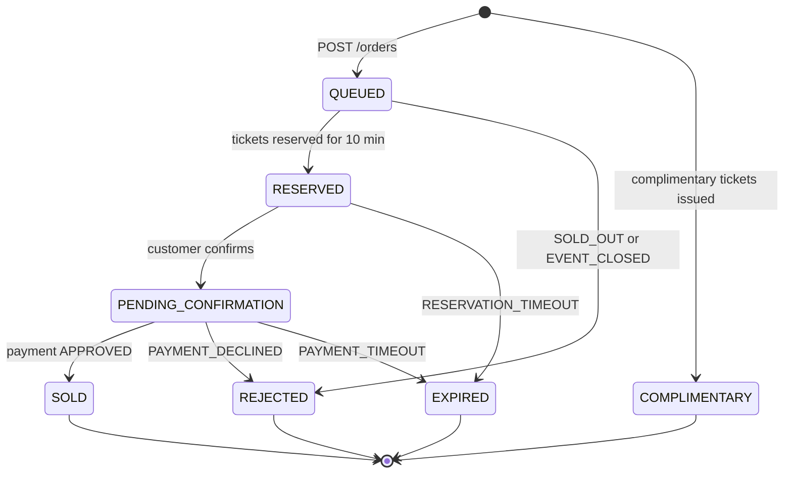

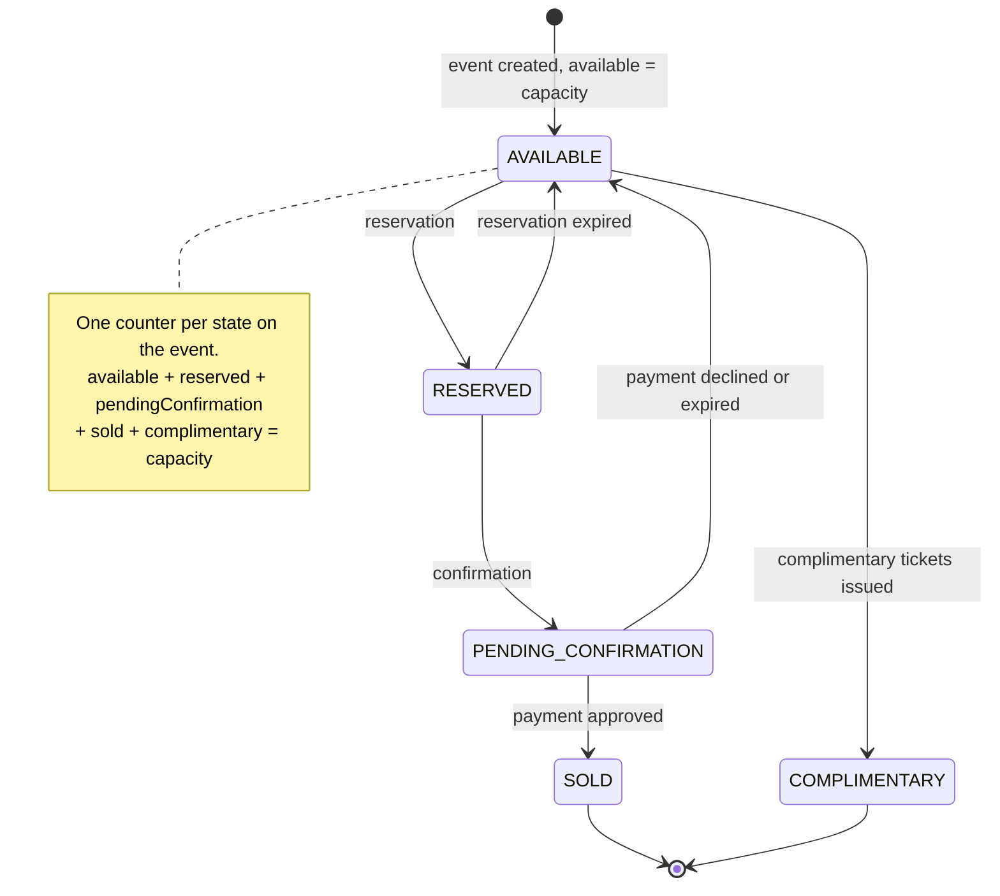

## 3. Tech stack

| Area | Technology |
|---|---|
| Language | Java 25 ([records](https://openjdk.org/jeps/395), [sealed interfaces](https://openjdk.org/jeps/409), [pattern matching in `switch`](https://openjdk.org/jeps/441), [unnamed variables `_`](https://openjdk.org/jeps/456)) |
| Framework | Spring Boot 4.1.1, [Spring WebFlux](https://docs.spring.io/spring-framework/reference/web/webflux.html) (functional routes), [Project Reactor](https://github.com/reactor/reactor-core) |
| Persistence | Amazon DynamoDB (AWS SDK v2, asynchronous enhanced client) |
| Messaging | Amazon SQS, standard queue with a dead-letter queue |
| Local cloud | LocalStack 4.14.0 (DynamoDB and SQS) |
| Infrastructure as code | Terraform 1.16.3 with the AWS provider pointing at LocalStack |
| Containers | Docker ([multi-stage build](https://docs.docker.com/build/building/multi-stage/), non-root user) and Docker Compose |
| Architecture | Clean Architecture, generated with the Bancolombia scaffold plugin 4.7.2 |
| Testing | JUnit 5, Mockito, reactor-test (`StepVerifier`), `WebTestClient`, [BlockHound](https://github.com/reactor/BlockHound), [ArchUnit](https://www.archunit.org/), [Testcontainers](https://java.testcontainers.org/modules/localstack/), [PIT](https://pitest.org/), [JaCoCo](https://www.jacoco.org/jacoco/) |
| API tests | Postman collection run with Newman |
| CI | GitHub Actions |
| Observability | Spring Boot Actuator, Micrometer and Prometheus |
| API documentation | [springdoc](https://springdoc.org/) (Swagger UI) |

[Virtual threads](https://openjdk.org/jeps/444) are **not** used on purpose: WebFlux and the asynchronous AWS SDK are already non-blocking, and mixing both models adds complexity without benefit (ADR 0011).

## 4. Getting started

### Prerequisites

| Tool | Needed for |
|---|---|
| Docker with Docker Compose v2 | Running the whole system. **It is the only requirement**: the application is compiled inside Docker, and no AWS account is needed |
| Java 25 | Only to compile and run the tests outside Docker |
| Node.js 22 (`npx`) | Only to run the Postman collection with Newman |

### Run with Docker

```bash
git clone https://github.com/whymvm/ticketing-platform.git
cd ticketing-platform
docker compose up --build
```

Compose starts three services in order:

1. **`localstack`**: emulates DynamoDB and SQS on port `4566`.
2. **`terraform`**: when LocalStack is healthy, it creates the tables, the index and the queues, and then exits.
3. **`app`**: when Terraform finished successfully, the application starts on port `8080`.

The first start takes a few minutes (building the image and creating the queues). The application is ready when its health check answers `UP`:

```bash
curl http://localhost:8080/actuator/health/readiness
# {"status":"UP"}
```

Other useful commands:

```bash
docker compose logs -f app     # application logs
docker compose down            # stop, keeping the volumes
docker compose down --volumes  # stop and reset everything (Terraform state included)
```

### Gradle shortcuts

The same steps are available as Gradle tasks (`./gradlew tasks --group ticketing`):

| Command | What it does |
|---|---|
| `./gradlew build` | Compiles, runs every unit test and **fails if line coverage drops below 90 %** |
| `./gradlew coverage` | Generates the coverage report of the whole project |
| `./gradlew integrationTest` | Concurrency test against LocalStack with the real Terraform (Testcontainers, about 2 minutes) |
| `./gradlew mutationTest` | Mutation tests (PIT); slow |
| `./gradlew localUp` | Builds the image and starts the stack; finishes when the application is healthy |
| `./gradlew postmanTest` | Runs the Postman collection against `http://localhost:8080` |
| `./gradlew smokeTest` | `localUp` + `postmanTest`: end-to-end test of the running stack (on demand, not in the CI) |
| `./gradlew localLogs` | Last 200 lines of the application log |
| `./gradlew localDown` / `localReset` | Stops the stack, keeping or deleting its volumes |
| `./gradlew terraformValidate` | Checks the format and validates the Terraform code |

If `./gradlew build`, `./gradlew integrationTest`, `./gradlew terraformValidate` and `./gradlew terraformScan` pass locally, a pull request should pass the CI.

### Tools

| Tool | URL |
|---|---|
| Swagger UI | <http://localhost:8080/v3/swagger-ui.html> |
| OpenAPI document | <http://localhost:8080/v3/api-docs> |
| Health probes | <http://localhost:8080/actuator/health/liveness> and `/readiness` |
| Prometheus metrics | <http://localhost:8080/actuator/prometheus> |
| Postman collection | [`postman/ticketing-platform.postman_collection.json`](postman/ticketing-platform.postman_collection.json) |

## 5. Configuration

Every value comes from environment variables. The infrastructure values have **no defaults on purpose**: if one is missing, the application fails at startup instead of running against the wrong resource. `docker-compose.yml` sets all of them for the local environment.

| Variable | Local value | Purpose |
|---|---|---|
| `AWS_REGION` | `us-east-1` | AWS region |
| `AWS_ENDPOINT` | `http://localstack:4566` | Only for LocalStack; empty means real AWS |
| `AWS_ACCESS_KEY_ID` / `AWS_SECRET_ACCESS_KEY` | `test` / `test` | Dummy credentials that LocalStack accepts. **They are not secrets** |
| `ADMIN_API_KEY` | `local-admin-key` | Key of the administrative operations (complimentary tickets). Empty means they are always denied |
| `EVENTS_TABLE` | `local-ticketing-events` | Events and their inventory counters |
| `ORDERS_TABLE` | `local-ticketing-orders` | Orders, with the `expiring-orders` index |
| `ORDER_HISTORY_TABLE` | `local-ticketing-order-history` | Append-only history of the transitions |
| `IDEMPOTENCY_TABLE` | `local-ticketing-idempotency` | Idempotency keys, deleted after 24 h by the native TTL |
| `QUEUE_RESERVATIONS_URL` | `http://localstack:4566/000000000000/local-ticketing-reservations` | Queue of placed orders |
| `EXPIRED_RESERVATIONS_DELAY` | `PT30S` (default) | Interval of the expiration scheduler |

Business rules that are constants in the domain: 10-minute reservations (`ReservedOrder.RESERVATION_TIME`), 5-minute payments (`PendingConfirmationOrder.PAYMENT_TIME`), at most 6 tickets per order (`OrderDetails.MAX_TICKETS_PER_ORDER`) and idempotency keys of 8 to 64 characters `[A-Za-z0-9_-]`.

## 6. Usage: main endpoints

All routes live under `/api/v1`. Errors use `application/problem+json` ([RFC 9457](https://www.rfc-editor.org/rfc/rfc9457)) with a stable `code`. Status codes follow [RFC 9110](https://www.rfc-editor.org/rfc/rfc9110).

| Method | Route | Description | Success |
|---|---|---|---|
| `POST` | `/events` | Create an event | `201` + `Location` |
| `GET` | `/events/{id}` | Event with its inventory | `200` |
| `GET` | `/events/{id}/availability` | Tickets in each state right now | `200` |
| `GET` | `/events/{id}/availability/stream` | Real-time availability (SSE) | `200 text/event-stream` |
| `POST` | `/events/{id}/complimentary` | Issue complimentary tickets (`X-Admin-Key`) | `201` + `Location` |
| `POST` | `/orders` | Place an order (asynchronous) | **`202`** + `Location` + `Retry-After` |
| `GET` | `/orders/{id}` | Order status | `200` |
| `POST` | `/orders/{id}/confirm` | Confirm a reserved order and wait for its payment | **`202`** |
| `POST` | `/orders/{id}/payment` | Payment notification from the provider (webhook) | `200` |
| `GET` | `/orders/{id}/history` | Every transition of the order | `200` |

**Headers**

| Header | Used in | Meaning |
|---|---|---|
| `X-Customer-Id` | Orders | Who the customer is. There is no authentication: the identity is declared (`local-customer` if missing). An order of another customer answers `404` |
| `Idempotency-Key` | `POST /orders`, complimentary tickets | Makes the request safe to repeat |
| `Idempotent-Replayed` | Response | `true` when the answer is an order created by an earlier request with the same key |
| `X-Admin-Key` | Complimentary tickets | Shared administrative key |

The examples below are real responses from the local environment (the security headers are omitted).

### 6.1 Create an event

```bash
curl -i -X POST http://localhost:8080/api/v1/events \
  -H 'Content-Type: application/json' \
  -d '{"name":"Rock al Parque","venue":"Parque Simón Bolívar","startsAt":"2026-12-05T01:00:00Z","finishesAt":"2026-12-05T05:00:00Z","capacity":100}'
```

```http
HTTP/1.1 201 Created
Location: /api/v1/events/dd4f6309-2d6c-428f-af9a-30a6c7095379

{"id":"dd4f6309-2d6c-428f-af9a-30a6c7095379","name":"Rock al Parque","venue":"Parque Simón Bolívar",
 "startsAt":"2026-12-05T01:00:00Z","finishesAt":"2026-12-05T05:00:00Z","capacity":100,
 "inventory":{"available":100,"reserved":0,"pendingConfirmation":0,"sold":0,"complimentary":0},
 "createdAt":"2026-10-11T22:20:41.541119709Z"}
```

### 6.2 Place an order

```bash
curl -i -X POST http://localhost:8080/api/v1/orders \
  -H 'Content-Type: application/json' \
  -H 'X-Customer-Id: customer-1' \
  -H 'Idempotency-Key: order-0001-abc' \
  -d '{"eventId":"dd4f6309-2d6c-428f-af9a-30a6c7095379","quantity":2}'
```

```http
HTTP/1.1 202 Accepted
Location: /api/v1/orders/78fdc3a0-4617-4321-aadb-55fbeb9e61b5
Retry-After: 1
Idempotent-Replayed: false

{"id":"78fdc3a0-4617-4321-aadb-55fbeb9e61b5","eventId":"dd4f6309-2d6c-428f-af9a-30a6c7095379",
 "customerId":"customer-1","quantity":2,"status":"QUEUED",
 "createdAt":"2026-10-11T22:20:41.680932251Z","updatedAt":"2026-10-11T22:20:41.680932251Z"}
```

Repeating the same request with the same key returns the same order in its current state, with `Idempotent-Replayed: true`. Using the same key with a different body is rejected:

```json
{"detail":"the Idempotency-Key was already used with a different request","instance":"/api/v1/orders",
 "status":422,"title":"Unprocessable Content","code":"IDEMPOTENCY_KEY_REUSED"}
```

### 6.3 Check the order

The client polls the `Location` of the `202`, waiting `Retry-After` seconds between attempts.

```bash
curl http://localhost:8080/api/v1/orders/78fdc3a0-4617-4321-aadb-55fbeb9e61b5 -H 'X-Customer-Id: customer-1'
```

```json
{"id":"78fdc3a0-4617-4321-aadb-55fbeb9e61b5","eventId":"dd4f6309-2d6c-428f-af9a-30a6c7095379",
 "customerId":"customer-1","quantity":2,"status":"RESERVED","ticketStatus":"RESERVED",
 "expiresAt":"2026-10-11T22:30:41.769469167Z",
 "createdAt":"2026-10-11T22:20:41.680932251Z","updatedAt":"2026-10-11T22:20:41.769469167Z"}
```

### 6.4 Confirm and pay

```bash
curl -i -X POST http://localhost:8080/api/v1/orders/78fdc3a0-4617-4321-aadb-55fbeb9e61b5/confirm \
  -H 'X-Customer-Id: customer-1'
```

```http
HTTP/1.1 202 Accepted

{"id":"78fdc3a0-...","status":"PENDING_CONFIRMATION","ticketStatus":"PENDING_CONFIRMATION",
 "expiresAt":"2026-10-11T22:25:43.864522418Z", ...}
```

The payment provider then notifies the result (`APPROVED` or `DECLINED`):

```bash
curl -X POST http://localhost:8080/api/v1/orders/78fdc3a0-4617-4321-aadb-55fbeb9e61b5/payment \
  -H 'Content-Type: application/json' \
  -d '{"result":"APPROVED"}'
```

```json
{"id":"78fdc3a0-...","status":"SOLD","ticketStatus":"SOLD","updatedAt":"2026-10-11T22:20:43.914335502Z", ...}
```

### 6.5 Order history

```bash
curl http://localhost:8080/api/v1/orders/78fdc3a0-4617-4321-aadb-55fbeb9e61b5/history -H 'X-Customer-Id: customer-1'
```

```json
{"orderId":"78fdc3a0-4617-4321-aadb-55fbeb9e61b5","transitions":[
  {"toStatus":"QUEUED","reason":"ORDER_PLACED","occurredAt":"2026-10-11T22:20:41.680932251Z"},
  {"fromStatus":"QUEUED","toStatus":"RESERVED","reason":"TICKETS_RESERVED","occurredAt":"2026-10-11T22:20:41.769469167Z"},
  {"fromStatus":"RESERVED","toStatus":"PENDING_CONFIRMATION","reason":"ORDER_CONFIRMED","occurredAt":"2026-10-11T22:20:43.864522418Z"},
  {"fromStatus":"PENDING_CONFIRMATION","toStatus":"SOLD","reason":"PAYMENT_APPROVED","occurredAt":"2026-10-11T22:20:43.914335502Z"}]}
```

### 6.6 Availability

```bash
curl http://localhost:8080/api/v1/events/dd4f6309-2d6c-428f-af9a-30a6c7095379/availability
```

```json
{"eventId":"dd4f6309-2d6c-428f-af9a-30a6c7095379","capacity":100,"available":98,"reserved":0,
 "pendingConfirmation":0,"sold":2,"complimentary":0,"asOf":"2026-10-11T22:20:44.030069960Z"}
```

In real time (the stream sends the current state, then each change, and a `:heartbeat` comment every 15 s):

```bash
curl -N http://localhost:8080/api/v1/events/dd4f6309-2d6c-428f-af9a-30a6c7095379/availability/stream
```

```text
id:1791757247462
event:availability
data:{"eventId":"dd4f6309-...","capacity":100,"available":96,"reserved":0,"pendingConfirmation":0,"sold":2,"complimentary":2,"asOf":"2026-10-11T22:20:47.462107128Z"}
```

### 6.7 Complimentary tickets

```bash
curl -i -X POST http://localhost:8080/api/v1/events/dd4f6309-2d6c-428f-af9a-30a6c7095379/complimentary \
  -H 'Content-Type: application/json' \
  -H 'X-Admin-Key: local-admin-key' \
  -H 'Idempotency-Key: comp-0001-abc' \
  -d '{"recipientId":"guest-7","quantity":2}'
```

```http
HTTP/1.1 201 Created
Location: /api/v1/orders/9e19096e-bd16-410e-bd24-c5ee50b680c5
Idempotent-Replayed: false

{"id":"9e19096e-bd16-410e-bd24-c5ee50b680c5","eventId":"dd4f6309-...","customerId":"guest-7","quantity":2,
 "status":"COMPLIMENTARY","ticketStatus":"COMPLIMENTARY", ...}
```

The recipient can read the order with `X-Customer-Id: guest-7`.

### 6.8 Error codes

| HTTP | `code` |
|---|---|
| `400` | `INVALID_EVENT_NAME`, `INVALID_EVENT_VENUE`, `INVALID_EVENT_SCHEDULE`, `EVENT_STARTS_IN_THE_PAST`, `INVALID_EVENT_CAPACITY`, `INVALID_ORDER_QUANTITY`, `INVALID_ORDER_EVENT`, `INVALID_CUSTOMER`, `IDEMPOTENCY_KEY_REQUIRED`, `INVALID_IDEMPOTENCY_KEY`, `INVALID_PAYMENT_NOTIFICATION`, `MISSING_REQUEST_BODY`, `MALFORMED_REQUEST_BODY` |
| `403` | `ADMIN_ACCESS_DENIED` |
| `404` | `EVENT_NOT_FOUND`, `ORDER_NOT_FOUND` (also for an order of another customer, so its existence is not revealed) |
| `409` | `TICKETS_SOLD_OUT`, `RESERVATION_EXPIRED`, `ORDER_NOT_RESERVED`, `PAYMENT_EXPIRED`, `ORDER_NOT_AWAITING_PAYMENT`, `CONCURRENCY_CONFLICT` |
| `422` | `EVENT_CLOSED`, `IDEMPOTENCY_KEY_REUSED` |
| `500` | `INTERNAL_ERROR` (no internal details in the body) |

The [Postman collection](postman/ticketing-platform.postman_collection.json) covers every flow above, plus the error cases (sold out, event already started, declined payment, wrong customer, missing keys), with assertions.

## 7. Architecture

### 7.1 System context

- **Customers** browse events, place and confirm orders, and check their status.
- **Visitors** follow the availability of an event in real time.
- **Administrators** create events and issue complimentary tickets.
- **The payment provider** notifies the result of each payment.

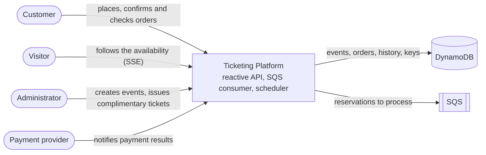

### 7.2 Containers (local environment)

One application container holds three roles: the reactive API, the SQS consumer and the expiration scheduler. It talks to DynamoDB and SQS on LocalStack. A Terraform container creates those resources before the application starts.

| Component | Responsibility |
|---|---|
| Reactive API (`reactive-web`) | Validates, stores, publishes and answers. Never touches the inventory when an order is placed |
| SQS consumer (`sqs-listener`) | Reads `ORDER_PLACED` messages and reserves or rejects each order |
| Scheduler (`scheduler`) | Every 30 s, expires the reservations and payments whose time is over |
| DynamoDB | Tables `events`, `orders` (with the `expiring-orders` index), `order-history` and `idempotency` |
| SQS | Queue `reservations` with its dead-letter queue (5 receives at most) |

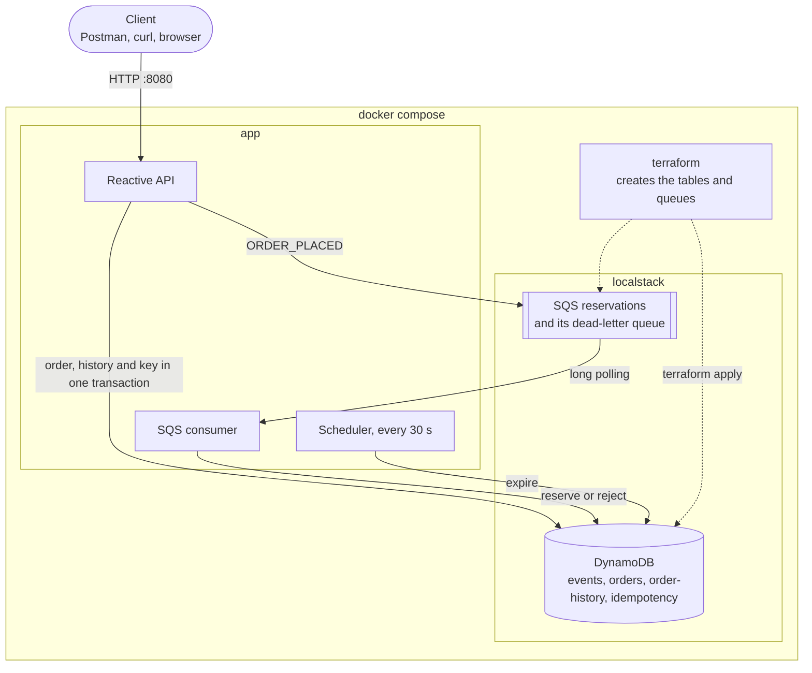

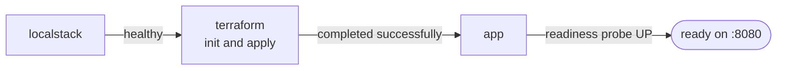

### 7.3 Clean Architecture

The project follows Clean Architecture as defined by Robert C. Martin in [*The Clean Architecture*](https://blog.cleancoder.com/uncle-bob/2012/08/13/the-clean-architecture.html), and its structure was generated with Bancolombia's official Gradle plugin, [**scaffold-clean-architecture**](https://github.com/bancolombia/scaffold-clean-architecture) (version 4.7.2, [documentation](https://bancolombia.github.io/scaffold-clean-architecture/docs/intro)). The plugin organizes the code in layers, explained by Bancolombia in [*Clean Architecture — Aislando los detalles*](https://medium.com/bancolombia-tech/clean-architecture-aislando-los-detalles-4f9530f35d7a) (in Spanish):


*Image: Bancolombia, [Clean Architecture — Aislando los detalles](https://medium.com/bancolombia-tech/clean-architecture-aislando-los-detalles-4f9530f35d7a).*

- **Domain:** the `model` module (entities, value objects and the *gateways*, which are the ports) and the `usecase` module (the business logic). It is the innermost layer and depends on nothing else.
- **Infrastructure:** *driven adapters* (implementations of the gateways: DynamoDB, SQS) and *entry points* (where flows start: HTTP, the SQS listener, the scheduler), plus *helpers*.
- **Application:** the outermost module; it wires the modules together, creates the use case beans and starts Spring Boot.

Dependencies only point inwards: the domain knows neither Spring, nor AWS, nor DynamoDB. Two checks enforce it on every build: the plugin task [`validateStructure`](https://bancolombia.github.io/scaffold-clean-architecture/docs/tasks/validate-structure) and the [ArchUnit](https://www.archunit.org/) rules of `ArchitectureTest`. Every module, model and use case was created with the plugin tasks ([`generateModel`](https://bancolombia.github.io/scaffold-clean-architecture/docs/tasks/generate-model), [`generateUseCase`](https://bancolombia.github.io/scaffold-clean-architecture/docs/tasks/generate-use-case), [`generateDrivenAdapter`](https://bancolombia.github.io/scaffold-clean-architecture/docs/tasks/generate-driven-adapter), [`generateEntryPoint`](https://bancolombia.github.io/scaffold-clean-architecture/docs/tasks/generate-entry-point)), not by hand.

| Layer | Module | Contents |
|---|---|---|
| Domain | `domain/model` | Entities as records (`Event`, `Inventory`, `Availability`), order states as sealed types, one specific exception per case, and the ports (`gateways`) |
| Domain | `domain/usecase` | One use case per action: `PlaceOrder`, `ReserveTickets`, `ConfirmOrder`, `RecordPayment`, `ReleaseExpiredReservations`, `IssueComplimentary`, `WatchAvailability`, and the queries |
| Infrastructure | `entry-points/reactive-web` | Functional routes, handlers, error mapping (RFC 9457), security headers, CORS |
| Infrastructure | `entry-points/sqs-listener` | Reactive listener with long polling and graceful shutdown |
| Infrastructure | `entry-points/scheduler` | Reactive [`@Scheduled`](https://docs.spring.io/spring-framework/reference/integration/scheduling.html) job |
| Infrastructure | `driven-adapters/dynamo-db` | Adapters of the ports, transactions and conditional expressions, the SSE polling feed |
| Infrastructure | `driven-adapters/sqs-sender` | Publisher of `ORDER_PLACED` |
| Infrastructure | `helpers/metrics` | Metrics of the AWS SDK in Micrometer |
| Application | `applications/app-service` | Spring Boot start-up, wiring of the use cases, injected `Clock` |

The ports are small and named after the business (`OrderCreator`, `OrderRetriever`, `InventoryUpdater`, `ComplimentaryIssuer`…), so each use case depends only on what it uses (interface segregation).

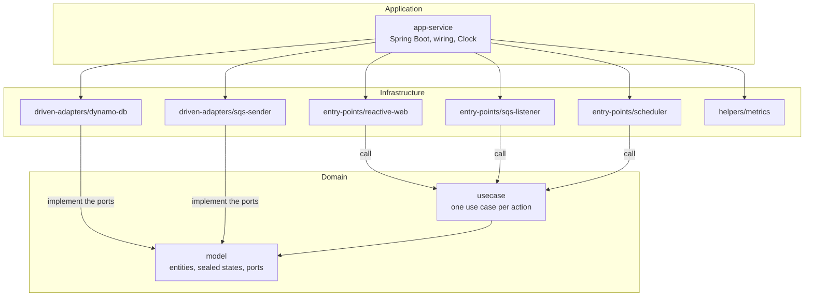

## 8. Main flows

### 8.1 Placing an order (`POST /orders`)

1. The handler reads `X-Customer-Id` and `Idempotency-Key`; the domain validates the key and the order (quantity between 1 and 6).
2. If the key already exists for that customer and has not expired:
   - same request (SHA-256 fingerprint of the data) → returns the original order in its current state, with `Idempotent-Replayed: true`, without writing or publishing anything;
   - different request → `422 IDEMPOTENCY_KEY_REUSED`.
3. Otherwise, it checks that the event exists (`404`) and has not started (`422 EVENT_CLOSED`).
4. It writes in **one transaction** the `QUEUED` order, its first history entry and the idempotency key.
5. It publishes `ORDER_PLACED` (only the order id: [*claim check*](https://www.enterpriseintegrationpatterns.com/patterns/messaging/StoreInLibrary.html)) and answers `202` with `Location` and `Retry-After: 1`.
6. If two requests with the same key race, the key condition lets only one win; the other reads the key again and answers with the winning order.

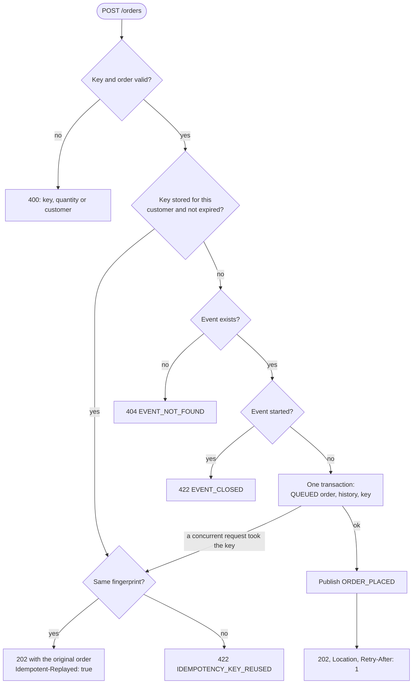

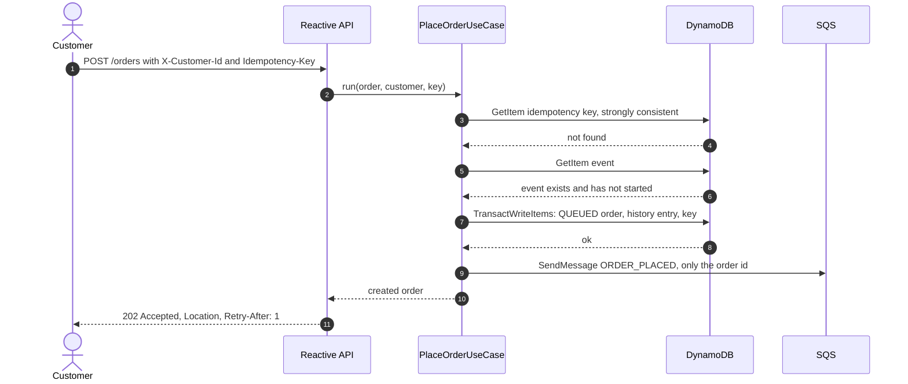

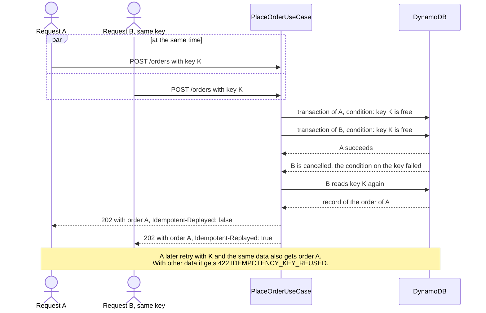

### 8.2 Reserving the tickets (SQS consumer)

1. The listener receives up to 10 messages with [long polling](https://docs.aws.amazon.com/AWSSimpleQueueService/latest/SQSDeveloperGuide/sqs-short-and-long-polling.html) (10 s) and processes each one in its own publisher.
2. It reads the order with a [strongly consistent read](https://docs.aws.amazon.com/amazondynamodb/latest/developerguide/HowItWorks.ReadConsistency.html). If it is no longer `QUEUED` (a duplicate message), nothing happens.
3. It checks again that the event has not started: the queue may be behind. If it has, the order is rejected with `EVENT_CLOSED`.
4. One transaction moves the tickets (`available - n`, `reserved + n`, with the condition `available >= n`), moves the order to `RESERVED` (condition `status = QUEUED`) and writes the history entry.
5. If the condition on the inventory fails, the order is rejected with `SOLD_OUT`. A `TransactionConflict` is retried 3 times with [exponential backoff](https://aws.amazon.com/blogs/architecture/exponential-backoff-and-jitter/) from 50 ms.
6. The message is deleted **only after** its effect is stored. A technical error leaves it in the queue: it reappears after the [visibility timeout](https://docs.aws.amazon.com/AWSSimpleQueueService/latest/SQSDeveloperGuide/sqs-visibility-timeout.html) (15 s) and, after 5 receives, goes to the [dead-letter queue](https://docs.aws.amazon.com/AWSSimpleQueueService/latest/SQSDeveloperGuide/sqs-dead-letter-queues.html).

| Outcome | Message |
|---|---|
| Reserved, or rejected (`SOLD_OUT`, `EVENT_CLOSED`) | Deleted: it is a valid business answer |
| The order is no longer `QUEUED` | Deleted, with no effect |
| Unreadable message or wrong type | Not deleted → dead-letter queue |
| Technical error or conflicts that persist | Not deleted → delivered again, then dead-letter queue |

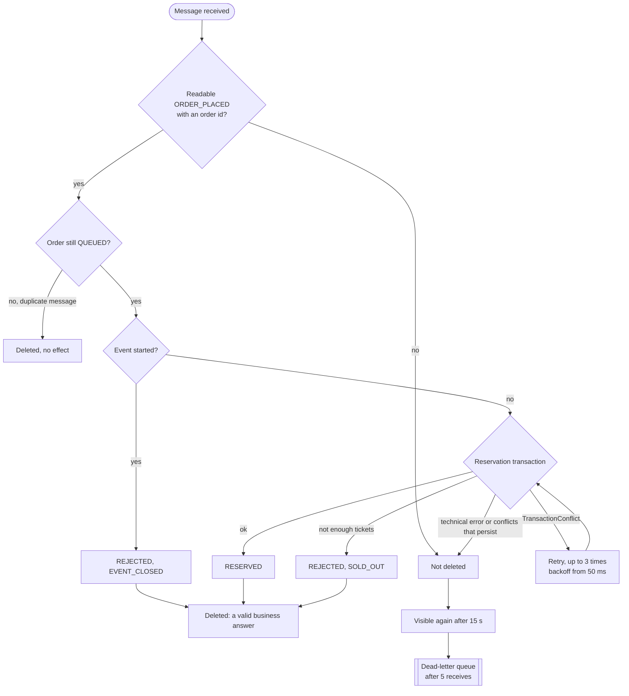

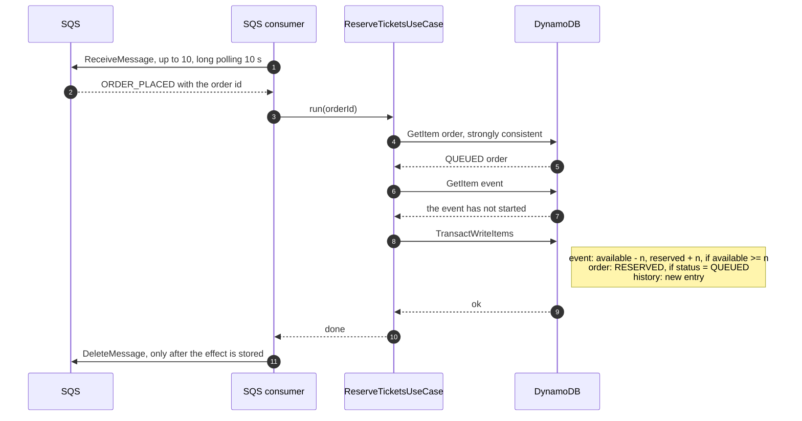

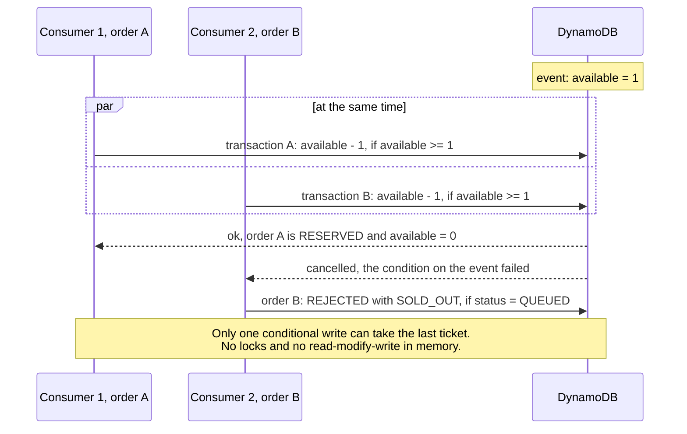

### 8.3 Confirmation and payment

1. `POST /orders/{id}/confirm` on a `RESERVED` order of the customer: the domain rejects a reservation whose time is over (`409 RESERVATION_EXPIRED`), even if the scheduler has not released it yet.
2. One transaction moves the tickets from `reserved` to `pendingConfirmation` and the order to `PENDING_CONFIRMATION`, with a 5-minute payment deadline. Answer: `202`.
3. Confirming again an order that is already `PENDING_CONFIRMATION` or `SOLD` returns it as it is.
4. The provider notifies `POST /orders/{id}/payment`:
   - `APPROVED` → `SOLD` (`pendingConfirmation - n`, `sold + n`);
   - `DECLINED` → `REJECTED` with `PAYMENT_DECLINED`, and the tickets go back to `available`;
   - a late notification (after the deadline) is rejected with `409 PAYMENT_EXPIRED`: a late approval never sells tickets that were already released;
   - the same notification again returns the order as it is, because providers repeat their notifications.

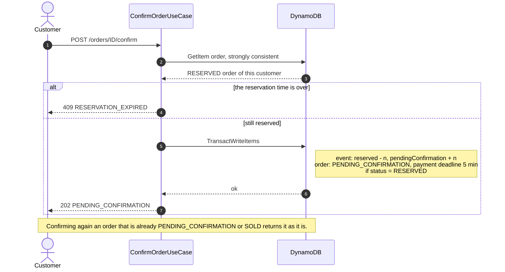

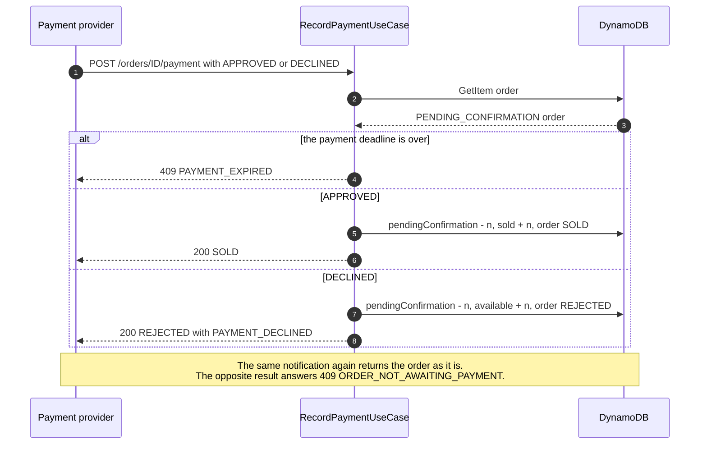

### 8.4 Expiration of reservations and payments

1. Every 30 s, the scheduler queries the [sparse index](https://docs.aws.amazon.com/amazondynamodb/latest/developerguide/bp-indexes-general-sparse-indexes.html) `expiring-orders`: only live `RESERVED` and `PENDING_CONFIRMATION` orders are in it, spread over 4 [shards](https://docs.aws.amazon.com/amazondynamodb/latest/developerguide/bp-partition-key-sharding.html).
2. For each order (up to 16 at a time) it checks the exact instant again, because the index is eventually consistent.
3. One transaction moves the tickets back to `available`, moves the order to `EXPIRED` (`RESERVATION_TIMEOUT` or `PAYMENT_TIMEOUT`), removes it from the index and writes the history entry.
4. If another process changed the order first (the customer confirmed in time, the payment arrived), the condition on the status fails and the order is skipped.

Every instance runs the scheduler; no leader election is needed, because only one conditional write wins for each order. The clock is read again on every run (`Flux.defer`): an earlier version read it once at start-up, so reservations created afterwards never expired. A test now subscribes twice to the same flow and checks that each run uses a new instant.

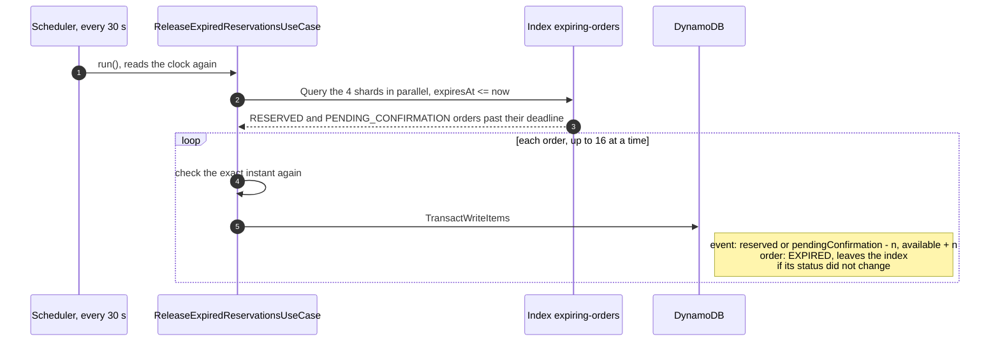

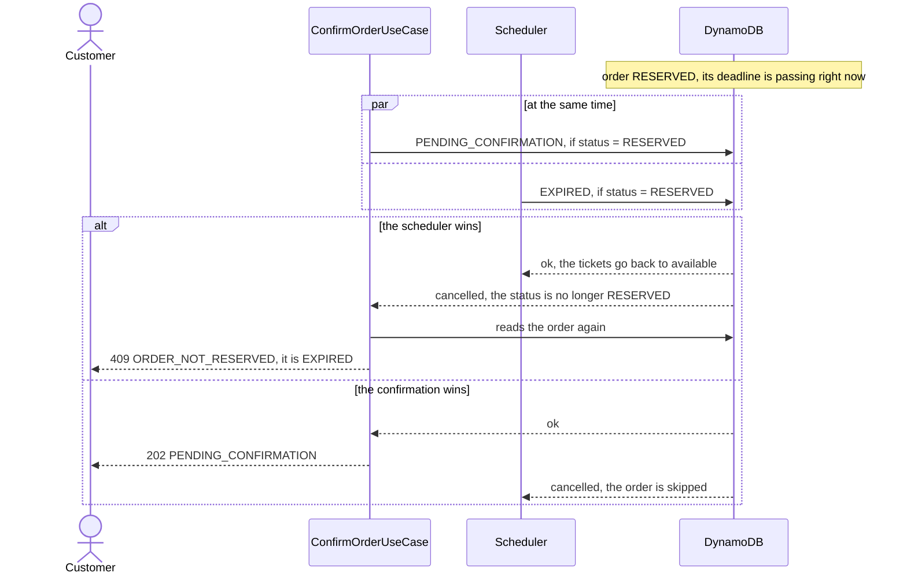

### 8.5 Real-time availability (SSE)

1. The stream first checks that the event exists: once an SSE response starts, its `200` cannot become a `404`.
2. Each subscriber starts with its own reading of the current state.
3. All the subscribers of the same event share **one** polling source (`share()`), which reads DynamoDB once per second and only while someone is watching.
4. `distinctUntilChanged` only sends real changes; a heartbeat every 15 s keeps proxies from closing the connection.

Measured locally: 5 clients for 10 s made 20 reads to DynamoDB, instead of about 60 with one polling per subscriber.

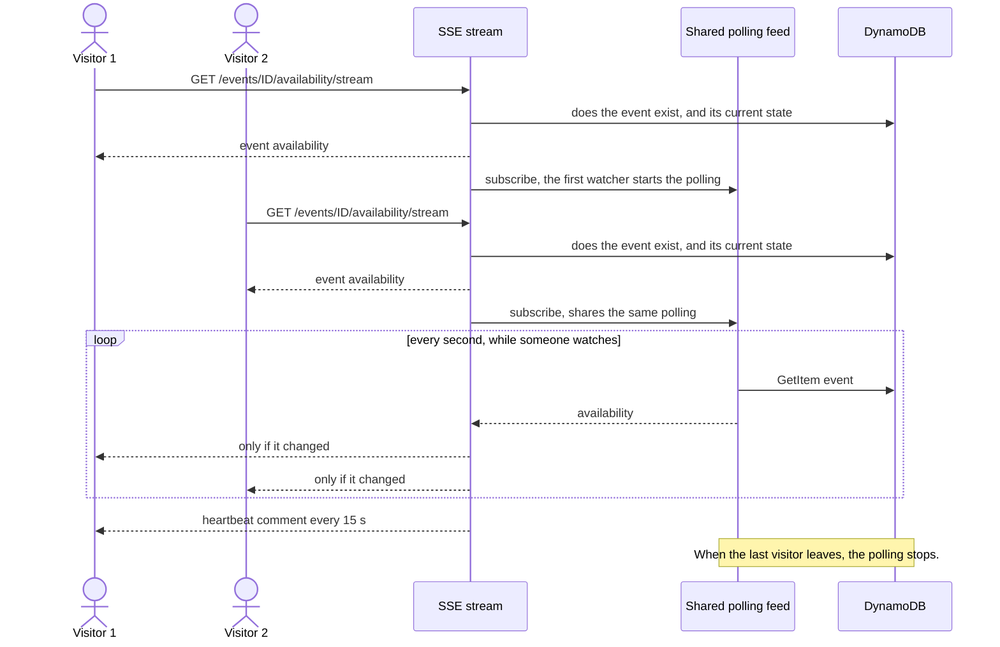

### 8.6 Complimentary tickets

Complimentary tickets do **not** go through the queue (ADR 0023). One transaction of 4 items takes the tickets (`available - n`, `complimentary + n`, condition `available >= n`), creates the `COMPLIMENTARY` order, writes its history entry and stores the idempotency key. Without enough tickets it answers `409 TICKETS_SOLD_OUT` and writes nothing. The administrator knows the result immediately, and no `REJECTED` orders are left behind.

Measured locally: 20 parallel requests of 1 ticket on an event of 5 gave exactly 5 `201` and 15 `409`.

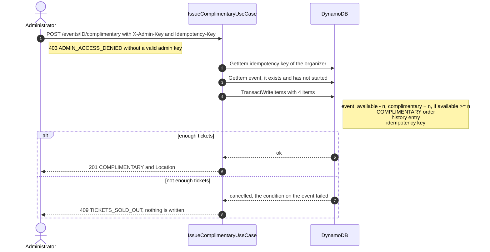

### 8.7 Graceful shutdown of the consumer

The listener is a [`SmartLifecycle`](https://docs.spring.io/spring-framework/docs/current/javadoc-api/org/springframework/context/SmartLifecycle.html) that, when the application stops, stops asking for messages, **waits for its open poll** (10 s at most), processes and deletes what that poll brings, and only then finishes. Spring stops it before the web server and before closing the SQS clients; Docker waits 35 s ([`stop_grace_period`](https://docs.docker.com/reference/compose-file/services/)) so it does not kill the process first.

Before this change, a message received by the poll of a stopping instance waited the whole visibility timeout (15 s) after every restart. The first fix, cancelling the poll, did not work: cancelling on the client does not stop the server from delivering the message. Verified afterwards in 5 out of 5 restarts (ADR 0021).

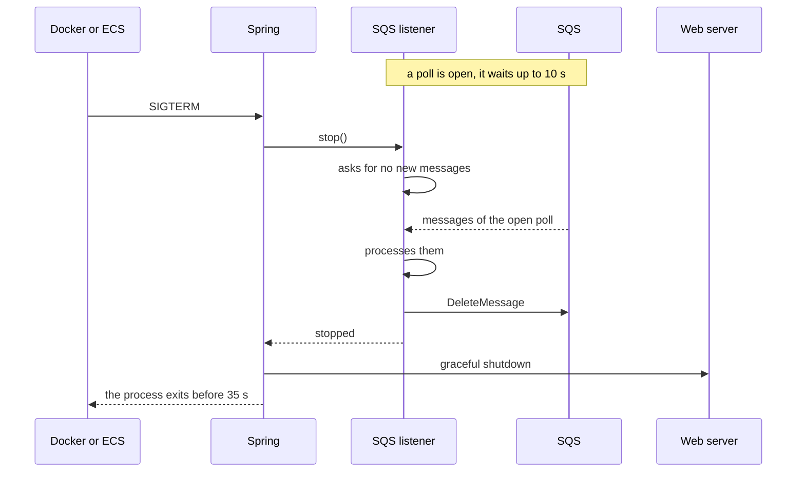

## 9. Architecture decisions

Each significant decision is recorded below as a short ADR ([*Architecture Decision Record*](https://cognitect.com/blog/2011/11/15/documenting-architecture-decisions)): the context, the options, the decision with its reason, and its pros and cons. The numbers are stable, because the code and the Terraform comments refer to them (for example, `ADR 0008`). An ADR is never rewritten: when a decision changes, a new one supersedes it.

| ADR | Decision |
|---|---|
| 0001 | Separate state machines for orders and tickets |
| 0002 | The SQS consumer makes the reservation; the API only enqueues |
| 0003 | Inventory as counters on the event |
| 0004 | Standard SQS, one queue per responsibility, each with a dead-letter queue |
| 0005 | Conditional writes inside one transaction |
| 0006 | Expiration scheduler over a sparse, sharded index |
| 0007 | Confirmation with an asynchronous simulated payment (superseded by 0022) |
| 0008 | Own deadline for payments |
| 0009 | Real-time availability with SSE and one shared source |
| 0010 | One deployable with activatable roles |
| 0011 | No virtual threads |
| 0012 | Local environment only, Terraform on LocalStack |
| 0013 | One DynamoDB table per aggregate |
| 0014 | `Idempotency-Key` stored in the same transaction as the order |
| 0015 | Dual write solved with retries and re-queuing (superseded by 0019) |
| 0016 | *Claim check* messages: only the `orderId` |
| 0017 | Declared identity without authentication |
| 0018 | Immutable domain with atomic transitions |
| 0019 | Defer the transactional outbox and accept the dual-write risk |
| 0020 | Order states as sealed types |
| 0021 | The SQS consumer waits for its open poll on shutdown |
| 0022 | Payment confirmed by a provider notification |
| 0023 | Complimentary tickets in one conditional transaction, without queue |

### 9.1 Domain model

#### ADR 0001 · Separate state machines for orders and tickets

- **Context:** a ticket has five states (`AVAILABLE`, `RESERVED`, `PENDING_CONFIRMATION`, `SOLD`, `COMPLIMENTARY`), but an asynchronous order goes through situations that none of them describes: it waits in the queue without tickets, it is rejected because none are left, or it expires. An "`AVAILABLE` order" makes no sense.
- **Options:** (1) use the ticket states for the order too; (2) add new states to the tickets; (3) two state machines.
- **Decision:** option 3. Tickets keep exactly the five states. The order reuses those names when the meaning matches and only adds `QUEUED`, `REJECTED` and `EXPIRED`. The API returns both: `status` (the order) and `ticketStatus` (always one of the five).
- **Why:** it models the asynchrony as it really is, without breaking the closed set of ticket states.
- **Pros:** the ticket rules stay intact; the order ↔ ticket mapping lives in one place (`OrderStatus.ticketStatus()`), covered by tests.
- **Cons:** more states to explain, and a mapping to maintain.

#### ADR 0018 · Immutable domain with atomic transitions

- **Context:** each transition must store, atomically, the new order state, the inventory movement and the history entry. The code runs in a reactive, concurrent environment, and the domain must not know how anything is stored.
- **Options:** (1) mutable entities with setters; (2) immutable records whose transitions return an `OrderChange` (before, after, inventory movement, audit entries) that one generic repository method applies.
- **Decision:** option 2 in spirit. Every transition returns a new immutable object (`QueuedOrder.reserve()` returns a `ReservedOrder`). Instead of one generic `apply(OrderChange)`, each transition has its own adapter method that builds its transaction, and the history entry is derived from the new state (`OrderHistoryEntry.of(order)`).
- **Why:** no shared mutable state between threads, and transitions that are pure functions: given a state and an instant, the result is always the same.
- **Pros:** transitions are trivial to test; a transition never exists without its history entry, nor an entry without its transition; port names say what changes (`InventoryUpdater.reserveTickets`).
- **Cons:** one adapter method and one transaction per transition instead of a single generic one; more objects are created (irrelevant next to the I/O).

#### ADR 0020 · Order states as sealed types

- **Context:** an order has restricted transitions (a `QUEUED` order can be reserved or rejected; a `REJECTED` one is final), and each state has its own data (`expiresAt` only exists in a reserved order, `rejectionReason` only in a rejected one).
- **Options:** (A) classic GoF [*State*](https://refactoring.guru/design-patterns/state), with a mutable context that delegates to a state object; (B) `sealed interface Order` with one record per state, each with only its data and its valid transitions; (C) one record with a `status` enum that validates transitions at run time.
- **Decision:** option B. `QueuedOrder`, `ReservedOrder`, `PendingConfirmationOrder`, `SoldOrder`, `RejectedOrder`, `ExpiredOrder` and `ComplimentaryOrder`; the shared data lives in `OrderDetails`.
- **Why:** an invalid transition stops being a run-time error and becomes code that does not compile. With immutable records, the indirection of classic *State* adds nothing; B is the idiomatic form of the pattern in Java 25.
- **Pros:** `SoldOrder` has no transitions, so reverting a sale does not compile; no field is `null` depending on the state; a `switch` over `Order` must cover every state, so a new state flags every place to update (it happened when `ExpiredOrder` and `SoldOrder` were added).
- **Cons:** an order read from DynamoDB is a generic `Order`, so the concrete state is still decided at run time at the border; it does not protect against concurrency (the conditional write does, ADR 0005); the adapters translate between the type and a flat `status`; each new state is one more record.

#### ADR 0003 · Inventory as counters on the event

- **Context:** never oversell, and every ticket should have its own state. An event can have tens of thousands of tickets, and admission is general (no seat selection).
- **Options:** (1) counters only; (2) pre-create one item per ticket and pick free ones when buying; (3) hybrid: the counters are the atomic gate and the ticket items are created on reservation.
- **Decision:** the counters `available`, `reserved`, `pendingConfirmation`, `sold` and `complimentary` on the event are the atomic gate: one conditional write `available >= n` decides. The per-ticket items of option 3 were left out of this version.
- **Why:** a single condition that is easy to reason about and to test prevents overselling, without writing thousands of items per event or competing for free tickets.
- **Pros:** the invariant `available + reserved + pendingConfirmation + sold + complimentary = capacity` holds by construction; one write per reservation.
- **Cons:** every reservation of an event writes the same item (*hot partition*: a partition takes at most [1,000 write units per second](https://docs.aws.amazon.com/amazondynamodb/latest/developerguide/bp-partition-key-design.html) and a [transactional write costs two](https://docs.aws.amazon.com/amazondynamodb/latest/developerguide/transaction-apis.html), so about 500 transitions per second per event); there is no way to know *which* ticket a customer holds, so numbered seats are not supported.

### 9.2 Concurrency and persistence

#### ADR 0005 · Conditional writes inside one transaction

- **Context:** each transition must be atomic and auditable, and concurrent purchases must never oversell. A transition touches several items: the event counters, the order and its history entry.
- **Options:** (1) read, change in memory and save (lost updates: the exact bug of the current system); (2) separate writes with compensation (windows of inconsistency); (3) one [`TransactWriteItems`](https://docs.aws.amazon.com/amazondynamodb/latest/developerguide/transaction-apis.html).
- **Decision:** option 3. One transaction with the [conditional update](https://docs.aws.amazon.com/amazondynamodb/latest/developerguide/Expressions.ConditionExpressions.html) of the counters (`available >= n`), the update of the order conditioned on its expected status (`status = QUEUED`, `status = RESERVED`…) and the history entry. DynamoDB cancellation reasons become domain exceptions: a failed inventory condition is a business answer (`SOLD_OUT`) and is never retried; a `TransactionConflict` becomes `ConcurrencyConflictException` and is retried with exponential backoff.
- **Why the status and not a version:** every write changes the status, so the expected status already plays the role of the version: two processes can never apply two transitions from the same state. It is one attribute less to maintain.
- **Pros:** real all-or-nothing atomicity; no counter can go negative; the history is guaranteed by the same operation.
- **Cons:** transactional writes cost twice as much; at most 100 items per transaction; concurrent transactions on the same event produce `TransactionConflict`; if an update that keeps the status were ever added, a `version` would be needed.

#### ADR 0013 · One DynamoDB table per aggregate

- **Context:** DynamoDB can be modeled as one single table with overloaded keys, or as several tables. Transactions across tables work the same way within a region.
- **Options:** (1) single-table design; (2) one table per aggregate or record type.
- **Decision:** option 2.
- **Why:** each table has one responsibility and its own policy: `order-history` is append-only, `idempotency` is short-lived with a native TTL, and `orders` has its own expiration index.
- **Pros:** a schema that explains itself; granular IAM per table in AWS; retention and backups suited to each kind of data; easier to test and to defend.
- **Cons:** more tables to define and manage; a query across aggregates needs several reads (there is none today).

#### ADR 0014 · `Idempotency-Key` stored in the same transaction as the order

- **Context:** duplicate purchases come from double clicks, client retries after a network timeout, or replay attacks. The same key must produce one single order, even when it arrives several times at once.
- **Options:** (1) store the key, then the order (a failure leaves a key pointing to nothing); (2) store the order, then the key (a failure lets a retry create a duplicate); (3) read the key first and, if it does not exist, write the order and the key in one transaction with `attribute_not_exists`.
- **Decision:** option 3. The key belongs to a customer (`customerId#key`) and lives 24 hours. Same key and same request (SHA-256 fingerprint) → the original order, `Idempotent-Replayed: true`. Same key and another request → `422`. Two concurrent requests → the transaction lets only one win, and the other answers with the winning order.
- **Why:** it is the only option without a window where the key and the order disagree.
- **Pros:** two orders with the same key are impossible; no orphan keys; a replay does not publish another message. Measured: 20 parallel requests with one key created one order.
- **Cons:** one more read on every `POST /orders`, and a transaction of 3 items instead of 2.

### 9.3 Messaging

#### ADR 0002 · The SQS consumer makes the reservation; the API only enqueues

- **Context:** the business problem is peaks of thousands of buyers at the same time. The purchase should be accepted immediately, and the real availability checked by an asynchronous consumer.
- **Options:** (1) the API reserves synchronously and then enqueues; (2) the API only validates, stores the `QUEUED` order, enqueues and answers `202`; (3) like option 2, plus a read-only availability check that rejects at once when the event is sold out.
- **Decision:** option 2.
- **Why:** the queue becomes a buffer. The API absorbs the peak with minimal work, and the bounded concurrency of the consumers decides how many writes compete for the inventory.
- **Pros:** low and stable latency on `POST /orders`; the database receives a levelled flow; transient failures are retried without the customer noticing.
- **Cons:** the customer does not know at once whether they got tickets and must poll the order (guided by `Location` and `Retry-After`); once an event is sold out, orders keep being queued only to be rejected. Option 3 remains as a future optimization.

#### ADR 0004 · Standard SQS, one queue per responsibility, each with a dead-letter queue

- **Context:** messages must be processed at least once. There were two asynchronous jobs with very different profiles: reservations (a massive peak, milliseconds) and payments (a smaller flow that depends on a slow external provider).
- **Options:** (1) [SQS FIFO](https://docs.aws.amazon.com/AWSSimpleQueueService/latest/SQSDeveloperGuide/FIFO-queues.html) with `MessageGroupId = eventId`; (2) one standard queue with two message types; (3) one standard queue per responsibility, each with its dead-letter queue.
- **Decision:** option 3, with a visibility timeout of 15 s for reservations and 30 s for payments, and `maxReceiveCount = 5`.
- **Why:** consistency does not depend on the order of the messages but on the conditional writes (ADR 0005), so FIFO's throughput limit per group buys nothing and would turn a popular event into a bottleneck. Separate queues isolate failures: a payment provider that is down does not slow down reservations.
- **Pros:** practically unlimited throughput; failure isolation; a dead-letter queue and alarms per queue that say at once where the problem is.
- **Cons:** consumers must tolerate duplicates and disorder (ADR 0016); more resources to manage.

#### ADR 0016 · *Claim check* messages: only the `orderId`

- **Context:** [standard SQS](https://docs.aws.amazon.com/AWSSimpleQueueService/latest/SQSDeveloperGuide/standard-queues.html) delivers each message at least once and in no guaranteed order, and a message becomes visible again if a consumer dies while processing it.
- **Options:** (1) messages with the whole state (quantity, event, customer…); (2) messages with only the order id, so the consumer always loads the current order.
- **Decision:** option 2. The consumer reads the order with a strongly consistent read and acts only if it is in the expected state (`QUEUED`); otherwise the message is a duplicate or arrived late, and it is deleted without effects. A message is deleted only after its effect is stored.
- **Why:** the state lives in DynamoDB, not in the message.
- **Pros:** immune to duplicates, disorder and stale or tampered data; the consumer never trusts quantities or amounts from a message.
- **Cons:** one read to DynamoDB per message.

#### ADR 0015 · Dual write solved with retries and re-queuing (superseded by 0019)

- **Decision it proposed:** every `QUEUED` order would get a deadline in the expiration index, and a scheduler would publish again the `QUEUED` orders that were too old. The design is kept as the first step of the plan in ADR 0019.

#### ADR 0019 · Defer the transactional outbox and accept the dual-write risk

- **Context:** placing an order saves it in DynamoDB and then publishes to SQS, without a common transaction. If the save succeeds and the publication fails (SQS down, or the process dies in between), the order stays `QUEUED` and nobody processes it.
- **Options:** (1) a [transactional outbox](https://microservices.io/patterns/data/transactional-outbox.html) table written in the same transaction as the order; (2) [DynamoDB Streams](https://docs.aws.amazon.com/amazondynamodb/latest/developerguide/Streams.html) as the outbox: only the order is written, and a change reader publishes to SQS; (3) retries plus a re-queuing scheduler (ADR 0015); (4) defer and document.
- **Decision:** option 4. Current mitigations: the publication is not *fire and forget*, so if it fails the error reaches the client; the AWS SDK retries transient failures; the consumer is idempotent, so a future re-publication causes no harm.
- **Why:** with limited time, the priority was the core of the system: the reservation with concurrency control.
- **Pros:** the time went to what matters most (no overselling, idempotency, expiration).
- **Cons:** a failure between both writes leaves an order stuck in `QUEUED`. Retrying with the **same** `Idempotency-Key` returns that stuck order without publishing again; only a new key creates a new order.
- **Plan:** first option 3, which reuses the existing scheduler and index; in production, option 2, which removes the problem instead of repairing it.

#### ADR 0021 · The SQS consumer waits for its open poll on shutdown

- **Context:** the listener of the scaffold template had no life cycle, and Spring Boot's [graceful shutdown](https://docs.spring.io/spring-boot/reference/web/graceful-shutdown.html) only covers the web server. An experiment showed that after a restart, a new order took 16 s to be reserved: the open long poll of the stopping process received the message and never deleted it, so the message waited the whole visibility timeout (15 s).
- **Options:** (1) do nothing, since the consumer is idempotent and the message is only delayed; (2) cancel the open poll on shutdown; (3) stop asking for messages, **wait** for the open poll, process and delete what it brings, then finish; (4) release received messages with [`ChangeMessageVisibility`](https://docs.aws.amazon.com/AWSSimpleQueueService/latest/SQSDeveloperGuide/sqs-visibility-timeout.html) set to 0.
- **Decision:** option 3, as a `SmartLifecycle` that Spring stops before the web server and before closing the SQS clients. `waitTimeSeconds` went from 20 to 10 s because it also bounds the shutdown; Spring gets 15 s per shutdown phase and Docker 35 s (`stop_grace_period`), so Docker does not kill the process first.
- **Why:** option 2 was built first and **discarded by evidence**: in 2 of 3 restarts the message still took 16 s, because cancelling the request on the client does not stop the server from delivering the message. AWS does not document that case, so the design cannot depend on it. Option 4 only works for messages the client actually received.
- **Pros:** a restart or a deployment leaves no message waiting (verified in 5 out of 5 restarts: under 1 s, instead of 16 s); an order placed during the shutdown is processed by the instance that is stopping.
- **Cons:** stopping an instance takes up to 10 s; a 10 s poll makes twice as many empty receives as 20 s (a negligible cost).

### 9.4 Business flows

#### ADR 0006 · Expiration scheduler over a sparse, sharded index

- **Context:** reservations expire after 10 minutes and payments after 5. When they expire, the tickets must go back to the inventory, with a history entry, without interfering with a customer who confirms at that very moment, and with several instances running.
- **Options:** (1) DynamoDB's [native TTL](https://docs.aws.amazon.com/amazondynamodb/latest/developerguide/TTL.html) (it deletes expired items within a few days and runs no business logic); (2) SQS messages with a [delay](https://docs.aws.amazon.com/AWSSimpleQueueService/latest/SQSDeveloperGuide/sqs-delay-queues.html) (15 minutes at most, and more messages and states); (3) a periodic scheduler over a sparse index, split into shards.
- **Decision:** option 3. Every 30 s the scheduler queries the shards, checks the exact instant of each order again and expires it with the same kind of conditional transaction as any other transition. If another flow won (the customer confirmed in time), the condition fails and the order is skipped.
- **Why:** it is deterministic, it goes through the domain, it is recorded in the history, and it is safe with several instances without electing a leader.
- **Pros:** precision of seconds; the sparse index only holds live orders, because the shard attribute is removed when an order leaves `RESERVED` or `PENDING_CONFIRMATION`; the shards keep a massive expiration from overloading one partition.
- **Cons:** a periodic query costs even when nothing expires; a release can take up to the deadline plus 30 s (the domain rejects confirming an expired reservation anyway); text dates sort with a margin under 1 s, so the use case checks the exact instant.

#### ADR 0008 · Own deadline for payments

- **Context:** the first design only expired reservations. But if the payment never arrives, an order in `PENDING_CONFIRMATION` would hold its tickets forever, and they would never be sold.
- **Options:** (1) only `RESERVED` expires; (2) `PENDING_CONFIRMATION` also expires, with its own deadline.
- **Decision:** option 2: 5 minutes to pay. The same scheduler and index expire it, with the reason `PAYMENT_TIMEOUT`, and the tickets go back to `available`.
- **Why:** no ticket can stay held forever, and the behavior is symmetric with the reservation.
- **Pros:** the inventory always comes back.
- **Cons:** with a real provider, a payment approved after the deadline means a customer paid for tickets that were already released. A late approval is rejected (`409 PAYMENT_EXPIRED`) and never sells released tickets, but a real integration needs a reconciliation or refund process.

#### ADR 0007 · Confirmation with an asynchronous simulated payment (superseded by 0022)

- **Decision it proposed:** confirming would publish to the payments queue, and a consumer would call a simulated gateway behind a `PaymentGateway` port. It was started and discarded because of its cost; see ADR 0022.

#### ADR 0022 · Payment confirmed by a provider notification

- **Context:** `PENDING_CONFIRMATION` is one of the five ticket states, but the first build went straight from `RESERVED` to `SOLD`, so the state was never used. What matters is that the state exists with a real meaning, not that the payment is asynchronous.
- **Options:** (1) asynchronous payment through a queue and a simulated gateway (ADR 0007); (2) a notification from the payment provider (*webhook*); (3) keep `RESERVED` → `SOLD`.
- **Decision:** option 2. Confirming moves the order to `PENDING_CONFIRMATION` (`202`) with 5 minutes to pay. The provider notifies `POST /orders/{id}/payment`: `APPROVED` → `SOLD`, `DECLINED` → `REJECTED (PAYMENT_DECLINED)` and the tickets go back. A repeated notification returns the order as it is; a late one is rejected.
- **Why:** option 1 was started and discarded: it needed a new consumer, a listener for two queues, a simulated gateway module and another publisher. A webhook is also how real payment providers work. The asynchrony of the platform is already shown by the reservation queue.
- **Pros:** every ticket state has a real meaning; very little new code; it reuses the inventory transitions, the history and the scheduler.
- **Cons:** **the webhook is not authenticated**: anyone who knows the id of an order waiting for its payment can mark it as paid. In production it must verify the provider signature (HMAC of the body and a timestamp, as [Stripe does](https://docs.stripe.com/webhooks)). The payments queue stays in Terraform without use.

#### ADR 0023 · Complimentary tickets in one conditional transaction, without queue

- **Context:** `COMPLIMENTARY` was the only ticket state without use. The design sent complimentary tickets through the same asynchronous flow as a purchase. But they are a low-volume administrative operation: there is no peak to absorb, and the protection against overselling comes from the conditional write, not from the queue.
- **Options:** (1) asynchronous, like a purchase (`202`, `QUEUED`, the consumer decides); (2) one synchronous conditional transaction.
- **Decision:** option 2. One transaction of 4 items: move `available` → `complimentary` with the condition `available >= n`, create the order (born final in `COMPLIMENTARY`), its history entry and the idempotency key. With tickets: `201`. Without: `409 TICKETS_SOLD_OUT`, and nothing is written. Access with `X-Admin-Key`, compared in constant time with [`MessageDigest.isEqual`](https://docs.oracle.com/en/java/javase/25/docs/api/java.base/java/security/MessageDigest.html).
- **Why:** the same guarantee against overselling with fewer pieces, and an immediate answer for the administrator.
- **Pros:** no `REJECTED` orders left behind; a `TransactionConflict` with a concurrent reservation is safe to retry because nothing was written. Measured: 20 parallel requests for 5 tickets gave exactly 5 `201` and 15 `409`.
- **Cons:** unlike a purchase, it does not go through the queue; the admin key is a shared secret, not an identity, so the history does not say which administrator issued the tickets.

#### ADR 0009 · Real-time availability with SSE and one shared source

- **Context:** visitors want to see availability in real time, and during a launch thousands of visitors can watch the same event.
- **Options:** (1) only a `GET`, polled by each client; (2) SSE where each connection reads the database; (3) a `GET` plus SSE fed by one shared source per event.
- **Decision:** option 3. One polling per watched event, shared by every subscriber (`share()`), that only runs while someone is watching; `distinctUntilChanged` sends only real changes; a heartbeat every 15 s keeps proxies from closing the connection.
- **Why:** the read cost must not grow with the number of visitors. Measured: 5 clients for 10 s made 20 reads instead of about 60.
- **Pros:** reactive end to end (`Flux` to the browser); the use case only knows the `InventoryChangeFeed` port, so DynamoDB Streams can replace the polling without touching it.
- **Cons:** long-lived connections use resources on each instance; 1 read per second per watched event and instance, even without changes; up to 1 s of delay.

### 9.5 Platform and security

#### ADR 0010 · One deployable with activatable roles

- **Context:** the system has several runnable components, the scaffold offers one application module, and everything runs locally.
- **Options:** (1) one microservice per component; (2) one deployable with everything always on; (3) one deployable whose roles are switched on by configuration (`@ConditionalOnProperty`).
- **Decision:** option 3 was designed; option 2 was built.
- **Why:** simple to run and operate, with no duplicated code. With roles, the same image could later run as separate services without code changes.
- **Pros:** one image, one configuration, easy to operate locally.
- **Cons:** the API and the workers share CPU and memory and cannot scale separately; production needs the roles first.

#### ADR 0011 · No virtual threads

- **Context:** [virtual threads](https://openjdk.org/jeps/444) are one of the headline features of modern Java. The application is reactive (WebFlux on Netty) and uses the asynchronous AWS SDK clients.
- **Options:** (1) use virtual threads; (2) stay 100 % reactive and non-blocking.
- **Decision:** option 2.
- **Why:** virtual threads solve the scaling of **blocking** code, and there is none here. Mixing two concurrency models adds complexity without a measurable benefit. Other modern Java features are used instead: records, sealed interfaces and pattern matching in `switch`.
- **Pros:** one concurrency model; BlockHound enforces "never block".
- **Cons:** virtual threads are not shown. They would apply to a dependency that only offers a blocking client (for example, a payment provider SDK), wrapped in `Schedulers.fromExecutor(Executors.newVirtualThreadPerTaskExecutor())`.

#### ADR 0012 · Local environment only, Terraform on LocalStack

- **Context:** the whole system must run on any machine with Docker, with DynamoDB and SQS emulated. Deploying to AWS has a real cost of about USD 85 per month.
- **Options:** (1) also deploy a production environment to AWS; (2) local only, with AWS CLI scripts; (3) local only, with the [Terraform AWS provider](https://registry.terraform.io/providers/hashicorp/aws/latest/docs) pointing at [LocalStack](https://docs.localstack.cloud/) as an init container, plus a documented AWS proposal.
- **Decision:** option 3. Terraform is the only source of truth for tables and queues. LocalStack also emulates DynamoDB, because the Terraform provider uses APIs (tags, continuous backups, TTL) that DynamoDB Local does not fully implement.
- **Why:** zero cost, only Docker needed, and real modular infrastructure as code: the modules do not know they run locally and would be reused for production.
- **Pros:** reproducible environment; IaC validated in the CI.
- **Cons:** the AWS architecture is defended with its design, decisions and costs, not live.
- **Update:** the production environment now exists as Terraform (`envs/prod`), validated and scanned in the CI and ready to apply; the local environment is still the one that runs (§16).

#### ADR 0017 · Declared identity without authentication

- **Context:** authentication was left out of scope, but the system still needs to know who makes each request: to scope the idempotency keys, to limit requests per customer, and to stop a customer from reading or confirming the orders of another.
- **Options:** (1) `customerId` in the request body; (2) an `X-Customer-Id` header behind an interface of the web layer; (3) full authentication (Cognito + JWT).
- **Decision:** option 2, simplified. The ownership rule lives in the domain (`Order.belongsTo`), and an order of another customer answers `404` so its existence is not revealed.
- **Why:** it keeps identity out of the business data and leaves a clear path to real authentication.
- **Pros:** the ownership rule has unit tests; identity is separate from the body.
- **Cons:** the identity is declared: anyone can impersonate another customer by changing the header; without the interface, adding JWT means touching the handlers. Production proposal: Cognito + JWT validated by Spring Security, with `customerId` from the `sub` claim and an `admin` group.

## 10. Concurrency and consistency

- **No locks in memory.** There is no `synchronized` or in-JVM lock, which would not work with several instances. Concurrency is solved in DynamoDB, so the application scales horizontally without coordination.
- **Inventory invariant.** `available + reserved + pendingConfirmation + sold + complimentary = capacity`, and no counter is negative. The `Inventory` record rejects any state that breaks it.
- **Conditional writes.** Every transition is a transaction with two conditions: one on the inventory (`available >= n`, `reserved >= n`…) and one on the expected order status (`status = QUEUED`, `status = RESERVED`…). The expected status plays the role of the optimistic-locking version: two processes can never apply two transitions from the same state.
- **Retries only where they help.** Only a `TransactionConflict` is retried (3 times, exponential backoff from 50 ms). A failed condition is a business answer (`SOLD_OUT`, already processed) and is never retried.
- **Strong reads.** Every read of an order by id is strongly consistent, so a client that reads right after the `202` never gets a `404` (read-your-writes).
- **At-least-once delivery.** A message is deleted only after its effect is stored; consumers are idempotent because they act on the current state of the order, not on the message.
- **Non-blocking.** Only asynchronous AWS clients are used, and BlockHound fails any test that blocks a reactive thread.

**Evidence:** the automated test `ConcurrencyIntegrationTest` sends 50 simultaneous purchases of 1 ticket for an event of 10, against LocalStack with the real Terraform. Result: exactly **10 `RESERVED`** and **40 `REJECTED (SOLD_OUT)`**, and the inventory adds up. Removing the condition `available >= n` makes the test fail. Also measured: 20 parallel requests with the same `Idempotency-Key` created one single order.

## 11. Security

### What is implemented

| Concern | Measure |
|---|---|
| Secrets and credentials | No secret in the code. Everything comes from environment variables. The only credentials are LocalStack's dummy `test`/`test` and a local-only admin key, both labelled as such |
| Malicious or accidental retries | `Idempotency-Key` scoped to the customer, with a fingerprint of the request and a 24 h TTL; idempotent consumers, confirmation and payment notification |
| Inventory hoarding | At most 6 tickets per order; reservations expire after 10 minutes and payments after 5 |
| Access to other customers' orders ([IDOR](https://cheatsheetseries.owasp.org/cheatsheets/Insecure_Direct_Object_Reference_Prevention_Cheat_Sheet.html)) | An order of another customer answers `404`, not `403`, so its existence is not revealed |
| Administrative operations | `X-Admin-Key` compared in constant time; with no key configured, every administrative request is denied |
| Input validation | Validated in the domain (records that validate themselves); errors in RFC 9457 format without stack traces or internal details |
| HTTP headers ([OWASP](https://cheatsheetseries.owasp.org/cheatsheets/HTTP_Headers_Cheat_Sheet.html)) | `Content-Security-Policy`, `Strict-Transport-Security`, `X-Content-Type-Options`, `Referrer-Policy`, `Cache-Control: no-store`; the `Server` header is removed. CORS restricted to known origins and to `GET`/`POST` |
| Messages | *Claim check*: the consumer never trusts quantities or amounts from a message |
| Container | Multi-stage image, JRE only, non-root user |
| Data at rest | DynamoDB [encrypts by default](https://docs.aws.amazon.com/amazondynamodb/latest/developerguide/EncryptionAtRest.html); queues use [SSE-SQS](https://docs.aws.amazon.com/AWSSimpleQueueService/latest/SQSDeveloperGuide/sqs-server-side-encryption.html) |
| Supply chain (CI) | Read-only token by default; every GitHub Action [pinned to a full commit SHA](https://docs.github.com/en/actions/security-for-github-actions/security-guides/security-hardening-for-github-actions) |

### What is not implemented

Locally there is **no authentication and no Spring Security**, there is no rate limiting, and the payment webhook is open. In AWS, the production environment adds a JWT validated by API Gateway (the customer comes from the token, not from a header), throttling and least-privilege IAM ([§16.3](#163-security-and-the-bill)); the application still does no authorization of its own. The full list, mapped to the OWASP Top 10, is in [§15.2](#152-security-owasp-top-10).

## 12. Testing and quality

| Type | Tools | What it checks |
|---|---|---|
| Use cases | JUnit 5, Mockito, `StepVerifier` | Each use case with mocked ports, including errors, retries and races |
| Reactive components | `WebTestClient`, `StepVerifier` | Handlers, routes, error mapping, SSE stream, listener and scheduler |
| Domain | JUnit 5 | Invariants, transitions and validations of each record |
| Blocking calls | BlockHound | No blocking call on a reactive thread |
| Architecture | ArchUnit, `validateStructure` | Layer rules of Clean Architecture |
| Concurrency | Testcontainers + LocalStack + real Terraform | No overselling with 50 concurrent purchases |
| End to end | Postman + Newman | Every flow and error case against the running stack, on demand (`./gradlew smokeTest`) |
| Mutation | PIT | That the tests verify the code, not only run it |

Results on 2026-10-11:

- **Line coverage: 99.1 %** of the whole project (358 tests). The build fails below 90 % (`minLineCoverage` in `gradle.properties`), and the CI checks it again.
- **Mutation score: 94.4 %** (340 of 360 mutants killed).

Reports: `build/reports/coverage/html/index.html` (coverage) and `<module>/build/reports/pitest/index.html` (mutation).

## 13. DevOps lifecycle

How the project covers the eight phases **Plan → Code → Build → Test → Release → Deploy → Operate → Monitor**, and what is still missing.

| Phase | What exists | Status | Gap |
|---|---|---|---|
| **Plan** | Requirements, domain model, data design, API contract and architecture designed before coding; decisions recorded as ADRs (§9); GitHub issues per feature | ✅ | — |
| **Code** | [Gitflow](https://nvie.com/posts/a-successful-git-branching-model/): `feature/*` → `develop` through pull requests, `release/*` and `hotfix/*` → `main`; small semantic commits; scaffold plugin for modules and use cases | ✅ | — |
| **Build** | Gradle wrapper with build cache and configuration cache; multi-stage Dockerfile that compiles inside Docker; ARM64 image for Fargate | ✅ | — |
| **Test** | Unit, reactive, architecture, concurrency, end-to-end and mutation tests; 90 % coverage gate in the build and in the CI | ✅ | PIT runs on demand, not in the CI with a threshold |
| **Release** | Gitflow: `release/x.y.z` is merged into `main` and tagged `vX.Y.Z`. The tag runs the release workflow: it checks that the commit is on `main`, builds and tests it again, publishes the Docker image to GitHub Packages for amd64 and arm64 (with provenance and SBOM), and creates the GitHub release with generated notes | ✅ | A changelog file; publishing to ECR belongs to a CD pipeline (§16.5) |
| **Deploy** | `docker compose up` deploys the whole local environment; `envs/prod` deploys to AWS with one `terraform apply` per version, rolling update and automatic rollback (§16.5) | 🟡 | Applied by hand, not by a pipeline; no `terraform plan` on pull requests yet |
| **Operate** | [Health probes](https://docs.spring.io/spring-boot/reference/actuator/endpoints.html) (liveness, readiness), container health checks, graceful shutdown aligned between Spring, Docker and ECS, dead-letter queues, idempotent consumers; AWS runbook with a kill switch (§16.5) | 🟡 | Readiness does not check DynamoDB or SQS |
| **Monitor** | Micrometer metrics in Prometheus format; in AWS, CloudWatch logs, JSON access logs and five alarms by email (abuse, 5xx, dead-letter queue, queue age, CPU), plus a monthly budget (§16.5) | 🟡 | Plain-text application logs without `correlationId`; no business metrics, dashboards or tracing |

### Continuous integration

Every pull request to `develop` or `main`, and every push to `develop`, `main`, `release/**` and `hotfix/**`, runs four independent jobs in parallel:

| Job | What it does |
|---|---|
| Build and test | `./gradlew build coverageReport` with JDK 25: compilation, structure validation, unit tests and the 90 % coverage gate; the coverage is shown in the run summary and the reports are uploaded as artifacts |
| Validate Terraform | `terraform fmt -check`, `terraform validate` of the three stacks (`envs/local`, `envs/prod`, `bootstrap`) and a [Checkov](https://www.checkov.io/) security scan that fails on any new finding (§16.6) |
| Integration tests | `./gradlew integrationTest`: the concurrency test against LocalStack, with the resources created by the real Terraform (Testcontainers) |
| Docker image | Builds the production image on an ARM64 runner (the Fargate architecture) and checks that it starts with a read-only root file system |

A newer push to the same pull request cancels the outdated run, and the branch rule requires a green CI before merging into `develop`.

### Release

[Gitflow](https://www.atlassian.com/git/tutorials/comparing-workflows/gitflow-workflow): a `release/x.y.z` branch leaves `develop`, is merged into `main` and into `develop`, and `main` is tagged `vX.Y.Z`. Pushing the tag runs `.github/workflows/release.yml`:

| Job | What it does |
|---|---|
| Verify the tagged commit | Fails if the tag is not on `main`; runs `./gradlew build` on that exact commit |
| Publish the Docker image | Builds `linux/amd64` and `linux/arm64` (the jar is compiled once, natively; only the runtime stage is built per platform) and pushes `ghcr.io/whymvm/ticketing-platform` with the tags `X.Y.Z`, `X.Y` and `latest`, the OCI labels, a provenance attestation and an SBOM |
| Create the GitHub release | `gh release create` with the notes generated from the merged pull requests and the command to pull the image |

The workflow token only gets `packages: write` and `contents: write` in the jobs that need them. A published version runs with its infrastructure without building anything:

```bash
APP_IMAGE=ghcr.io/whymvm/ticketing-platform:1.0.0 docker compose up --no-build --wait
```

The CI and the release are separate workflows because they have a different trigger and different permissions: the CI runs on every change with a read-only token, the release runs only for a version tag and writes. A deployment would be a third one (CD), with manual approval and AWS credentials through OIDC.

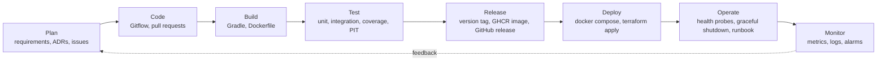

```mermaid
flowchart LR
    subgraph ci["ci.yml, every pull request and push"]
        change(["Change"]) --> build["Build and test<br/>compile, unit tests, coverage gate"]
        change --> integ["Integration tests<br/>LocalStack and the real Terraform"]
        change --> tf["Validate Terraform<br/>fmt, validate, Checkov"]
        change --> img["Docker image<br/>ARM64 build, start check"]
        build & integ & tf & img --> green{"All green?"}
        green -->|"yes"| merge["Merge into develop"]
    end
    subgraph rel["release.yml, version tag on main"]
        tag(["vX.Y.Z"]) --> verify["Verify<br/>tag on main, build"]
        verify --> publish["Publish the image<br/>ghcr.io, amd64 and arm64"]
        publish --> ghrel["GitHub release"]
    end
```

## 14. Infrastructure as code

Every environment is created by Terraform, not by scripts. Locally the AWS provider points at LocalStack; in AWS, `envs/prod` reuses the same `data` and `messaging` modules and adds the network, compute, entry, identity and observability modules (§16).

```text
infra/terraform/
├── bootstrap/           # once per account: state bucket, ECR registry, GitHub OIDC release role, monthly budget
├── envs/local/          # local environment: provider pointing at LocalStack, default tags
├── envs/prod/           # AWS: remote state in S3, every module below
└── modules/
    ├── data/            # DynamoDB tables: events, orders (+ GSI expiring-orders), order-history, idempotency (+ TTL)
    ├── messaging/       # SQS queues, each with its dead-letter queue and redrive policy
    ├── network/         # VPC, public subnets, DynamoDB gateway endpoint, security groups
    ├── compute/         # ECS Fargate, IAM roles, autoscaling, Cloud Map
    ├── auth/            # Cognito
    ├── edge/            # API Gateway HTTP API
    └── observability/   # alarms and their SNS topic
```

| Decision | Detail |
|---|---|
| On-demand billing | `PAY_PER_REQUEST`: pay per use, no capacity planning |
| Sparse and sharded index | `expiring-orders` only holds live reservations and payments, spread over 4 shards so a massive expiration does not saturate one partition |
| Idempotency with native TTL | Keys are deleted by DynamoDB after 24 h; the application ignores expired keys that are not deleted yet |
| Dead-letter queues | `maxReceiveCount = 5`; 4 days of retention in the queue and 14 in the dead-letter queue; redrive allowed only from its own queue |
| Encryption | SSE-SQS on every queue; DynamoDB always encrypts at rest |
| Environment flags | `point_in_time_recovery`, `deletion_protection` and the maximum on-demand throughput are module variables: off in local, on in `envs/prod` |
| Default tags | `project`, `env` and `managed-by` on every resource |
| State | Locally, a Docker volume reconciled on every run; in AWS, a versioned and encrypted S3 bucket with native locking (`use_lockfile`) |
| Checks | `./gradlew terraformValidate` (format and validation of every stack) and `./gradlew terraformScan` (Checkov), the same as the CI |

## 15. Known limitations

The solution is not presented as perfect. These are the known limitations, with the reason they exist and how they would be solved.

### 15.1 Consistency and messaging

| Limitation | Impact | Solution |
|---|---|---|
| **No transactional outbox** (ADR 0019). Placing an order writes to DynamoDB and then publishes to SQS, without a transaction between them | If the process dies, or SQS fails after the SDK retries, between both writes, the order stays `QUEUED` forever and its tickets are never reserved. The client gets the error, but retrying with the same `Idempotency-Key` returns the stuck order without publishing again | Transactional outbox: only write the order, and let DynamoDB Streams (with EventBridge Pipes or Lambda) publish to SQS. Meanwhile, a scheduler that re-publishes old `QUEUED` orders (designed in ADR 0015, not built) |
| **No `version` attribute.** Optimistic locking relies on the expected status, not on a version number | Safe today, because every write changes the status. If an update that keeps the status were added (for example, editing a reserved order), two writers could overwrite each other | Add `version` to the order and to the condition of every transaction |
| **No per-ticket entity.** The inventory is five counters per event | It is not possible to know *which* ticket a customer has; it only supports general admission, not numbered seats | Create one item per ticket inside the transaction (up to 100 items) |
| **Hot partition.** Every reservation of an event writes the same item | Theoretical ceiling of about 500 transitions per second per event; beyond that, more `TransactionConflict` and retries | Sharded counters per event; the queue already levels the peaks |
| **Non-atomic event start check.** The consumer checks that the event has not started, then writes | If the event starts within those milliseconds, the reservation is made (it still expires in 10 minutes). Confirming after the event started is not blocked | Add the start instant to the transaction condition, and the same rule to the confirmation |
| **Expiration index with text dates.** `expiresAt` is an ISO-8601 string | The index orders with a margin under 1 s; the use case checks the exact instant again | Store a numeric epoch for the index |
| **Unused payment queue.** Terraform creates the `payments` queue and its dead-letter queue, which nobody uses since ADR 0022 | Dead infrastructure | Remove it from Terraform |

### 15.2 Security (OWASP Top 10)

Mapped to the [OWASP Top 10 (2021)](https://owasp.org/Top10/).

| OWASP 2021 | Limitation | Solution in production |
|---|---|---|
| [A01](https://owasp.org/Top10/A01_2021-Broken_Access_Control/) Broken access control | **No authentication and no Spring Security.** `X-Customer-Id` is declared and can be spoofed: whoever knows an order id and its customer id can read or confirm it | Amazon Cognito + JWT validated by Spring Security (`oauth2-resource-server`); `customerId` from the `sub` claim |
| A01 Broken access control | **The payment webhook (`POST /orders/{id}/payment`) is not authenticated.** Anyone who knows an order id in `PENDING_CONFIRMATION` can mark it as paid | Verify the provider signature (HMAC of the body with a secret in AWS Secrets Manager) and a timestamp to stop replays |
| A01 Broken access control | `POST /events` is open; complimentary tickets use a shared key, not a role, and do not record who issued them; a wrong key answers `403` instead of `401` | `admin` group in Cognito for every administrative endpoint; author and reason stored in the history |
| [A04](https://owasp.org/Top10/A04_2021-Insecure_Design/) Insecure design (resource abuse) | **No rate limiting.** The designed `WebFilter` ([token bucket](https://en.wikipedia.org/wiki/Token_bucket) per customer, `429 RATE_LIMITED`, [`RateLimit-*`](https://datatracker.ietf.org/doc/draft-ietf-httpapi-ratelimit-headers/) headers) was not built; it could also be evaded by changing `X-Customer-Id` | AWS WAF rate-based rule per IP at the edge, plus a per-customer limit with a shared counter |
| A04 Insecure design (resource abuse) | No limit of SSE connections per instance, and no explicit request body size limit | Connection limit with `503`; codec limit of a few KB with `413` |
| [A05](https://owasp.org/Top10/A05_2021-Security_Misconfiguration/) Security misconfiguration | Actuator (`/actuator/prometheus`) and Swagger UI are exposed on the API port; `Strict-Transport-Security` is sent over plain HTTP because there is no TLS locally; unknown JSON fields are ignored instead of rejected | Separate management port that is not public; TLS at CloudFront or the load balancer; Swagger disabled in production; strict deserialization |
| [A06](https://owasp.org/Top10/A06_2021-Vulnerable_and_Outdated_Components/) Vulnerable components | Some dependency versions are forced by hand; there is no automatic dependency or image scanning | Dependabot, OWASP Dependency-Check or Trivy in the CI, and ECR image scanning |
| [A09](https://owasp.org/Top10/A09_2021-Security_Logging_and_Monitoring_Failures/) Logging and monitoring failures | Plain-text logs without correlation id; no alarms | See §15.3 |

### 15.3 Operation and observability

| Limitation | Solution |
|---|---|
| **No structured logs.** Logs are plain text, without `correlationId`, `orderId` or `eventId`, and the id is not propagated from HTTP to the SQS message | JSON logs ([Spring Boot structured logging](https://docs.spring.io/spring-boot/reference/features/logging.html)) with a correlation id carried in the SQS message attributes; one canonical log line per request |
| No business metrics (`orders.placed`, `orders.rejected{reason}`, `inventory.conflicts`…) and no alarms | Micrometer counters; CloudWatch alarms on dead-letter queue depth, age of the oldest message and conflict rate |
| Readiness does not check DynamoDB or SQS | Custom health indicators |
| One deployable with the three roles always on: the API and the workers cannot scale separately | Activate each role by configuration (`@ConditionalOnProperty`) and run the same image as separate services |
| Stopping an instance takes up to 10 s (the listener waits for its open poll) | Accepted cost of ADR 0021 |
| SSE polling: 1 read per second per watched event and instance, even without changes; up to 1 s of delay | DynamoDB Streams behind the same port, without touching the use case |
| `terraform apply` fails when adding the index to an already existing table (root cause still a hypothesis) | Workaround: `docker compose down --volumes`. The CI always starts from scratch |

### 15.4 Scope

- Only the local environment runs. The AWS environment is Terraform ready to apply (`envs/prod`), validated and scanned in the CI but not deployed, so it has not been tested against real AWS yet (§16).
- No listing of events (`GET /events`) and no order cancellation.
- Creating an event is not idempotent: retrying `POST /events` creates another event.
- The API contract is generated by springdoc and published in Swagger UI; there is no hand-written OpenAPI file.

## 16. Production on AWS

The production environment is written in Terraform (`infra/terraform/envs/prod`), validated and scanned on every pull request, and ready for `terraform apply`. It is not left running, to avoid a permanent cost; this section explains how it is deployed, what it costs and why each decision was taken.

It is designed for a **small budget with a cost ceiling by construction**: one evaluator, a few hundred requests a day, and hard limits on what abuse can make the backend consume ([§16.3](#163-security-and-the-bill) states the risk that remains). [§16.7](#167-at-scale-what-would-change) describes how it evolves when real traffic arrives.

### 16.1 Architecture

```text
Client ──HTTPS──> API Gateway HTTP API ──VPC link──> AWS Cloud Map (SRV) ──> ECS Fargate service (ARM64)
                  · JWT from Cognito                                          · 1 task (autoscaling up to 2)
                  · throttling (10 rps, burst 20)                             · public subnets, no NAT Gateway
                  · X-Customer-Id = token "sub"                               · security group: VPC link only
                                                                                     │
                       ┌─────────────────────────────┬───────────────────────────────┼──────────────────────┐
                       ▼                             ▼                               ▼                      ▼
              DynamoDB (on demand,          SQS reservations + DLQ          CloudWatch Logs + alarms   SSM Parameter Store
              max throughput, PITR,         (SSE-SQS)                       → SNS email                (admin key)
              gateway endpoint)
```

```mermaid
flowchart LR
    client(["Client"])
    cognito["Amazon Cognito<br/>user pool, no self sign-up"]
    subgraph aws["AWS account, us-east-1"]
        apigw["API Gateway HTTP API<br/>JWT authorizer, throttling<br/>X-Customer-Id = token sub"]
        subgraph vpc["VPC, 2 Availability Zones"]
            link["VPC link"]
            map["AWS Cloud Map<br/>SRV records"]
            ecs["ECS Fargate ARM64<br/>1 to 2 tasks, public subnets<br/>security group: VPC link only"]
        end
        ddb[("DynamoDB<br/>through a gateway endpoint")]
        sqs[["SQS reservations<br/>and dead-letter queue"]]
        ssm["SSM Parameter Store<br/>admin key"]
        cw["CloudWatch<br/>logs and alarms"]
        sns["SNS<br/>email alerts"]
    end
    client -->|"sign in"| cognito
    client -->|"HTTPS with the access token"| apigw
    apigw -.->|"validates the token"| cognito
    apigw --> link
    map -.->|"IP and port of the healthy tasks"| link
    link --> ecs
    ecs --> ddb
    ecs --> sqs
    ecs --> cw
    ssm -.->|"secret injected at start"| ecs
    cw --> sns
```

```text
infra/terraform/
├── bootstrap/        # once per account: state bucket, ECR registry, GitHub OIDC release role, monthly budget
├── envs/local/       # LocalStack
├── envs/prod/        # AWS: composes every module below
└── modules/
    ├── data/         # DynamoDB tables (shared with local)
    ├── messaging/    # SQS queues and DLQs (shared with local)
    ├── network/      # VPC, 2 public subnets, DynamoDB gateway endpoint, chained security groups
    ├── compute/      # ECS cluster, task definition, service, autoscaling, IAM roles, Cloud Map
    ├── auth/         # Cognito user pool without self sign-up
    ├── edge/         # HTTP API, VPC link, JWT authorizer, throttling, access logs
    └── observability/# SNS topic and CloudWatch alarms
```

### 16.2 Decisions and trade-offs

| Decision | Why | Trade-off |
|---|---|---|
| **API Gateway HTTP API as the only entry point**, no load balancer | No fixed cost (pay per request); HTTPS on the default endpoint with an AWS certificate, JWT validation and throttling included | [AWS WAF cannot protect HTTP APIs](https://docs.aws.amazon.com/waf/latest/developerguide/waf-chapter.html) (only REST APIs, CloudFront and ALB). The [maximum integration timeout is 30 s](https://docs.aws.amazon.com/apigateway/latest/developerguide/http-api-quotas.html), so the SSE stream is cut every 30 s and `EventSource` reconnects by itself |
| **VPC link + AWS Cloud Map instead of an ALB** | API Gateway reaches the private tasks directly; ECS registers [SRV records](https://docs.aws.amazon.com/apigateway/latest/developerguide/http-api-develop-integrations-private.html) (IP and port), and only tasks with a passing container health check receive traffic. Saves a load balancer (about USD 16–20 a month) | No load balancer health checks or connection draining; the container health check and the graceful shutdown (ADR 0021) cover it |
| **Public subnets without a NAT Gateway** | A NAT Gateway costs [USD 0.045 per hour plus data](https://aws.amazon.com/vpc/pricing/) (about USD 33 a month), more than the rest of the environment. DynamoDB goes through a [gateway endpoint, which has no charge](https://aws.amazon.com/vpc/pricing/) | The task has a public IP ([USD 0.005 per hour](https://aws.amazon.com/vpc/pricing/)) to reach ECR, SQS and CloudWatch. Its security group only accepts traffic from the VPC link, so nothing on the internet can open a connection to it. At scale: private subnets (§16.7) |
| **Cognito + JWT authorizer, identity taken from the token** | API Gateway validates the [access token](https://docs.aws.amazon.com/apigateway/latest/developerguide/http-api-jwt-authorizer.html) and [overwrites `X-Customer-Id`](https://docs.aws.amazon.com/apigateway/latest/developerguide/http-api-parameter-mapping.html) with its `sub` claim. The application does not change, and the impersonation risk of the declared identity (ADR 0017) disappears in AWS. The route requires the scope `aws.cognito.signin.user.admin`, which [only access tokens carry](https://docs.aws.amazon.com/cognito/latest/developerguide/amazon-cognito-user-pools-using-the-access-token.html), as API Gateway recommends | The application trusts the header, so it must only be reachable through the gateway: guaranteed by the security group. No self sign-up: users are created by an administrator. [Free up to 10,000 monthly active users](https://aws.amazon.com/cognito/pricing/) |
| **Fargate ARM64, 0.25 vCPU and 1 GB, one task** | Graviton is [about 20 % cheaper than x86](https://aws.amazon.com/fargate/pricing/) and the image is already built for ARM64 on Apple silicon. Autoscaling by CPU, with at most 2 tasks as a cost ceiling | The JVM starts slowly (health check `startPeriod` of 120 s); no headroom for real load |
| **DynamoDB on demand with a [maximum throughput](https://docs.aws.amazon.com/amazondynamodb/latest/developerguide/on-demand-capacity-mode-max-throughput.html)**, PITR and deletion protection | Pay per request, plus a ceiling: requests above 100 reads or 50 writes per second per table are throttled instead of billed. Same modules as local, with backups and deletion protection on | The ceiling is applied on a best-effort basis. `deletion_protection` (tables and user pool) must be set to `false` on purpose before `terraform destroy` |
| **Secrets outside Terraform** | The admin key is a SecureString parameter created with the AWS CLI; ECS [injects it when the task starts](https://docs.aws.amazon.com/AmazonECS/latest/developerguide/secrets-envvar-ssm-paramstore.html). Users and passwords are created with the CLI too. No secret reaches the code or the Terraform state | Two manual steps before the first deployment. Parameter Store standard parameters have no charge |
| **Least-privilege IAM** | The task role only allows the calls the code makes (`GetItem`, `PutItem`, `UpdateItem`, `Query`; `SendMessage`, `ReceiveMessage`, `DeleteMessage`) on its own tables and queue. A [transaction only needs the permissions of its items](https://docs.aws.amazon.com/amazondynamodb/latest/developerguide/transaction-apis-iam.html), so there is no `DeleteItem` and no `Scan`. The execution role only reads its own parameter | Any new operation in the code needs a policy change |
| **Hardened container** | Non-root user, read-only root file system with `/tmp` as the only writable path (tested locally against LocalStack), immutable image tags and a scan of each image on push | — |
| **Remote state in S3 with native locking** | Versioned, encrypted, private, TLS-only bucket; locking with [`use_lockfile`](https://developer.hashicorp.com/terraform/language/backend/s3), because DynamoDB locking is deprecated | The `bootstrap` stack keeps a local state: it creates the bucket that would store it |
| **Isolation of environments** | `local` and `prod` use the same `data` and `messaging` modules with their own state, name prefix and tags | One AWS account for everything. In production: one account per environment with AWS Organizations |

### 16.3 Security and the bill

A public API can be abused to make the bill grow. The controls are layered, from the hard limits to the detection:

| Layer | Control | Effect |
|---|---|---|
| Entry | Throttling of 10 requests per second (burst 20) on the stage; JWT required on every route; only `/api/*` is published (the actuator stays private) | Bounds what reaches the tasks and DynamoDB. API Gateway applies throttles [on a best-effort basis](https://docs.aws.amazon.com/apigateway/latest/developerguide/http-api-throttling.html) |
| Backend | At most 2 tasks; DynamoDB maximum throughput per table | The backend cannot grow, so it rejects instead of billing |
| Detection | Alarm on the request count of the API (more than 2,000 in 5 minutes), plus 5xx, dead-letter messages, queue age and CPU, sent by email | Minutes, not hours |
| Last line | Monthly budget with alerts at 50, 80 and 100 % and a forecast alert | Budgets are updated a few times a day, so it is a backstop |
| Response | Kill switch through variables: `desired_count=0` stops every task; `throttling_rate_limit=0` and `throttling_burst_limit=0` are meant to reject every request at the gateway (the [API reference](https://docs.aws.amazon.com/apigatewayv2/latest/api-reference/apis-apiid-stages.html) states no minimum, so confirm it on the first deployment) | Reversible with one `terraform apply` |

**Residual risk, stated honestly:** the [API Gateway pricing page](https://aws.amazon.com/api-gateway/pricing/) does not say whether requests rejected by the authorizer or by throttling are charged. A volumetric attack could therefore still cost money at the entry point, at about USD 1 per million requests. The request-count alarm and the kill switch limit how long it lasts. Shield Advanced would add cost protection, but it is far outside this budget.

### 16.4 Cost

Prices of `us-east-1`, checked on the official pricing pages; to be confirmed with the [AWS Pricing Calculator](https://calculator.aws/) before deploying:

| Resource | Monthly cost, running 24/7 | Source |
|---|---|---|
| Fargate ARM64, 0.25 vCPU and 1 GB | USD 8.51 | [Fargate pricing](https://aws.amazon.com/fargate/pricing/): USD 0.03238 per vCPU-hour, 0.00356 per GB-hour |
| Public IPv4 of the task | USD 3.65 | [VPC pricing](https://aws.amazon.com/vpc/pricing/): USD 0.005 per hour |
| Route 53 private hosted zone (Cloud Map) and the registered task | USD 0.60 | [Route 53](https://aws.amazon.com/route53/pricing/): USD 0.50; [Cloud Map](https://aws.amazon.com/cloud-map/pricing/): USD 0.10 |
| API Gateway, DynamoDB, SQS, Cognito, CloudWatch, ECR, S3 | About USD 1 at evaluation traffic | Pay per use; 5 alarms are within the 10 free ones; Cognito is free up to 10,000 users |
| **Total** | **About USD 14 a month** | With `desired_count=0`, about USD 1.60 |

The at-scale design of §16.7 costs about USD 85 a month: more than half of it is fixed network cost (NAT Gateway and load balancer). The budget design trades WAF and private subnets for a sixth of that cost, and documents the residual risk.

### 16.5 Release, deploy, operate and monitor

**Release.** The release workflow (§13) publishes every version to GitHub Packages for amd64 and arm64. A deployment to AWS would copy that image to ECR with an immutable version tag: the `bootstrap` stack already creates the role for it, which uses [OIDC instead of long-lived keys](https://docs.github.com/en/actions/how-tos/secure-your-work/security-harden-deployments/oidc-in-aws). Only the `release` environment of this repository can assume it, and it can only push images; changing the infrastructure stays a reviewed `terraform apply`. That CD step is not implemented, because nothing runs in AWS.

**Deploy** (once per account, then one apply per version):

```bash
# 1. Account guardrails: state bucket, registry, release role, budget (local state)
cd infra/terraform/bootstrap
terraform init && terraform apply -var alert_email=you@example.com

# 2. Admin key: created outside Terraform, so it never reaches the state
aws ssm put-parameter --name /prod-ticketing/admin-api-key --type SecureString --value "$(openssl rand -hex 32)"

# 3. Release: build for ARM64 and push an immutable tag
aws ecr get-login-password | docker login --username AWS --password-stdin <ecr_repository_url>
docker buildx build --platform linux/arm64 -f deployment/Dockerfile -t <ecr_repository_url>:1.0.0 --push .

# 4. Environment: remote state from the bootstrap output, then apply
cd ../envs/prod
cp backend.hcl.example backend.hcl   # set the state_bucket output
terraform init -backend-config=backend.hcl
terraform apply -var container_image=<ecr_repository_url>:1.0.0 -var alert_email=you@example.com

# 5. The evaluator user, created by an administrator
aws cognito-idp admin-create-user --user-pool-id <user_pool_id> --username evaluator --message-action SUPPRESS
aws cognito-idp admin-set-user-password --user-pool-id <user_pool_id> --username evaluator --password '<password>' --permanent
```

Each new version is one `terraform apply -var container_image=<url>:<version>`. ECS starts the new task next to the old one, and the [deployment circuit breaker](https://docs.aws.amazon.com/AmazonECS/latest/developerguide/deployment-circuit-breaker.html) rolls back by itself if the new version never becomes healthy.

**Use the API:**

```bash
TOKEN=$(aws cognito-idp initiate-auth --auth-flow USER_PASSWORD_AUTH --client-id <client_id> \
  --auth-parameters USERNAME=evaluator,PASSWORD='<password>' --query AuthenticationResult.AccessToken --output text)
curl -H "Authorization: Bearer $TOKEN" <api_endpoint>/api/v1/events/<id>/availability
```

**Operate (runbook):**

| Situation | Action |
|---|---|
| Stop the application, keep the data | `terraform apply -var desired_count=0` (start again with `1`) |
| Suspected abuse | `terraform apply -var throttling_rate_limit=0 -var throttling_burst_limit=0`: every request is rejected at the gateway |
| Rotate the admin key | `aws ssm put-parameter --overwrite ...`, then `aws ecs update-service --force-new-deployment` (ECS reads secrets when a task starts) |
| Messages in the dead-letter queue | Inspect them, fix the cause, and move them back with the SQS redrive (allowed only to their own queue) |
| Remove everything | `terraform apply -var deletion_protection=false`, then `terraform destroy` |

**Monitor.** Application logs and API access logs in CloudWatch (14 days, JSON access logs with the request ID, status, latency and authorizer error), and five alarms sent by email: request count, 5xx, dead-letter messages, age of the oldest message and CPU. Container Insights stays off: it adds paid custom metrics, and the alarms use the free `AWS/ECS` metrics.

### 16.6 Static analysis

[Checkov](https://www.checkov.io/) scans the Terraform code in the CI (`./gradlew terraformScan` locally), with the image pinned by digest. Result: **125 checks passed, 0 failed, 19 skipped**. Each skipped check is written inside its resource with the reason, so a new finding fails the build:

- **Customer managed KMS keys** (DynamoDB, CloudWatch Logs, S3, ECR): every service already encrypts at rest with AWS keys; a customer key costs money and is only needed for compliance.
- **Retention, Container Insights, flow logs, access logs and replication of the state bucket**: paid extras without a requirement at this scale.
- **Public IP of the tasks and unencrypted SNS topic**: the decisions of §16.2; CloudWatch alarms [cannot publish to a topic encrypted with the AWS managed key](https://repost.aws/knowledge-center/cloudwatch-configure-alarm-sns).
- **Security groups "not attached"**: false positive; they are attached in other modules.

### 16.7 At scale: what would change

| Area | Budget design (implemented) | With real traffic |
|---|---|---|
| Entry | HTTP API with throttling | CloudFront + AWS WAF (managed rules, rate limits per IP) in front of an Application Load Balancer, or an API Gateway REST API with WAF and usage plans |
| Network | Public subnets, no NAT | Private subnets with a NAT Gateway or interface endpoints; tasks without public IPs |
| Compute | One service with every role | API and workers as separate services, scaled by requests and by queue depth |
| Accounts | One account | AWS Organizations: one account per environment, with service control policies |
| Delivery | Manual apply | GitHub Actions with OIDC: `terraform plan` on pull requests, apply with approval, release on version tags |
| Observability | Logs and alarms | JSON logs with `correlationId`, business metrics, X-Ray tracing, dashboards |
| Data and messaging | Dual write | Transactional outbox and SSE fed by DynamoDB Streams |
| Identity | One user, gateway validation | Groups (`admin`) checked by the application with Spring Security |

## 17. Roadmap

Ordered by priority:

1. Authenticate the payment webhook with the provider signature.
2. Rate limiting (`WebFilter` with a token bucket) and protect `POST /events` with the admin access.
3. Structured JSON logs with `correlationId` from HTTP to SQS, and business metrics.
4. Re-publishing of stale `QUEUED` orders, and then a transactional outbox.
5. Spring Security with JWT (Cognito) and an `admin` role.
6. `version` attribute in the conditions, besides the status.
7. CD pipeline for AWS: push the release image to ECR with the OIDC role of `bootstrap`, `terraform plan` on pull requests and apply with approval.
8. PIT in the CI with a mutation threshold; dependency scanning.
9. Version tags and a changelog for each release.

## 18. Project structure

```text
.
├── applications/app-service/      # Spring Boot start-up and wiring; integration test (src/integrationTest)
├── domain/
│   ├── model/                     # Entities, order states (sealed types), exceptions and ports
│   └── usecase/                   # One use case per action
├── infrastructure/
│   ├── driven-adapters/
│   │   ├── dynamo-db/             # DynamoDB adapters, transactions and the SSE polling feed
│   │   └── sqs-sender/            # Publisher of ORDER_PLACED
│   ├── entry-points/
│   │   ├── reactive-web/          # Routes, handlers, errors, security headers, CORS
│   │   ├── sqs-listener/          # Reactive SQS consumer with graceful shutdown
│   │   └── scheduler/             # Expiration job
│   └── helpers/metrics/           # AWS SDK metrics in Micrometer
├── infra/terraform/               # Infrastructure as code: bootstrap, envs/local, envs/prod and their modules
├── deployment/Dockerfile          # Multi-stage image, non-root user
├── postman/                       # Postman collection with assertions
├── .github/workflows/ci.yml       # Continuous integration
└── docker-compose.yml             # LocalStack → Terraform → application
```

## 19. License and author

Released under the [MIT License](LICENSE). The project structure was generated with Bancolombia's [scaffold-clean-architecture](https://github.com/bancolombia/scaffold-clean-architecture) plugin, distributed under the [Apache License 2.0](https://github.com/bancolombia/scaffold-clean-architecture/blob/master/LICENSE).

Built by **Mateo** ([@whymvm](https://github.com/whymvm)).

## 20. References

**Architecture**
- Bancolombia, [scaffold-clean-architecture](https://github.com/bancolombia/scaffold-clean-architecture) and its [documentation](https://bancolombia.github.io/scaffold-clean-architecture/docs/intro).
- Bancolombia Tech, [Clean Architecture — Aislando los detalles](https://medium.com/bancolombia-tech/clean-architecture-aislando-los-detalles-4f9530f35d7a).
- Robert C. Martin, [The Clean Architecture](https://blog.cleancoder.com/uncle-bob/2012/08/13/the-clean-architecture.html).
- Michael Nygard, [Documenting Architecture Decisions](https://cognitect.com/blog/2011/11/15/documenting-architecture-decisions).
- Enterprise Integration Patterns, [Claim Check](https://www.enterpriseintegrationpatterns.com/patterns/messaging/StoreInLibrary.html); microservices.io, [Transactional outbox](https://microservices.io/patterns/data/transactional-outbox.html).

**AWS**
- Amazon DynamoDB: [condition expressions](https://docs.aws.amazon.com/amazondynamodb/latest/developerguide/Expressions.ConditionExpressions.html), [transactions](https://docs.aws.amazon.com/amazondynamodb/latest/developerguide/transaction-apis.html), [read consistency](https://docs.aws.amazon.com/amazondynamodb/latest/developerguide/HowItWorks.ReadConsistency.html), [partition key design](https://docs.aws.amazon.com/amazondynamodb/latest/developerguide/bp-partition-key-design.html), [sparse indexes](https://docs.aws.amazon.com/amazondynamodb/latest/developerguide/bp-indexes-general-sparse-indexes.html), [TTL](https://docs.aws.amazon.com/amazondynamodb/latest/developerguide/TTL.html), [Streams](https://docs.aws.amazon.com/amazondynamodb/latest/developerguide/Streams.html).
- Amazon SQS: [standard queues](https://docs.aws.amazon.com/AWSSimpleQueueService/latest/SQSDeveloperGuide/standard-queues.html), [visibility timeout](https://docs.aws.amazon.com/AWSSimpleQueueService/latest/SQSDeveloperGuide/sqs-visibility-timeout.html), [long polling](https://docs.aws.amazon.com/AWSSimpleQueueService/latest/SQSDeveloperGuide/sqs-short-and-long-polling.html), [dead-letter queues](https://docs.aws.amazon.com/AWSSimpleQueueService/latest/SQSDeveloperGuide/sqs-dead-letter-queues.html).
- AWS Architecture Blog, [Exponential Backoff And Jitter](https://aws.amazon.com/blogs/architecture/exponential-backoff-and-jitter/).
- Amazon API Gateway (HTTP APIs): [private integrations](https://docs.aws.amazon.com/apigateway/latest/developerguide/http-api-develop-integrations-private.html), [JWT authorizers](https://docs.aws.amazon.com/apigateway/latest/developerguide/http-api-jwt-authorizer.html), [parameter mapping](https://docs.aws.amazon.com/apigateway/latest/developerguide/http-api-parameter-mapping.html), [throttling](https://docs.aws.amazon.com/apigateway/latest/developerguide/http-api-throttling.html), [quotas](https://docs.aws.amazon.com/apigateway/latest/developerguide/http-api-quotas.html), [pricing](https://aws.amazon.com/api-gateway/pricing/).
- Amazon ECS: [deployment circuit breaker](https://docs.aws.amazon.com/AmazonECS/latest/developerguide/deployment-circuit-breaker.html), [service discovery](https://docs.aws.amazon.com/AmazonECS/latest/developerguide/service-discovery.html), [task execution role](https://docs.aws.amazon.com/AmazonECS/latest/developerguide/task_execution_IAM_role.html), [secrets from Parameter Store](https://docs.aws.amazon.com/AmazonECS/latest/developerguide/secrets-envvar-ssm-paramstore.html), [task definition parameters](https://docs.aws.amazon.com/AmazonECS/latest/developerguide/task_definition_parameters.html); [Fargate pricing](https://aws.amazon.com/fargate/pricing/).
- Amazon Cognito: [access tokens](https://docs.aws.amazon.com/cognito/latest/developerguide/amazon-cognito-user-pools-using-the-access-token.html), [pricing](https://aws.amazon.com/cognito/pricing/).
- DynamoDB [maximum throughput for on-demand tables](https://docs.aws.amazon.com/amazondynamodb/latest/developerguide/on-demand-capacity-mode-max-throughput.html) and [IAM for transactions](https://docs.aws.amazon.com/amazondynamodb/latest/developerguide/transaction-apis-iam.html); [VPC pricing](https://aws.amazon.com/vpc/pricing/); [Route 53 pricing](https://aws.amazon.com/route53/pricing/); [AWS Cloud Map pricing](https://aws.amazon.com/cloud-map/pricing/); [AWS WAF protected resources](https://docs.aws.amazon.com/waf/latest/developerguide/waf-chapter.html); AWS re:Post, [CloudWatch alarm with an encrypted SNS topic](https://repost.aws/knowledge-center/cloudwatch-configure-alarm-sns).

**Terraform and supply chain**
- HashiCorp, [S3 backend and `use_lockfile`](https://developer.hashicorp.com/terraform/language/backend/s3); [AWS provider](https://registry.terraform.io/providers/hashicorp/aws/latest/docs).
- GitHub, [OpenID Connect in AWS](https://docs.github.com/en/actions/how-tos/secure-your-work/security-harden-deployments/oidc-in-aws).
- [Checkov](https://www.checkov.io/), static analysis of infrastructure as code.

**Standards and security**
- [RFC 9110](https://www.rfc-editor.org/rfc/rfc9110) (HTTP semantics), [RFC 9457](https://www.rfc-editor.org/rfc/rfc9457) (problem details), IETF drafts for the [`Idempotency-Key`](https://datatracker.ietf.org/doc/draft-ietf-httpapi-idempotency-key-header/) and [`RateLimit`](https://datatracker.ietf.org/doc/draft-ietf-httpapi-ratelimit-headers/) headers, [Server-Sent Events](https://html.spec.whatwg.org/multipage/server-sent-events.html).
- [OWASP Top 10 (2021)](https://owasp.org/Top10/), [HTTP Headers Cheat Sheet](https://cheatsheetseries.owasp.org/cheatsheets/HTTP_Headers_Cheat_Sheet.html), [IDOR Prevention Cheat Sheet](https://cheatsheetseries.owasp.org/cheatsheets/Insecure_Direct_Object_Reference_Prevention_Cheat_Sheet.html).
- GitHub, [Security hardening for GitHub Actions](https://docs.github.com/en/actions/security-for-github-actions/security-guides/security-hardening-for-github-actions).

**Java and Spring**
- JEPs: [395 Records](https://openjdk.org/jeps/395), [409 Sealed Classes](https://openjdk.org/jeps/409), [441 Pattern Matching for switch](https://openjdk.org/jeps/441), [444 Virtual Threads](https://openjdk.org/jeps/444), [456 Unnamed Variables](https://openjdk.org/jeps/456).
- Spring: [WebFlux](https://docs.spring.io/spring-framework/reference/web/webflux.html), [graceful shutdown](https://docs.spring.io/spring-boot/reference/web/graceful-shutdown.html), [scheduling](https://docs.spring.io/spring-framework/reference/integration/scheduling.html), [Actuator endpoints](https://docs.spring.io/spring-boot/reference/actuator/endpoints.html), [logging](https://docs.spring.io/spring-boot/reference/features/logging.html).
